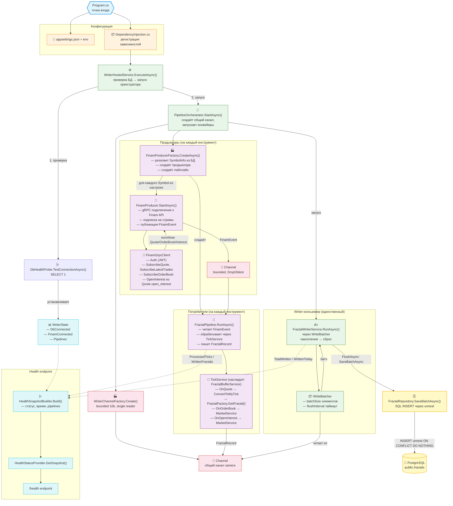

# Data Flow: от запуска Writer до записи в PostgreSQL

> Проект: `C#/src/Writer/ArtasWriter.Worker`
> Все пути ниже — относительно `d:/work/Artas2026/C#/src/Writer`



---

## Пошаговый поток данных

### Шаг 1. Запуск приложения (Program.cs)

[`Program.cs`](C#/src/Writer/ArtasWriter.Worker/Program.cs) — точка входа.

1. Устанавливает кодировку `UTF-8` для консольного вывода (чтобы русские логи не превращались в кракозябры).
2. Создаёт `WebApplication` и загружает конфигурацию:
   - `appsettings.json` — базовые настройки
   - Переменные окружения — имеют приоритет (перезаписывают JSON)
3. Регистрирует **все зависимости** через `builder.Services.AddWriterModule()`, что приводит к вызову статического метода `DependencyInjection.AddWriterModule()`.
4. Создаёт HTTP-сервер на порту `Writer:HealthPort` (по умолчанию 8080):
   - `GET /health` — вызывает `HealthStatusProvider.GetSnapshot()`
   - `GET /exit` — останавливает приложение (graceful shutdown)
5. Запускает `app.RunAsync()` → внутри запускается `WriterHostedService`.

---

### Шаг 2. Регистрация зависимостей (DependencyInjection.cs)

[`DependencyInjection.cs`](C#/src/Writer/ArtasWriter.Worker/DependencyInjection.cs) — композиционный корень.

Регистрирует (порядок важен для понимания графа зависимостей):

| Что регистрируется | Тип | Реализация |
|---|---|---|
| `WriterOptions` | конфиг | секция `Writer` из appsettings.json |
| `FinamOptions` | конфиг | секция `Finam` из appsettings.json |
| `DbConfig` | конфиг | строка подключения к PostgreSQL |
| `ISymbolRepository` | доступ к БД | [`SymbolRepository`](ArtasWriter.Infrastructure/Data/SymbolRepository.cs) |
| `IFractalRepository` | доступ к БД | [`FractalRepository`](ArtasWriter.Infrastructure/Data/FractalRepository.cs) |
| `IHealthProbe` | проверка БД | [`DbHealthProbe`](ArtasWriter.Infrastructure/Data/DbHealthProbe.cs) |
| `IFinamClient` | транспорт | [`FinamGrpcClient`](ArtasWriter.FinamApi/FinamGrpcClient.cs) или `SimulationFinamClient` |
| `IFinamProducerBuilder` | фабрика | [`FinamProducerBuilder`](ArtasWriter.FinamApi/FinamProducerBuilder.cs) |
| `IInstrumentPipelineFactory` | фабрика | [`InstrumentPipelineFactory`](ArtasWriter.Application/Producers/InstrumentPipelineFactory.cs) |
| `IFinamProducerFactory` | фабрика | [`FinamProducerFactory`](ArtasWriter.Application/Producers/FinamProducerFactory.cs) |
| `FractalWriterService` | writer | singleton (реализует `IFractalWriter`) |
| `IFractalWriter` | абстракция | биндинг на `FractalWriterService` |
| `WriterState` | состояние | singleton (реализует `IWriterState`) |
| `IWriterState` | абстракция | биндинг на `WriterState` |
| `IHealthSnapshotBuilder` | health | [`HealthSnapshotBuilder`](ArtasWriter.Worker/Health/HealthSnapshotBuilder.cs) |
| `IHealthStatusProvider` | health | [`HealthStatusProvider`](ArtasWriter.Worker/Health/HealthStatusProvider.cs) |
| `WriterChannelFactory` | утилита | фабрика канала |
| `PipelineOrchestrator` | оркестратор | управляет жизненным циклом конвейеров |

---

### Шаг 3. WriterHostedService — проверка БД и запуск оркестратора

[`WriterHostedService.ExecuteAsync()`](C#/src/Writer/ArtasWriter.Worker/WriterHostedService.cs:42)

```
логика:
  WriterState.SetDbConnected( await DbHealthProbe.TestConnectionAsync() )
  └─ если БД недоступна → лог "PostgreSQL недоступен на старте — запись будет повторяться"
     (FractalWriterService позже восстановит соединение при следующем батче)

  await PipelineOrchestrator.StartAsync()
  └─ бесконечное ожидание (Task.Delay(Infinite)) до сигнала остановки
  └─ при остановке → PipelineOrchestrator.StopAsync()
```

**Куда идёт результат проверки БД:** флаг `WriterState.DbConnected` читается `HealthSnapshotBuilder` для `/health`.

---

### Шаг 4. PipelineOrchestrator — оркестрация конвейеров

[`PipelineOrchestrator.StartAsync()`](C#/src/Writer/ArtasWriter.Worker/PipelineOrchestrator.cs:45)

```
1. var writeChannel = WriterChannelFactory.Create()
   └─ Channel.CreateBounded<FractalRecord>(capacity=10_000, SingleReader=true, FullMode=Wait)
   └─ ЭТО ОБЩИЙ КАНАЛ, в который все FractalPipeline'ы пишут готовые фракталы

2. var pipelines = await FinamProducerFactory.CreateAsync(writeChannel.Writer)
   └─ создаёт InstrumentPipeline для каждого символа из настроек

3. WriterState.SetPipelines(pipelines)

4. Запуск writer-консьюмера (один на все инструменты):
   Task.Run(() => FractalWriterService.RunAsync(writeChannel.Reader))

5. Запуск потребителей (каждый FractalPipeline читает свой канал):
   Task.Run(() => pipeline.Pipeline.RunAsync(pipeline.Reader))

6. Запуск продьюсеров (каждый FinamProducer.StartAsync):
   await producer.StartAsync()
```

**Важно:** продьюсеры стартуют **после** того, как потребители и writer уже запущены — это исключает race condition, когда событие пришло, а читать его некому.

---

### Шаг 5. WriterChannelFactory — создание общего канала

[`WriterChannelFactory.Create()`](C#/src/Writer/ArtasWriter.Worker/WriterChannelFactory.cs:24)

```java
Channel.CreateBounded<FractalRecord>({
    capacity: 10_000,
    SingleReader: true,   // один FractalWriterService читает
    SingleWriter: false,  // много FractalPipeline'ов пишут
    FullMode: Wait        // если канал полон — ждём (backpressure)
})
```

**Назначение:** единый конвейер для записи фракталов всех инструментов в PG. `FractalPipeline` после формирования фрактала вызывает `channel.Writer.TryWrite(record)`. `FractalWriterService` в цикле читает и накапливает батч.

---

### Шаг 6. FinamProducerFactory — создание конвейеров инструментов

[`FinamProducerFactory.CreateAsync()`](C#/src/Writer/ArtasWriter.Application/Producers/FinamProducerFactory.cs:39)

Для **каждого символа** из секции `Writer:Symbols` в конфиге:

```
1. symbolInfo = await SymbolRepository.GetByNameAsync(setting.Name)
   └─ SELECT из public.symbols WHERE name = ?
   └─ получает: id, symbol (Finam-код), name, digits, point

2. producer = FinamProducerBuilder.Create(
       setting.Name,          // projectSymbol (напр. "Si")
       symbolInfo.Symbol,     // finamSymbol (напр. "SiZ6")
       channelCapacity,       // из настроек
       depth)                 // глубина стакана

3. pipeline = InstrumentPipelineFactory.Create(
       symbolInfo,            // SymbolInfo
       writerChannel,         // общий канал записи
       setting.Name)          // имя для логгера

4. wrapper = InstrumentPipeline {
       ProjectSymbol  = setting.Name,
       FinamSymbol    = symbolInfo.Symbol,
       SymbolInfo     = symbolInfo,
       Producer       = producer,
       Pipeline       = pipeline,
       Reader         = producer.Reader   // канал событий продьюсера
   }
```

**Результат:** список `InstrumentPipeline` — готовых связок «продьюсер → канал событий → потребитель».

---

### Шаг 7. FinamProducer — подключение к Finam API

[`FinamProducer.StartAsync()`](C#/src/Writer/ArtasWriter.FinamApi/FinamProducer.cs:57)

**Если симуляция** (`SimulationMode = true` или `client == null`):
- Запускает фоновую задачу `SimulatedEventSource.RunAsync()` — генерирует синтетические `QuoteEvent`, `OrderBookEvent`, `OpenInterestEvent` и пишет их в канал.

**Если реальный режим:**
```
1. Подписывается на события gRPC-клиента:
   client.QuoteReceived        += OnQuote
   client.OrderBookReceived    += OnOrderBook
   client.OpenInterestReceived += OnOpenInterest

2. client.ConnectAsync()
   └─ gRPC AuthService.Auth(secret_key) → JWT
   └─ JWT сохраняется для последующих подписок

3. client.SubscribeOpenInterestAsync(fullSymbol)
   └─ запоминает символ, отдельной подписки нет (OpenInterest в котировках)

4. client.SubscribeOrderBookAsync(fullSymbol)
   └─ gRPC MarketDataService.SubscribeOrderBook
   └─ получает дельты (ADD/UPDATE/REMOVE) и снапшоты
   └─ материализует полный стакан в SymbolOrderBook

5. client.SubscribeQuotesAsync(fullSymbol)
   └─ два стрима:
      a) SubscribeQuote — котировки (bid/ask/last)
      b) SubscribeLatestTrades — сделки с направлением (BUY/SELL)
   └─ OpenInterest публикуется из поля Quote.open_interest
```

**Коллбэки FinamProducer:**

| Коллбэк | Что делает |
|---|---|
| `OnQuote(QuoteEvent)` | `channel.TryWrite(new FinamEvent(quote))` |
| `OnOrderBook(OrderBookEvent)` | `channel.TryWrite(new FinamEvent(ob))` |
| `OnOpenInterest(OpenInterestEvent)` | `channel.TryWrite(new FinamEvent(oi))` |

Все события пишутся в персональный bounded-канал инструмента (`capacity` из конфига, `DropOldest` при переполнении).

---

### Шаг 8. FinamGrpcClient — транспортный уровень

[`FinamGrpcClient`](C#/src/Writer/ArtasWriter.FinamApi/FinamGrpcClient.cs:27)

| Метод | Поток данных |
|---|---|
| `ConnectAsync()` | gRPC Auth → секретный ключ → JWT |
| `SubscribeQuotesAsync(symbol)` | 2 стрима: `SubscribeQuote` (котировки bid/ask/last) + `SubscribeLatestTrades` (сделки с направлением Buy/Sell) → `QuoteReceived` |
| `SubscribeOrderBookAsync(symbol)` | 1 стрим: `SubscribeOrderBook` (дельта + снапшоты) → `OrderBookReceived` |
| `SubscribeOpenInterestAsync(symbol)` | нет отдельного стрима; OI приходит в `Quote.open_interest` → `OpenInterestReceived` |

**Публикация сделок (`PublishTrade`)**: сделка из `SubscribeLatestTrades` публикуется как `QuoteEvent` с флагом `Buy` или `Sell` (направление берётся из `Trade.side`). Это критично для ядра фракталов — направление сделки определяет `FractalFactory`.

**Публикация стакана (`PublishOrderBook`)**: стрим `SubscribeOrderBook` присылает дельты (`ACTION_ADD`/`UPDATE`/`REMOVE`) и полные снапшоты. Клиент материализует полный стакан в `SymbolOrderBook` и отдаёт уже готовые списки (`bids` по убыванию, `asks` по возрастанию).

---

### Шаг 9. FractalPipeline — потребитель канала событий

[`FractalPipeline.Process(FinamEvent)`](C#/src/Writer/ArtasWriter.Application/Pipeline/FractalPipeline.cs:73)

```
На вход: FinamEvent из канала инструмента
                            │
          ┌─────────────────┼──────────────────┐
          ▼                 ▼                   ▼
   OrderBookEvent    OpenInterestEvent     QuoteEvent
          │                 │                   │
          ▼                 ▼                   ▼
   TickService       TickService           TickService
   .OnOrderBook()    .OnOpenInterest()     .OnQuote()
          │                 │                   │
          ▼                 ▼                   ├──► ConvertToMyTick()
   MarketService      MarketService             │    (QuoteEvent → MyTick)
   .UpdateOrderBook() .UpdateInterest()         │
          │                 │                   ├──► FractalFactory.Init()
          ▼                 ▼                   │    (первый направленный тик)
   обновление          открытый                 │
   стакана             интерес                   ├──► FractalFactory.GetFractal()
          │                 │                   │    (формирование фрактала)
          ▼                 ▼                   │
   (данные           (данные                     └──► если фрактал сформирован
    для MyTick)       для MyTick)                     ─► WrittenFractals++
                                                      ─► channel.TryWrite(
                                                           FractalRecord(
                                                             symbolId,
                                                             fractal
                                                           ))
                                                      ─► в ОБЩИЙ КАНАЛ ЗАПИСИ
```

**TickService** ([`TickService`](C#/src/Writer/ArtasWriter.Application/Services/TickService.cs:11)) — сердце обработки. Наследует `FractalBufferService` (кольцевой буфер фракталов).

| Метод | Вход | Выход |
|---|---|---|
| `OnOrderBook(OrderBookEvent)` | список уровней стакана | → `MarketService.UpdateOrderBook()` — обновляет стакан с опорной ценой `TickCurrent.Last` |
| `OnOpenInterest(OpenInterestEvent)` | значение интереса | → `MarketService.UpdateInterest()` — сохраняет актуальный открытый интерес |
| `OnQuote(QuoteEvent)` | котировка/сделка | → `ConvertToMyTick()` → если первый тик → `Init()` + `Calculate()` (прогрев) → `GetFractal()` → если фрактал готов → `AddFractal()` + возврат `Fractal` или null |
| `ConvertToMyTick(QuoteEvent)` | событие Finam | → `MyTick{Volume, Ask, Bid, Last, Flags, TimeMsc, Interest, MarketPairs}` |
| `Init(MyTick)` | тик | → инициализация `FractalFactory` (установка `Max`/`PrevPick`, сброс буфера) |

**MarketService** — управляет рыночными данными:
- `CurrentMarkets` — актуальный стакан (список `(Price, Volume, IsAsk)`)
- `Interest` — открытый интерес

---

### Шаг 10. FractalWriterService — writer-консьюмер

[`FractalWriterService.RunAsync()`](C#/src/Writer/ArtasWriter.Infrastructure/Services/FractalWriterService.cs:46)

Читает общий канал `ChannelReader<FractalRecord>` через **WriteBatcher**:

```
WriteBatcher.RunAsync(
    reader:          общий канал FractalRecord,
    flushAsync:      FractalWriterService.FlushAsync,
    cancellationToken
)
```

**WriteBatcher** ([`WriteBatcher`](C#/src/Writer/ArtasWriter.Infrastructure/Services/WriteBatcher.cs:11)):

```
Политика накопления:
  • batchSize = WriterOptions.WriteBatchSize (сколько фракталов копить)
  • flushInterval = WriterOptions.WriteFlushIntervalMs (максимальное ожидание)

Цикл:
  1. Ожидание элемента (WaitToReadAsync)
  2. Чтение до batchSize элементов (TryRead)
  3. Если батч не набран — ждём до дедлайна, добирая
  4. Вызов FlushAsync(батч)
  5. При завершении канала — досброс остатка
```

---

### Шаг 11. FractalRepository — запись в PostgreSQL

[`FractalRepository.SaveBatchAsync()`](C#/src/Writer/ArtasWriter.Infrastructure/Data/FractalRepository.cs:37)

```
Вход: IReadOnlyList<(int SymbolId, Fractal Fractal)>

Подготовка параллельных массивов:
  long[]   ids        = fractal.Id
  int[]    symbolIds  = symbolId
  double[] prices     = fractal.Price
  DateTime[] times    = fractal.TickPeak.Time
  string[]  metadata  = JSON(FractalMetadataDto.FromFractal(fractal))
                         └─ содержит: bid, ask, volume, flags, interest,
                            market_pairs, digits, open_interest,
                            route (setter, date)

SQL (unnest для массовой вставки):
  INSERT INTO public.fractals (id, symbol_id, price, time, metadata, stat)
  SELECT id, symbol_id, price, time, metadata::jsonb, NULL
  FROM unnest(@ids, @symbol_ids, @prices, @times, @metadata)
       AS t(id, symbol_id, price, time, metadata)
  ON CONFLICT (id, symbol_id) DO NOTHING
  └─ идемпотентность: если фрактал уже есть — пропускаем

Подключение: новое NpgsqlConnection на каждый батч (пул не используется,
соединение закрывается после запроса).

Возвращает: количество реально вставленных строк.
```

**Идемпотентность:** `ON CONFLICT (id, symbol_id) DO NOTHING` — если фрактал с таким `(id, symbol_id)` уже существует (например при перезапуске после частичной записи), он не дублируется.

---

### Шаг 12. Health endpoint — обратная связь

[`/health` — Program.cs](C#/src/Writer/ArtasWriter.Worker/Program.cs:34)

```
HealthStatusProvider.GetSnapshot()
  └─ HealthSnapshotBuilder.Build()
       ├─ WriterState.DbConnected      → флаг соединения с БД
       ├─ WriterState.FinamConnected   → флаг соединения с Finam
       ├─ WriterState.StartTimeUtc     → время запуска
       ├─ WriterState.Pipelines        → список конвейеров
       │    └─ pipeline.TickCurrent        → последний тик
       │    └─ pipeline.ProcessedTicks     → обработано тиков
       │    └─ pipeline.WrittenFractals    → записано фракталов
       │    └─ pipeline.Interest           → открытый интерес
       │    └─ pipeline.CurrentBook        → стакан (best ask/bid)
       └─ FractalWriter.TotalWritten   → всего записано фракталов
```

**Ответ JSON (пример):**
```json
{
  "status": "ok",
  "server_time": "...",
  "start_time": "...",
  "uptime_seconds": 12345,
  "finam_connected": true,
  "db_connected": true,
  "total_written": 54321,
  "symbols": [
    {
      "symbol": "Si",
      "name": "SiZ6",
      "symbol_id": 1,
      "processed_ticks": 1000,
      "written_fractals": 42,
      "open_interest": 123456789,
      "last_tick": { "last": 1.2345, "volume": 10, "time_msc": 1234567890 }
    }
  ]
}
```

---

## Сводная схема потоков данных

### Поток тиков (Quote → Fractal)

```
Finam Trade API (gRPC)
    │
    ├─ SubscribeQuote         ─┐
    ├─ SubscribeLatestTrades  ─┤──► FinamGrpcClient.PublishQuote/Trade
    └─ Quote.open_interest    ─┘         │
                                          ▼
                              FinamProducer.OnQuote()
                                          │
                                          ▼
                              Channel<FinamEvent>.TryWrite()
                                          │
                                          ▼
                              FractalPipeline.Process(QuoteEvent)
                                          │
                                          ▼
                              TickService.OnQuote()
                                          │
                              ┌───────────┴───────────┐
                              ▼                       ▼
                    ConvertToMyTick()      FractalFactory.GetFractal()
                              │                       │
                              ▼                       ▼
                          MyTick              Fractal (или null)
                              │                       │
                              └─────── если есть ─────┘
                                                      │
                                                      ▼
                              Channel<FractalRecord>.TryWrite()
                                                      │
                                                      ▼
                              WriteBatcher → FractalWriterService.FlushAsync()
                                                      │
                                                      ▼
                              FractalRepository.SaveBatchAsync()
                                                      │
                                                      ▼
                              PostgreSQL (public.fractals)
```

### Поток стакана (OrderBook → MarketService)

```
Finam Trade API (gRPC)
    │
    ├─ SubscribeOrderBook ──► FinamGrpcClient.PublishOrderBook
                                      │
                                      ▼
                          FinamProducer.OnOrderBook()
                                      │
                                      ▼
                          Channel<FinamEvent>.TryWrite()
                                      │
                                      ▼
                          FractalPipeline.Process(OrderBookEvent)
                                      │
                                      ▼
                          TickService.OnOrderBook()
                                      │
                                      ▼
                          MarketService.UpdateOrderBook()
                                      │
                                      ▼
                          MyTick.MarketPairs (в ConvertToMyTick)
```

### Поток открытого интереса

```
Finam Trade API (gRPC)
    │
    ├─ Quote.open_interest ──► FinamGrpcClient.PublishInterest
                                      │
                                      ▼
                          FinamProducer.OnOpenInterest()
                                      │
                                      ▼
                          Channel<FinamEvent>.TryWrite()
                                      │
                                      ▼
                          FractalPipeline.Process(OpenInterestEvent)
                                      │
                                      ▼
                          TickService.OnOpenInterest()
                                      │
                                      ▼
                          MarketService.UpdateInterest()
                                      │
                                      ▼
                          MyTick.Interest (в ConvertToMyTick)
```

---

## Разница между Quote и OrderBook

Вопрос: чем отличаются **Quote** (котировка) от **OrderBook** (стакан)?

### Quote — это «сигнал» (триггер)

`QuoteEvent` — событие, которое **запускает формирование фрактала**. Приходит из двух gRPC-стримов:

| Стрим | Что даёт | Направление сделки |
|---|---|---|
| `SubscribeQuote` | bid / ask / last (цены спроса, предложения, последней сделки) | Нет → `TickFlag.Last` |
| `SubscribeLatestTrades` | цена сделки + объём | Да → `TickFlag.Buy` / `TickFlag.Sell` |

```csharp
// PublishQuote — котировка без направления
handler(new QuoteEvent(symbol,
    bid, ask, last, lastSize,
    (int)TickFlag.Last, time));

// PublishTrade — сделка с направлением
handler(new QuoteEvent(symbol,
    0d, 0d, price, size,
    (int)TickFlag.ForTrade(MapSide(trade.Side)), time));
```

**Роль:** OnQuote → TickService.OnQuote() → ConvertToMyTick() → FractalFactory.GetFractal().

### OrderBook — это «контекст» (данные для стакана)

`OrderBookEvent` — полный **список лимит-заявок** на покупку и продажу со всеми уровнями цен и объёмами.

```csharp
public readonly record struct OrderBookEvent(
    string Symbol,
    IReadOnlyList<(double Price, int Volume)> Bids,  // заявки на покупку
    IReadOnlyList<(double Price, int Volume)> Asks,   // заявки на продажу
    long TimeMsc)
```

**Роль:** OnOrderBook → MarketService.UpdateOrderBook() → данные используются **позже**, когда придёт следующий Quote — `ResolveMarketPairs()` берёт стакан из `MarketService.CurrentMarkets` с реальными объёмами.

### Как они связаны (сводная таблица)

| | Quote | OrderBook |
|---|---|---|
| **Содержимое** | bid / ask / last / volume / flags / time | полный список Bids[] и Asks[] со своими объёмами |
| **Направление сделки** | да (только в Trade) | нет |
| **Объёмы** | объём последней сделки | объём на каждом уровне цен |
| **Частота** | каждый тик | реже, по изменению |
| **Запускает формирование фрактала?** | **да** | нет |
| **Что без него будет** | фрактал без направления (всегда Last) | MyTick.MarketPairs с volume = 0 |

**Главное:** Quote — **причина** создать фрактал. OrderBook — **данные**, которые обогащают этот фрактал корректными объёмами стакана.

---

## Ключевые паттерны и решения

1. **Pipeline + Channel** — классический `producer → channel → consumer`. Продьюсеры (Finam) пишут в персональный bounded-канал; потребители (пайплайны) читают и публикуют результат в общий канал записи; writer-консьюмер читает и батчит в PG.

2. **Единственный writer** — в `PipelineOrchestrator` запускается ровно один `FractalWriterService` на все инструменты. Это гарантирует последовательную запись в PG без блокировок.

3. **Идемпотентность** — `ON CONFLICT (id, symbol_id) DO NOTHING` исключает дубликаты при перезапусках.

4. **Разделение Quote и Trade** — Finam присылает котировки (bid/ask/last без направления) и сделки (с направлением Buy/Sell). Оба публикуются как `QuoteEvent`; сделки получают флаг `TickFlag.Buy`/`TickFlag.Sell`, что критично для формирования фракталов.

5. **Материализация стакана** — `FinamGrpcClient.SymbolOrderBook` применяет дельты к полному состоянию и отдаёт консистентный снапшот при каждом обновлении.

6. **Приоритет OrderBook → Quote** — `ResolveMarketPairs()` сначала пытается взять стакан из `MarketService.CurrentMarkets` (с реальными объёмами), а если его нет — падает на цены из котировки. Это даёт корректные объёмы в MyTick.

7. **Backpressure** — общий канал 10k элементов с `FullMode.Wait`: если PG не успевает писать, продьюсеры тормозятся через канал.