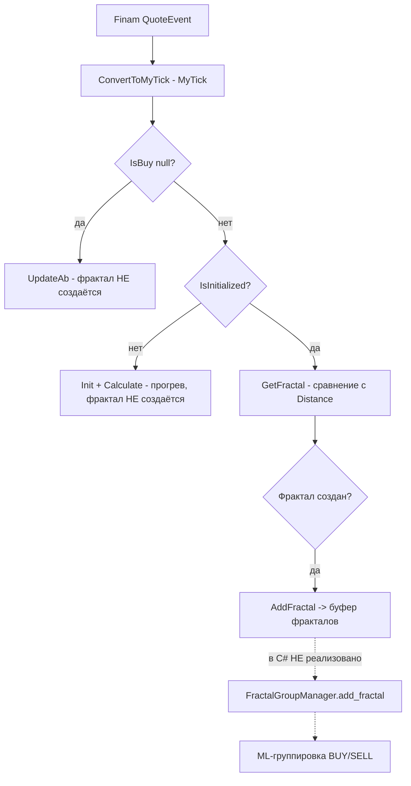

# Формирование и группировка фракталов (FractalFactory + FractalGroupManager)

> **Статус:** исторический документ. Python-пакет `artas2026` (в т.ч. `ml/fractal_group`)
> удалён при полном переносе проекта на C#. Логика ML-группировки фракталов в C# пока
> **не перенесена** — документ описывает исходный алгоритм (эталон) для возможной
> будущей реализации. Ссылки на `src/artas2026/ml/*.py` относятся к удалённому коду.
>
> **Важно:** раздел «Формирование фракталов» (ниже) описывает **уже реализованный** в C#
> этап (`FractalFactory` + `TickService`). Разделы про `FractalGroupManager` — это
> эталонный, но **не перенесённый** в C# этап пост-обработки сформированных фракталов.

## Два независимых порога

В конвейере используются **два разных порога**; их важно не путать:

| Порог | Где задаётся | Что делает |
|---|---|---|
| `Distance` = `round(trade_tick_size * distance_points, digits)`, по умолчанию `distance_points = 1` | [`FractalFactory`](src/Writer/ArtasWriter.Core/Models/FractalFactory.cs:52) | когда **создать** фрактал из потока тиков |
| `stop_distance = 0.005` | `NewGroupingStrategy` (ML-группировка) | когда **финализировать** уже готовую группу фракталов |

## Параметры

- `stop_distance = 0.005` — порог расстояния для определения момента финализации группы
- `distance_points = 1` — дистанция формирования фрактала в пунктах (C#, `FractalFactory`)

---

## Формирование фракталов (этап перед группировкой)

Этот этап **реализован в C#** и описан как контекст: группировка работает с уже
готовыми фракталами, поэтому сначала нужно понимать, как фрактал появляется.



**Ключевые моменты:**

1. **Тики без направления** (`IsBuy == null`, котировки) обрабатываются
   [`UpdateAb()`](src/Writer/ArtasWriter.Core/Models/FractalFactory.cs:78) и фрактал не создают.
2. **Прогрев первым «направленным» тиком:** при первом направленном тике выполняется
   [`Init()`](src/Writer/ArtasWriter.Core/Models/FractalFactory.cs:64) + `Calculate()`,
   фрактал на нём **не формируется** ([`TickService.cs:88`](src/Writer/ArtasWriter.Application/Services/TickService.cs:88)).
3. **Создание фрактала:** [`GetFractal()`](src/Writer/ArtasWriter.Core/Models/FractalFactory.cs:169)
   создаёт фрактал при превышении `Distance` (см. таблицу порогов выше).
4. **Инверсия направления:** при поиске снизу вверх (`IsUp == true`) и пробитии вверх
   создаётся **нижний** фрактал (`IsUp = false`) — фрактал «смотрит» на противоположный
   экстремум ([`FractalFactory.cs:190`](src/Writer/ArtasWriter.Core/Models/FractalFactory.cs:190)).
   Это и порождает соответствие `ModelType.BUY = DOWN-фракталы`, `SELL = UP-фракталы`.
5. **Связь со статистикой:** признак `Stat.IsStop`, используемый для метки группы, —
   производное значение из [`StatF`](src/Core/ArtasCore/Models/StatF.cs:10), вычисляемое
   [`StatCursor.Check()`](src/Stat/Stat.Application/StatCursor.cs:94)
   (`IsStop => IndexStop > 0`). То есть метка группы опирается на статистику, посчитанную
   отдельным сервисом Stat.

---

## Общая архитектура

### [`ModelType`](src/artas2026/ml/fractal_group/group.py:28)
Enum: `ModelType.BUY = 'buy'` (DOWN-фракталы), `ModelType.SELL = 'sell'` (UP-фракталы).

Соответствие вытекает из инверсии направления при формировании (см. раздел
«Формирование фракталов», п. 4): группа `BUY` собирает DOWN-фракталы (низкие пики),
группа `SELL` — UP-фракталы (высокие пики).

### Индексное пространство `mm_peak_index`

`mm_peak_index` — индекс **внутри `fractals`** группы (не в `first_stops`).
На старте группы, пока `fractals` пуст (есть только `first_stops`), индекс условно
указывает на `first_stops`; после переноса первого primary в `fractals` он ведётся по
`fractals` (`append_primary_to_fractals` → `mm_peak_index = len(fractals)`).
При финализации остатка индекс пересчитывается как
`max(len(new_active.fractals) - 2, 0)` (см. `_finalize`).

### [`PriceRange`](src/artas2026/ml/fractal_group/group.py:14)
Immutable DTO — вычисляется через `get_price_range()`. Содержит `min_price`, `min_index`, `max_price`, `max_index`, `peak_price`, `peak_index`.

### [`FractalGroup`](src/artas2026/ml/fractal_group/group.py:34)
Dataclass, хранящий группу фракталов:

- `model_type: ModelType` — тип группы (BUY/SELL)
- `first_stops: list[Fractal]` — начальные стоповые фракталы (primary + intermediate, чётные/нечётные индексы)
- `fractals: list[Fractal]` — основные фракталы (чётные индексы `[0, 2, 4...]` — primary; нечётные `[1, 3, 5...]` — intermediate)
- `is_positive: Optional[bool]` — метка группы (устанавливается при финализации)
- `is_finalized: bool` — флаг финализации
- `mm_peak_index: int` — индекс **максимального пика** для sell и **минимального пика** для buy (среди primary фракталов)

### [`FractalGroupManager`](src/artas2026/ml/fractal_group/manager.py:32)
Менеджер, управляющий активными группами (по одной на buy/sell).

**Поток обработки фрактала:**

```
add_fractal(fractal)
  │
  ├── inactive.add_intermediate(fractal)  →  фрактал противоположного направления
  │                                           добавляется как intermediate
  │
  ├── should_finalize(fractal, active)    →  проверка: нужно ли финализировать
  │     │                                     ТЕКУЩУЮ группу ДО добавления нового
  │     └── True → _finalize(active, index)   фрактала?
  │                └── копия группы → _completed_groups
  │                └── остаток → новая active группа
  │
  └── _add_primary(fractal, active)       →  добавляем фрактал (логика в менеджере)
```

**Важно:** Финализация происходит **до** добавления нового фрактала. Новый фрактал становится первым в следующей группе.

---

## Логика `NewGroupingStrategy.should_finalize()`

Определяет, нужно ли финализировать текущую группу **до** добавления нового primary фрактала.

Использует `get_price_range()` — инкапсулированный DTO с диапазоном цен.

### Sell (UP-фракталы)

```python
price_range = active.get_price_range()
new_price = fractal.Price

# 1. Новый UP пробивает текущий максимум?
if new_price <= price_range.peak_price:
    return (False, -1)               # нет пробоя

# 2. Размах от минимума до нового максимума превысил stop_distance?
if (new_price - price_range.min_price) > stop_distance:
    return (True, price_range.min_index)  # финализация!
```

### Buy (DOWN-фракталы)

```python
price_range = active.get_price_range()
new_price = fractal.Price

# 1. Новый DOWN пробивает текущий минимум?
if new_price >= price_range.peak_price:
    return (False, -1)               # нет пробоя

# 2. Размах от нового минимума до максимума превысил stop_distance?
if (price_range.max_price - new_price) > stop_distance:
    return (True, price_range.max_index)  # финализация!
```

---

## Логика добавления primary (`_add_primary`)

Определяет, куда добавить primary фрактал:

```
_add_primary(fractal, group)
  │
  ├── first_stops пуст?          → group.append_primary(fractal)
  ├── fractals уже есть?         → group.append_primary_to_fractals(fractal)
  └── first_stops есть, fractals пуст?
      ├── равная цена?           → group.append_primary(fractal)
      ├── хуже экстремума?       → group.append_primary(fractal, reset=True)
      └── лучше экстремума?      → group.append_primary_to_fractals(fractal)
```

---

## Правила разбиения для группы sell (UP-фракталы)

- **`mm_peak_index`**: индекс максимальной цены среди primary (UP) фракталов.
  Обновляется в `append_primary_to_fractals()`: если новый UP имеет `Price >= current_peak.Price → mm_peak_index = len(fractals)`.
- **`get_primaries()`**: итератор пар `(price, index)` по **всем** primary фракталам
  (чётные индексы в `fractals`).
- **`get_primary_fractals()`**: список primary фракталов из fractals (чётные индексы).
- **`get_intermediate_fractals()`**: список intermediate фракталов из fractals (нечётные индексы).
- **`get_price_range()`**: возвращает `PriceRange` — инкапсулированный DTO.

### Позитивная группа sell:
- После финализации: у всех `AnyStopFalse` (primary кроме первого) — `Stat.IsStop == False`.

### Негативная группа sell:
- Хотя бы один `AnyStopFalse` имеет `Stat.IsStop == True`.

---

## Правила разбиения для группы buy (DOWN-фракталы)

- **`mm_peak_index`**: индекс минимальной цены среди primary (DOWN) фракталов.
  Обновляется в `append_primary_to_fractals()`: если новый DOWN имеет `Price <= current_peak.Price → mm_peak_index = len(fractals)`.

### Позитивная группа buy:
- После финализации: у всех `AnyStopFalse` — `Stat.IsStop == False`.

### Негативная группа buy:
- Хотя бы один `AnyStopFalse` имеет `Stat.IsStop == True`.

---

## Финализация группы (`_finalize`)

**Возвращает** `tuple[Optional[FractalGroup], FractalGroup]` — `(finalized_copy, new_active_group)`.

Сигнатура: `_finalize(group, next_first_stop_index = -1)` — второй аргумент необязателен,
что позволяет вызывать метод без него из `flush_all()`.

1. **Всегда** создаётся новая активная группа (унификация путей).
2. Если группа пуста → возвращается `(None, new_empty_group)`.
3. Определяется метка группы: `is_positive = StatIsStopLabelStrategy.is_positive_group(group)`.
4. Создаётся **копия** группы с флагом `is_finalized=True`.
5. Копия сохраняется в `_completed_groups`.
6. Если `next_first_stop_index >= 0` — новая группа заполняется из остатка фракталов:
   - `new_active.first_stops = fractals[next_first_stop_index : next_first_stop_index + 2]`
   - `new_active.fractals = fractals[next_first_stop_index + 2 :]`
   - `new_active.mm_peak_index = max(len(new_active.fractals) - 2, 0)`
7. Новая группа записывается в `_active_groups`.

---

## `flush_all()`

Вызывается **перед обучением модели**. Финализирует все незакрытые активные группы.

```python
for group_key in active_groups:
    group = active_groups[group_key]
    if group.fractals:
        finalized, _ = self._finalize(group)
        finalized_groups.append(finalized)
    del active_groups[group_key]
```

**Важно:** группы с непустым `first_stops`, но пустым `fractals` (только начальный стоп,
без перенесённых primary) **отбрасываются молча** — в `finalized_groups` они не попадают.

---

## Определение метки (`StatIsStopLabelStrategy`)

```python
any_stop_false = primary_fractals[1:]  # все primary кроме первого
if not any_stop_false:
    return False                        # нет AnyStopFalse → негатив

return all(not f.Stat.IsStop for f in any_stop_false)
```

**Positive:** все AnyStopFalse имеют `Stat.IsStop=False`.
**Negative:** хотя бы один AnyStopFalse имеет `Stat.IsStop=True` (или нет AnyStopFalse).

---

## Пример полного цикла (sell)

Параметры: `stop_distance = 0.005`. Напоминание: `mm_peak_index` — индекс **внутри
`fractals`**; пока `fractals` пуст (только `first_stops`), индекс указывает на `first_stops`.

| Шаг | Действие | Price | mm_peak_index | Результат |
|-----|----------|-------|---------------|-----------|
| 1 | UP1 → группа | 1.100 | 0 (в `first_stops`, max=1.100) | `first_stops=[UP1]` |
| 2 | UP2 → группа | 1.120 | 1 (в `fractals`, max=1.120) | `fractals=[UP1, UP2]`. UP2 ≥ UP1 → mm_peak=1 |
| 3 | DOWN → intermediate | 1.115 | 1 | `add_intermediate`: `fractals=[UP1, UP2, DOWN]` |
| 4 | UP3 → should_finalize? | 1.130 | — | `peak=1.120`, `1.130>1.120` → пробой. `min=1.100`, `1.130-1.100=0.030>0.005` → **ФИНАЛИЗАЦИЯ** |
| 5 | UP3 → новая группа | 1.130 | 0 (в `first_stops`) | Начинает новую группу |

---

## Структура кода

### [`FractalGroup`](src/artas2026/ml/fractal_group/group.py)
- `append_primary(fractal, reset)` — добавить primary фрактал в first_stops
- `append_primary_to_fractals(fractal)` — добавить primary фрактал в fractals + обновить mm_peak_index
- `add_intermediate(fractal)` — добавить intermediate фрактал
- `is_primary(fractal)` — проверка направления фрактала
- `get_primaries()` — итератор (price, index) primary фракталов
- `get_primary_fractals()` — список primary фракталов
- `get_intermediate_fractals()` — список intermediate фракталов
- `get_price_range()` — инкапсулированный PriceRange DTO
- `get_label()` — метка группы

### [`FractalGroupManager`](src/artas2026/ml/fractal_group/manager.py)
- `add_fractal(fractal)` — основной метод
- `flush_all()` — финализация всех активных групп
- `_finalize(group, next_first_stop_index = -1)` → `(finalized, new_active)` — копия + новая группа
- `_add_primary(fractal, group)` — логика определения цели добавления
- `_get_or_create_group(key)` — ленивое создание группы

### [`NewGroupingStrategy`](src/artas2026/ml/fractal_group/strategies.py)
- `should_finalize(fractal, active_group)` — проверка пробоя через `get_price_range()`

### [`StatIsStopLabelStrategy`](src/artas2026/ml/fractal_group/strategies.py)
- `is_positive_group(group)` — проверка `Stat.IsStop` у всех `AnyStopFalse`

### [`ILocalStopStrategy`](src/artas2026/ml/fractal_group/strategies.py)
- Абстрактное свойство `stop_distance: float` — порог расстояния

### [`PriceDistanceStopStrategy`](src/artas2026/ml/fractal_group/strategies.py)
- Реализация `ILocalStopStrategy` с параметром `stop_distance`
