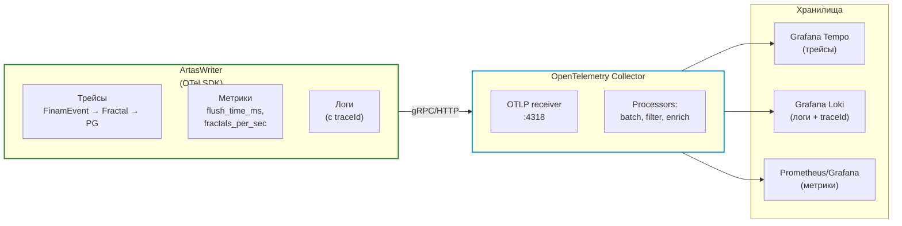
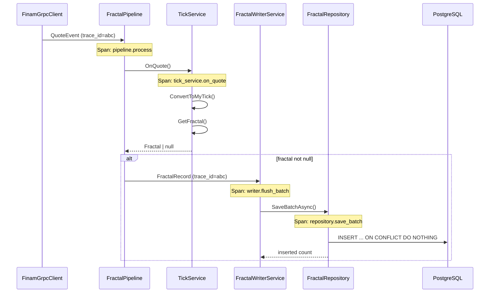
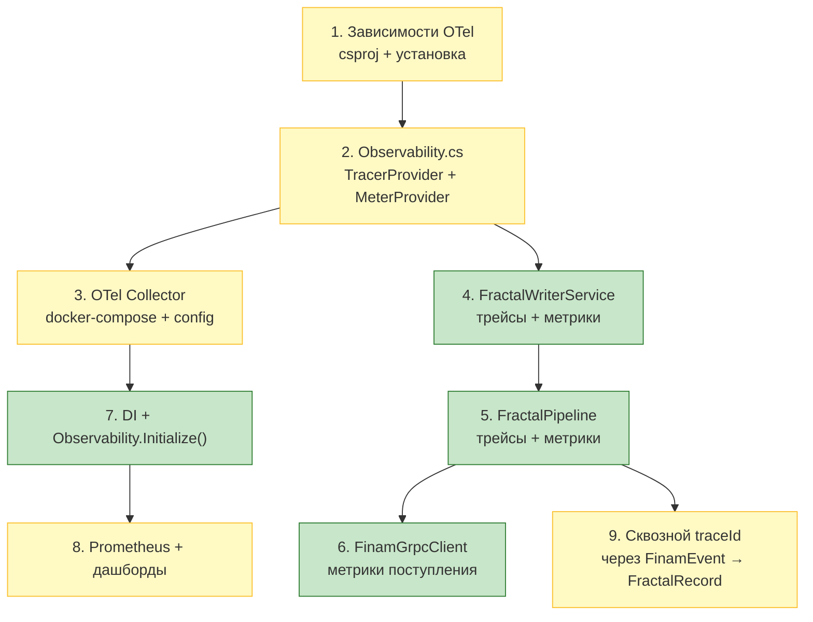

# План: внедрение OpenTelemetry в ArtasWriter

> Проект: `C#/src/Writer/ArtasWriter.Worker`
> Все пути — относительно `d:/work/Artas2026`

---

## 0. Статус реализации (актуально)

**Готово ✅**
- Пакеты `OpenTelemetry` 1.17.0 / `.Exporter.OpenTelemetryProtocol` / `.Extensions.Hosting`
  подключены в `ArtasWriter.Core.csproj` (из локального NuGet-кэша).
- [`ArtasWriter.Core/Observability.cs`](../C%23/src/Writer/ArtasWriter.Core/Observability.cs) переписан
  на реальный OTel SDK: `System.Diagnostics.Metrics.Meter` + `ActivitySource`,
  OTLP-gRPC экспортёр. Публичный API (`Counter`/`Histogram`/`StartSpan`) сохранён.
- Инициализация: `Observability.Initialize(...)` в `AddWriterModule` +
  `Observability.Shutdown()` в `Program.cs` (флаш буферов при остановке).
- Endpoint настраивается через `Writer:OtlpEndpoint` → `OTEL_EXPORTER_OTLP_ENDPOINT` →
  `http://localhost:4317`.
- `monitoring/prometheus/prometheus.yml` — исправлен (remote-write приём + самомониторинг).
- `monitoring/docker-compose.monitoring.yml` — Prometheus получил
  `--web.enable-remote-write-receiver`.
- `monitoring/otel-collector/config.yml` — добавлены `memory_limiter`/`batch`/`resource`,
  diagnostics-порты.
- Сборка `dotnet build ArtasWriter.slnx -c Release` — успешно (0 ошибок/0 предупреждений).
- Тесты: 55/56 (единственное падение `MyTick_Time_FromTimeMsc` — зависит от таймзоны,
  к OTel не относится).

**Технические решения (офлайн-ограничение)**
- OTel 1.17.0 транзитивно требует `Microsoft.Extensions.*` 10.0.0; в локальном кэше нет
  `Configuration.EnvironmentVariables` 10.0.0 → явная ссылка на 8.0.0 +
  `<NoWarn>NU1605</NoWarn>` в `Directory.Build.props` (осознанный downgrade).

**Проверено в рантайме (Docker/WSL) ✅**
- `artas_prometheus` Up, версия 3.15.0, `/-/healthy` → 200, `/-/ready` → 200.
- `artas_otel_collector` Up, «Everything is ready. Begin running and processing data».
- Сквозной тест: OTLP-push метрики `writer_fractals_written_total=42` на `:4318`
  (HTTP 200) → collector → remote-write → Prometheus; запрос
  `query=writer_fractals_written_total` вернул значение с метками
  `job="artas-writer"`, `service_name="artas-writer"`.

**Обнаруженные и исправленные при запуске проблемы**
- Prometheus: неверный флаг `--storage.retention.time` → `--storage.tsdb.retention.time`.
- Collector: экспортёр `loki` удалён в contrib 0.162.0 → заменён на `otlp_http/loki`
  (`http://loki:3100/otlp`).
- Collector: `service.telemetry.metrics.address` устарел → схема `readers: [pull: ...]`.
- Collector: `file`-экспортёр падал `permission denied` на volume → `user: "0:0"`.

**Осталось (опционально)**
- Grafana datasource `prometheus` + дашборд `artas-writer.json`.
- Сквозной `traceId` через `FinamEvent → FractalRecord` (шаг 9).
- Tempo для трейсов (сейчас traces → file).
- `finam.connection.reconnects` счётчик.

---

## 1. Зачем OpenTelemetry?

У нас сейчас есть:

| Что есть | Проблема |
|---|---|
| ✅ Логи в файл (stdout) | Нет связи между событием в Finam → фракталом → записью в PG |
| ✅ Loki + Grafana | Только для Python-сервисов |
| ❌ Нет трассировки | Нельзя ответить «сколько мс прошло от Quote до INSERT в PG» |
| ❌ Нет метрик | Нет histogram времени записи, нет rate фракталов/сек |
| ❌ Нет корреляции | Ошибка в логе — но не видно, какой batchId, какой symbolId |

**OpenTelemetry (OTel) решает это одним протоколом:** трейсы + метрики + логи — связанные общим `traceId`.



---

## 2. Что будем инструментировать

### 2.1 Трейсы (трассировка)



| Точка | Span Name | Что измеряем |
|---|---|---|
| `FinamGrpcClient.PublishQuote` | `finam.quote.received` | время от получения до публикации |
| `FractalPipeline.Process` | `pipeline.process_event` | полное время обработки одного события |
| `TickService.OnQuote` | `tick_service.on_quote` | время формирования фрактала |
| `FractalWriterService.FlushAsync` | `writer.flush_batch` | время записи батча в PG |
| `FractalRepository.SaveBatchAsync` | `repository.save_batch` | чистое время SQL INSERT |

### 2.2 Метрики

| Метрика | Тип | Где считаем |
|---|---|---|
| `writer.fractals.written` | counter (total) | `FractalWriterService.FlushAsync` — инкремент на inserted |
| `writer.batch.size` | histogram | `FractalWriterService.FlushAsync` — размер батча |
| `writer.batch.flush_time_ms` | histogram | `FlushAsync` — elapsed ms |
| `pipeline.events.processed` | counter | `FractalPipeline.Process` |
| `pipeline.event.processing_time_ms` | histogram | `Process` — время обработки |
| `pipeline.fractals.produced` | counter | `FractalPipeline.Process` — когда fractal не null |
| `tick_service.quote_to_fractal_ms` | histogram | `OnQuote` → `GetFractal` |
| `finam.quotes.received` | counter | `FinamGrpcClient.PublishQuote` |
| `finam.trades.received` | counter | `FinamGrpcClient.PublishTrade` |
| `finam.orderbooks.received` | counter | `FinamGrpcClient.PublishOrderBook` |
| `finam.connection.errors` | counter | `FinamGrpcClient` — reconnect attempts |

### 2.3 Логи (обогащённые traceId)

Каждый логгер сейчас работает через `Microsoft.Extensions.Logging.ILogger<T>`. С OTel логи **остаются** в stdout/файл, но получают поле `trace_id`:

```
info: ArtasWriter.Infrastructure.Services.FractalWriterService[0]
      Батч 5b6ecefb: 1/1 записей за 7.3596ms
      → [trace_id=abc12345] Батч 5b6ecefb: 1/1 записей за 7.3596ms
```

Это позволит в Grafana/Loki найти **все логи**, связанные с одним `traceId`.

---

## 3. Архитектура решения

```mermaid
flowchart TD
    subgraph sdk["ArtasWriter (OTel SDK)"]
        api["@opentelemetry/api"]
        sdk["@opentelemetry/sdk"]
        exporter["OTLP gRPC exporter"]
        instrument["Инструментация<br/>в ключевых классах"]
    end

    subgraph coll["Docker: OTel Collector"]
        recv["OTLP receiver<br/>:4317 (gRPC)"]
        proc["Processors"]
        exp["Exporters"]
    end

    subgraph storage["Хранилища"]
        tempo["Grafana Tempo<br/>:4318"]
        prom["Prometheus<br/>:9090"]
        loki["Loki<br/>:3100"]
    end

    subgraph viz["Визуализация"]
        grafana["Grafana<br/>:3000"]
    end

    sdk -->|gRPC| coll
    recv --> proc
    proc -->|SpanExporter| exp
    proc -->|MetricsExporter| exp
    proc -->|LogExporter| exp
    exp --> tempo
    exp --> prom
    exp --> loki
    tempo --> grafana
    prom --> grafana
    loki --> grafana

    style sdk stroke:#2e7d32,stroke-width:2px
    style coll stroke:#0288d1,stroke-width:2px
```

---

## 4. Состав изменений

### 4.1 Новые зависимости (C# csproj)

**Файл:** `ArtasWriter.Infrastructure/ArtasWriter.Infrastructure.csproj`

```xml
<ItemGroup>
  <!-- OpenTelemetry API + SDK -->
  <PackageReference Include="opentelemetry-api" Version="1.15.0" />
  <PackageReference Include="opentelemetry-sdk" Version="1.15.0" />
  
  <!-- OTLP Exporter (gRPC) -->
  <PackageReference Include="opentelemetry-exporter-otlp-grpc" Version="1.15.0" />
  
  <!-- Instrumentation для gRPC-клиента (автоматическая трассировка) -->
  <PackageReference Include="opentelemetry-instrumentation-grpc" Version="1.15.0" />
</ItemGroup>
```

### 4.2 OTel Collector — новый Docker-сервис

**Файл:** `monitoring/docker-compose.monitoring.yml`

```yaml
otel-collector:
  image: otel/opentelemetry-collector-contrib:latest
  container_name: artas_otel_collector
  restart: unless-stopped
  ports:
    - "127.0.0.1:4317:4317"  # gRPC
    - "127.0.0.1:4318:4318"  # HTTP
  volumes:
    - ./otel-collector/config.yml:/etc/otel-collector-config.yml
  command: --config /etc/otel-collector-config.yml
  networks:
    - artas_monitoring
  depends_on:
    loki:
      condition: service_started
```

**Важно:** Prometheus — **самостоятельная база данных временных рядов** (TSDB). Она хранит все метрики на диске (`prometheus_data`) и отдаёт их по запросу. Данные не теряются при перезапуске контейнера, если смонтирован volume.

**Что хранит Prometheus:**
- Все метрики за период `retention` (по умолчанию — 15 дней для детальных данных, 5 лет для агрегированных)
- При старте подтягивает историю из `wal` (write-ahead log)
- Не требует отдельной БД — Prometheus сам себе БД

**Новый файл:** `monitoring/otel-collector/config.yml`

```yaml
receivers:
  otlp:
    protocols:
      grpc:
        endpoint: 0.0.0.0:4317
      http:
        endpoint: 0.0.0.0:4318

exporters:
  # Prometheus Remote Write Exporter — OTel Collector выступает как
  # gateway, который конвертирует OTel-метрики в Prometheus-формат
  # и пушит их в Prometheus Server
  prometheusremotewrite:
    endpoint: http://prometheus:9090/api/v1/write
    # namespace добавляет префикс ко всем метрикам
    resource_attributes:
      - key: service.name
        value: artas_writer

  loki:
    endpoint: http://loki:3100/loki/api/v1/push
    labels:
      app: artas-writer

  file:
    path: /var/log/otel/traces.json
  
service:
  pipelines:
    traces:
      receivers: [otlp]
      exporters: [file]
    metrics:
      receivers: [otlp]
      exporters: [prometheusremotewrite]
    logs:
      receivers: [otlp]
      exporters: [loki]
```

### 4.3 TracerProvider — настройка OTel

**Новый файл:** `ArtasWriter.Infrastructure/Services/Observability.cs`

```csharp
namespace ArtasWriter.Infrastructure.Services;

/// <summary>
/// Центральная конфигурация OpenTelemetry: TracerProvider, MeterProvider, LoggerProvider.
/// Инициализируется один раз при старте приложения.
/// </summary>
public sealed class Observability
{
    private static volatile bool _initialized;

    /// <summary>
    /// Инициализировать OTel SDK (безопасно вызывать多次).
    /// </summary>
    public static void Initialize()
    {
        if (_initialized) return;

        // OTLP gRPC endpoint (локальный OTel Collector)
        var otlpEndpoint = Environment.GetEnvironmentVariable("OTEL_EXPORTER_OTLP_ENDPOINT")
            ?? "http://localhost:4317";

        // Resource (метаданные приложения)
        var resource = Resources.Create(
            Resource("service.name", "artas-writer"),
            Resource("service.version", "1.0.0"),
            Resource("deployment.environment", "production"));

        // TracerProvider
        var tracerProvider = TracerProvider.Create(
            resource,
            Exporter.OTLP(otlpEndpoint, ExportProtocol.Grpc));
        TracerProvider.SetDefault(tracerProvider);

        // MeterProvider (метрики)
        var meterProvider = MeterProvider.Create(
            resource,
            Exporter.OTLP(otlpEndpoint, ExportProtocol.Grpc));
        MeterProvider.SetDefault(meterProvider);

        _initialized = true;
    }
}
```

### 4.4 Инструментация ключевых точек

#### FractalWriterService — метрики + трейсинг

```csharp
// Ключевые изменения в FlushAsync:
public async Task<int> FlushAsync(List<FractalRecord> batch, CancellationToken cancellationToken)
{
    var batchId = Guid.NewGuid().ToString().Substring(0, 8);
    var startTime = DateTime.UtcNow;

    // Начинаем трейс для этого батча
    using var tracer = TracerProvider.Default.Get("writer.flush_batch")
        .SetTag("batch_id", batchId)
        .SetTag("batch_size", batch.Count);

    try
    {
        var inserted = await _repository
            .SaveBatchAsync(records, cancellationToken)
            .ConfigureAwait(false);

        var elapsed = (DateTime.UtcNow - startTime).TotalMilliseconds;
        
        // Метрики
        Metrics.Counter("writer.fractals.written").Add(inserted);
        Metrics.Histogram("writer.batch.flush_time_ms").Record(elapsed);
        Metrics.Histogram("writer.batch.size").Record(batch.Count);

        _logger.LogInformation(
            "Батч {BatchId}: {Inserted}/{Total} записей за {Elapsed}ms",
            batchId, inserted, batch.Count, elapsed);
        return inserted;
    }
    catch (Exception ex)
    {
        var elapsed = (DateTime.UtcNow - startTime).TotalMilliseconds;
        tracer.SetStatus(Status.Error).RecordException(ex);
        Metrics.Counter("writer.batch.errors").Add(1);
        
        _logger.LogError(ex, "Батч {BatchId}: ошибка записи {Count} фракталов после {Elapsed}ms",
            batchId, batch.Count, elapsed);
        return 0;
    }
}
```

#### FractalPipeline — трейс обработки события

```csharp
public void Process(FinamEvent evt)
{
    using var tracer = TracerProvider.Default.Get("pipeline.process_event")
        .SetTag("symbol_id", _symbolId)
        .SetTag("event_type", 
            evt.Quote is not null ? "quote" :
            evt.OrderBook is not null ? "orderbook" :
            evt.OpenInterest is not null ? "openinterest" : "unknown");

    // ... существующая логика без изменений ...

    if (evt.Quote is { } quote)
    {
        ProcessedTicks++;
        Metrics.Counter("pipeline.ticks.processed").Add(1);
        
        var processStart = DateTime.UtcNow;
        var fractal = _tickService.OnQuote(quote);
        var processTime = (DateTime.UtcNow - processStart).TotalMilliseconds;
        
        Metrics.Histogram("pipeline.quote_processing_ms").Record(processTime);

        if (fractal is not null)
        {
            WrittenFractals++;
            Metrics.Counter("pipeline.fractals.produced").Add(1);
            _writerChannel.TryWrite(new FractalRecord(_symbolId, fractal));
        }
    }
}
```

#### FinamGrpcClient — метрики поступления данных

```csharp
// В PublishQuote:
private void PublishQuote(Quote quote)
{
    Metrics.Counter("finam.quotes.received").Add(1);
    Metrics.Histogram("finam.quote.bid").Record(ToDouble(quote.Bid?.Value) ?? 0);
    Metrics.Histogram("finam.quote.ask").Record(ToDouble(quote.Ask?.Value) ?? 0);
    // ... существующая логика ...
}

// В PublishTrade:
private void PublishTrade(string symbol, Trade trade)
{
    Metrics.Counter("finam.trades.received").Add(1);
    // ... существующая логика ...
}

// При обрыве стрима:
catch (RpcException ex)
{
    Metrics.Counter("finam.connection.reconnects").Add(1);
    // ... существующая логика ...
}
```

### 4.5 DependencyInjection — инициализация OTel

**Файл:** `ArtasWriter.Worker/DependencyInjection.cs`

```csharp
// В начале AddWriterModule:
// Инициализация OpenTelemetry (один раз)
Observability.Initialize();
```

### 4.6 Prometheus — источник данных для Grafana

**Добавить в `docker-compose.monitoring.yml`:**

```yaml
prometheus:
  image: prom/prometheus:latest
  container_name: artas_prometheus
  restart: unless-stopped
  ports:
    - "127.0.0.1:9090:9090"
  volumes:
    - ./prometheus/prometheus.yml:/etc/prometheus/prometheus.yml
  networks:
    - artas_monitoring
```

**Новый файл:** `monitoring/prometheus/prometheus.yml`

```yaml
scrape_configs:
  - job_name: otel_collector
    scrape_interval: 10s
    static_configs:
      - targets:
          - otel-collector:9090
```

### 4.7 Grafana — дашборды

Импортировать новый дашборд `monitoring/grafana/dashboards/artas-writer.json` с панелями:

- **Трейсы:** таблица последних трейсов (traceId, duration, status)
- **Метрики:** графики `writer.batch.flush_time_ms` (p50/p95/p99)
- **Метрики:** rate `writer.fractals.written` за последний час
- **Логи:** поиск по traceId (linked logs)

---

## 5. Порядок реализации



### Шаг 1. Зависимости

- [ ] Добавить `opentelemetry-api`, `opentelemetry-sdk`, `opentelemetry-exporter-otlp-grpc`, `opentelemetry-instrumentation-grpc` в `ArtasWriter.Infrastructure.csproj`
- [ ] `dotnet restore` — проверить, что пакеты устанавливаются

### Шаг 2. Observability.cs

- [ ] Создать `ArtasWriter.Infrastructure/Services/Observability.cs`
- [ ] `Initialize()` — OTLP gRPC exporter на `localhost:4317`
- [ ] Resource: `service.name=artas-writer`

### Шаг 3. OTel Collector

- [ ] Создать `monitoring/otel-collector/config.yml`
- [ ] pipeline: traces → file (временное хранилище)
- [ ] pipeline: metrics → Prometheus
- [ ] pipeline: logs → Loki
- [ ] Добавить сервис `otel-collector` в `docker-compose.monitoring.yml`

### Шаг 4. FractalWriterService

- [ ] В `FlushAsync`: Span `writer.flush_batch` с `batch_id`, `batch_size`
- [ ] Counter `writer.fractals.written` (+inserted)
- [ ] Histogram `writer.batch.flush_time_ms` (elapsed)
- [ ] Histogram `writer.batch.size`
- [ ] Counter `writer.batch.errors` (catch)

### Шаг 5. FractalPipeline

- [ ] В `Process`: Span `pipeline.process_event` с `symbol_id`, `event_type`
- [ ] Counter `pipeline.ticks.processed`
- [ ] Histogram `pipeline.quote_processing_ms`
- [ ] Counter `pipeline.fractals.produced`

### Шаг 6. FinamGrpcClient

- [ ] Counter `finam.quotes.received`
- [ ] Counter `finam.trades.received`
- [ ] Counter `finam.orderbooks.received`
- [ ] Counter `finam.connection.reconnects` (catch RpcException)

### Шаг 7. DependencyInjection.cs

- [ ] Добавить `Observability.Initialize()` в начало `AddWriterModule`
- [ ] Убедиться, что вызов безопасен (idempotent)

### Шаг 8. Prometheus + Grafana

- [ ] Добавить Prometheus в `docker-compose.monitoring.yml`
- [ ] Создать `monitoring/prometheus/prometheus.yml`
- [ ] Создать дашборд `monitoring/grafana/dashboards/artas-writer.json`
- [ ] Добавить datasource `prometheus` в Grafana provisioning

### Шаг 9. Сквозной traceId (опционально, но важно)

- [ ] Добавить поле `traceId` в `FinamEvent` (чтобы трейс проходил через весь pipeline)
- [ ] В `FractalRecord` передавать `traceId`
- [ ] В `FractalWriterService.FlushAsync` использовать parent `traceId` из `FractalRecord`

---

## 6. Риски

| Риск | Вероятность | Смягчение |
|---|---|---|
| **Пакеты OTel несовместимы с .NET 10** | 🟡 средняя | Использовать OTel HTTP exporter вместо gRPC (на один слой зависимостей меньше) |
| **Гонка при инициализации OTel** | 🟢 низкая | `volatile bool _initialized` + блокировка при старте |
| **OTel Collector — дополнительный сервис** | 🟢 низкая | Уже есть опыт с Loki/Promtail; Collector — типовой компонент |
| **Метрики Prometheus не сохраняются при перезапуске** | 🟢 низкая | Добавить volume `prometheus_data` |

---

## 7. Критерии готовности

1. [ ] Writer запускается и не падает с OTel SDK
2. [ ] Трейсы пишутся: `/health` показывает метрику `writer.batch.flush_time_ms`
3. [ ] Metriki в Prometheus: `curl http://localhost:9090/api/v1/artas_writer/writer_fractals_written` возвращает данные
4. [ ] Loki получает логи с `trace_id`
5. [ ] Grafana дашборд показывает:
   - Время записи батча (p50/p95/p99) за последний час
   - Rate фракталов/сек
   - Последние ошибки с traceId
   - Поиск по traceId показывает связанные логи
6. [ ] При обрыве Finam-стрима счётчик `finam.connection.reconnects` инкрементится