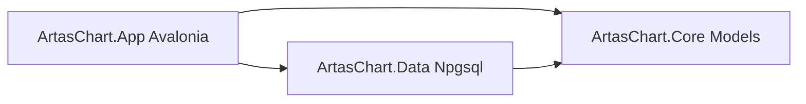

# План: C# проект ArtasChart (Avalonia + ScottPlot, .NET 8) — Этап 1: Инфраструктура

## Контекст

Существующий график реализован на **Bokeh (Python + JS)**:
- [`src/artas2026/visualization/chart.py`](../src/artas2026/visualization/chart.py) — `TickChart`
- [`src/artas2026/visualization/bokeh_server.py`](../src/artas2026/visualization/bokeh_server.py) — базовый сервер
- [`src/artas2026/visualization/bokeh_db.py`](../src/artas2026/visualization/bokeh_db.py) — чтение из PostgreSQL
- Данные: `PostgreSQL (artas_db)`, таблицы `symbols` и `fractals` (JSONB metadata/stat)

Цель нового проекта — **повторить отображение текущего графика** на **C# Avalonia + ScottPlot, .NET 8**,
расположив решение в `D:\work\Artas2026\C#\src`.

**Область Этапа 1 (этот план):** только инфраструктура — решение, проекты, подключение к БД,
загрузка моделей, заглушка пустого окна. UI-чарты (scatter, гистограмма, hover, фильтры, рулетка)
выполняются **следующим этапом**.

## Целевая структура решения

```
D:\work\Artas2026\C#\src\
├── ArtasChart.sln
├── Directory.Build.props            # общие свойства (net8.0, Nullable, LangVersion)
├── .gitignore
├── artaschart.settings.json.example # пример строки подключения (не коммитить реальный)
├── ArtasChart.Core\                 # модели предметной области (без зависимостей)
│   ├── ArtasChart.Core.csproj
│   └── Models\
│       ├── MarketPair.cs
│       ├── MyTick.cs
│       ├── InfoF.cs
│       ├── StatF.cs
│       ├── Fractal.cs
│       └── SymbolInfo.cs
├── ArtasChart.Data\                 # доступ к PostgreSQL (Npgsql) + маппинг
│   ├── ArtasChart.Data.csproj
│   ├── DbConfig.cs
│   ├── FractalRepository.cs
│   └── JsonModels\                  # DTO для парсинга JSONB (metadata, stat)
│       ├── FractalMetadataDto.cs
│       └── FractalRecordDto.cs
└── ArtasChart.App\                  # Avalonia UI (заглушка окна)
    ├── ArtasChart.App.csproj
    ├── Program.cs
    ├── App.axaml / App.axaml.cs
    ├── Views\MainWindow.axaml / .axaml.cs
    ├── ViewModels\MainWindowViewModel.cs
    ├── appsettings.json             # конфиг подключения к БД
    └── Assets\
```

### Граф зависимостей


- `ArtasChart.Core` — ни от чего не зависит (только BCL).
- `ArtasChart.Data` — ссылается на `Core`, использует `Npgsql`.
- `ArtasChart.App` — ссылается на `Core` и `Data`, содержит UI и DI-конфигурацию.

## Соответствие моделей (Python -> C#)

| Python | C# | Примечание |
|--------|-----|-----------|
| `MarketPair` | `MarketPair` | `record` с `Price: double`, `Volume: int` |
| `MPair` (info_f) | переиспользуем `MarketPair` | одинаковые поля price/volume |
| `MyTick` | `MyTick` | `Volume, Ask, Bid, Last, Flags, TimeMsc`, + `MarketPairs` (tuple 2) |
| `InfoF` | `InfoF` | 18 полей + `IReadOnlyList<MarketPair> Markets` |
| `StatF` | `StatF` | 11 полей (price_*, result_*, index_*, has_buy, from_start_interest) |
| `Fractal` | `Fractal` | `Index, Price, Distance, Min, Max, DefInterest, FromStartInterest, IsUp, Id, TickPeak, Info, Stat` |
| `DbConfig` | `DbConfig` | host/port/database/user/password + `ConnectionString` |

Имена JSON-полей из БД **сохраняем** как в Python (snake_case где он есть, PascalCase где он есть),
чтобы маппинг был 1:1. Для маппинга JSONB metadata удобно использовать `System.Text.Json` с
`JsonPropertyName` и настройкой `PropertyNameCaseInsensitive = true`.

## Ключевые технические решения

### 1. .NET 8 и пакеты
- `TargetFramework`: `net8.0`.
- `Nullable`: `enable`, `ImplicitUsings`: `enable`.
- Пакеты:
  - `ArtasChart.App`: `Avalonia`, `Avalonia.Desktop`, `Avalonia.Themes.Fluent`,
    `Avalonia.Fonts.Inter`, `CommunityToolkit.Mvvm` (MVVM генератор), позже `ScottPlot.Avalonia`.
  - `ArtasChart.Data`: `Npgsql`, `Microsoft.Extensions.Configuration.Json`,
    `Microsoft.Extensions.Configuration.EnvironmentVariables`.

### 2. Конфигурация подключения
- Приоритет источников: переменные окружения (`DB_HOST`, `DB_PORT`, `DB_NAME`, `DB_USER`,
  `DB_PASSWORD`) -> файл `appsettings.json` -> значения по умолчанию из [`DbConfig`](../src/artas2026/db/config.py:9)
  (localhost:5432, artas_db, artas_user, artas_password).
- Строка подключения Npgsql формируется из `DbConfig` (host/port/database/user/password).

### 3. Доступ к данным (Этап 1)
- `FractalRepository` с методом `GetFractalsAsync(name, limit, orderDesc)`.
- SQL повторяет [`FractalReaderService.get_fractals()`](../src/artas2026/services/fractal_read.py:39):
  - поиск `symbol_id` по `symbols.name`;
  - `SELECT f.* FROM fractals` с фильтрами и `ORDER BY id LIMIT`.
- Парсинг JSONB `metadata`/`stat` в DTO через `System.Text.Json`.
- Асинхронные методы (`NpgsqlConnection` + `NpgsqlCommand.ExecuteReaderAsync`).

### 4. Заглушка окна (Этап 1)
- `MainWindow` — пустое окно с заголовком `ArtasChart {symbol}`, статус-строкой
  (подключение к БД, число загруженных фракталов) и кнопкой «Проверить подключение».
- `MainWindowViewModel` (CommunityToolkit.Mvvm) — `InitializeAsync()`, вызывающий репозиторий
  и выводящий результат в статус. Чарты не рисуем.

## Точки интеграции (что проверяет Этап 1)

1. Решение собирается: `dotnet build`.
2. Приложение запускается, показывает окно.
3. Кнопка «Проверить подключение» открывает соединение с `artas_db` и читает последние N фракталов
   для `Si`, выводит их количество в статус. Это подтверждает весь слой данных до UI.

## Окружение и предпосылки

- .NET 8 SDK установлен; **шаблоны Avalonia отсутствуют** — требуется:
  `dotnet new install Avalonia.Templates`.
- PostgreSQL `artas_db` доступен по localhost:5432 (как в текущем Python-проекте).
  Наличие символа `Si` в `symbols` (в живой БД есть: 98421 фрактал).

## Риски и ограничения

| Риск | Митигация |
|------|-----------|
| Отсутствуют Avalonia-шаблоны | Установить `dotnet new install Avalonia.Templates` (первый шаг) |
| Различие версий ScottPlot/Avalonia API | Этап 2: зафиксировать версию `ScottPlot.Avalonia` и проверить API на простом примере |
| Формат JSONB metadata может отличаться по символам | DTO с nullable-полями + защитный парсинг |
| Регистр полей JSON (snake_case vs PascalCase) | `PropertyNameCaseInsensitive = true` + явные `JsonPropertyName` |
| Пароль в конфиге | Держать в env-переменных / `appsettings.Development.json` вне git |

## Что НЕ входит в Этот этап

- Отрисовка scatter/линии фракталов, гистограмма `from_start_interest`.
- Hover-панель с `Info/Stat/Peak/Pred`.
- Фильтры по `Markets[i].volume` и чекбоксы.
- Crosshair, рулетка, save/zoom/pan, синхронизация осей.
- Real-time периодическое обновление (`update_fractals_only`).
- Загрузка ML-модели прогноза (`prediction.pkl`).

## Проверка готовности этапа (Definition of Done)

- [ ] Установлены шаблоны Avalonia (`dotnet new list` содержит avalonia).
- [ ] Создано решение `ArtasChart.sln` в `D:\work\Artas2026\C#\src` с тремя проектами.
- [ ] Проекты ссылаются корректно (`App -> Data -> Core`, `App -> Core`).
- [ ] Реализованы модели `Core` 1:1 с Python.
- [ ] Реализован `FractalRepository` с асинхронным чтением фракталов из `artas_db`.
- [ ] `MainWindow` открывается как заглушка со статус-строкой.
- [ ] Кнопка «Проверить подключение» реально читает фракталы `Si` и показывает их число.
- [ ] `dotnet build` проходит без ошибок.
