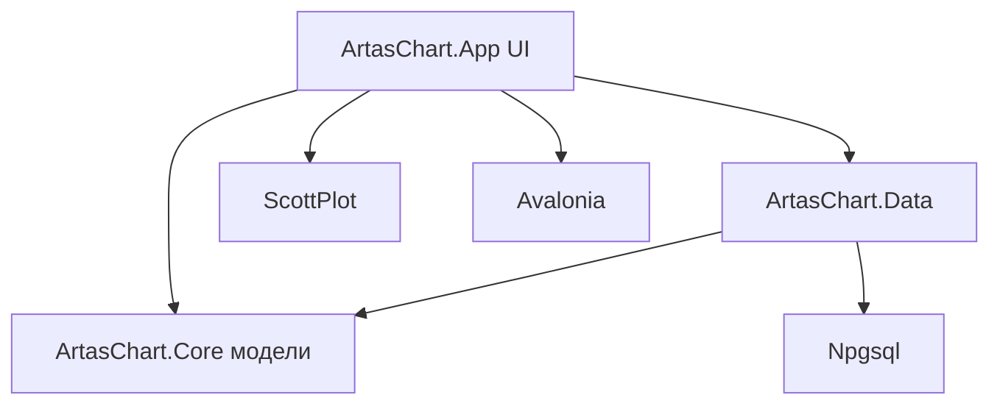
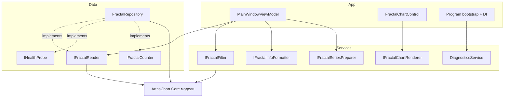

# План приведения C# решения ArtasChart к SOLID

Решение: [`C#/src/ArtasChart.sln`](C#/src/ArtasChart.sln)
Сборки: `ArtasChart.Core` (модели), `ArtasChart.Data` (доступ к PostgreSQL), `ArtasChart.App` (Avalonia + ScottPlot UI).

Решения приняты:
- В сейв добавляется новая сборка **`ArtasChart.Services`** (прикладная бизнес-логика). Она зависит только от `ArtasChart.Core`, использует `ArtasChart.Data` через интерфейсы и потребительется из `ArtasChart.App`.
- На этом этапе готовится **только план** — код не реализуется.

## 1. Текущее состояние

### Структура зависимостей

### Сводка нарушений SOLID

| Принцип | Где | Суть проблемы |
|---------|-----|---------------|
| S | [`MainWindowViewModel.cs`](C#/src/ArtasChart.App/ViewModels/MainWindowViewModel.cs:16) | Смешаны оркестрация загрузки, real-time таймер и форматирование info-панели |
| S | [`FractalChartControl.axaml.cs`](C#/src/ArtasChart.App/Views/FractalChartControl.axaml.cs:19) | Фильтрация, бизнес-расчёты, отрисовка ScottPlot и обработка ввода в одном классе |
| S | [`Program.cs`](C#/src/ArtasChart.App/Program.cs:17) | Конфигурация, CLI-диагностика `--check-db` и bootstrap Avalonia вместе |
| S | [`FractalRepository.cs`](C#/src/ArtasChart.Data/FractalRepository.cs:12) | Чтение фракталов, health-check и подсчёт в одном классе |
| O | [`FractalChartControl.cs`](C#/src/ArtasChart.App/Views/FractalChartControl.axaml.cs:325) | Фильтры жёстко зашиты; новый фильтр требует правки метода |
| O | [`MainWindowViewModel.cs`](C#/src/ArtasChart.App/ViewModels/MainWindowViewModel.cs:225) | Магические индексы стакана `Markets[0..5]` |
| L | — | Нарушений не выявлено (используются `sealed`/`record`) |
| I | [`MainWindowViewModel.cs`](C#/src/ArtasChart.App/ViewModels/MainWindowViewModel.cs:54) | Зависимость от всего класса репозитория, хотя нужны лишь 2 метода |
| D | [`MainWindowViewModel.cs`](C#/src/ArtasChart.App/ViewModels/MainWindowViewModel.cs:18) | Зависимость от конкретного класса, а не абстракции |
| D | [`App.axaml.cs`](C#/src/ArtasChart.App/App.axaml.cs:16) | Ручная композиция, нет DI-контейнера |
| D | [`Program.cs`](C#/src/ArtasChart.App/Program.cs:14) | Глобальный статик `Program.Configuration` — скрытая зависимость |

## 2. Целевая архитектура

### Целевая структура сборок

| Сборка | Зависит от | Содержание |
|--------|-----------|------------|
| `ArtasChart.Core` | — | Модели (`Fractal`, `InfoF`, `StatF`, `MyTick`, `MarketPair`, `SymbolInfo`) и JSON-конвертеры |
| `ArtasChart.Data` | Core, Npgsql | Интерфейсы чтения + `FractalRepository` |
| `ArtasChart.Services` | Core, Data | Фильтрация, подготовка серии, форматтер info, рендерер, диагностика |
| `ArtasChart.App` | Core, Data, Services, Avalonia, ScottPlot | UI, VM, bootstrap + DI |

## 3. Задачи
> **Статус: выполнено 2026-10-08.** Реализована вся работа: добавлена сборка
> `ArtasChart.Services`, сегрегированы интерфейсы Data-слоя, внедрён DI-контейнер,
> бизнес-логика вынесена из UI, CLI-диагностика изолирована. Сборка и `--check-db` проходят.

### Итоговая структура сборок

| Сборка | Содержание |
|--------|------------|
| `ArtasChart.Core` | Модели + `InfoF.GetMarket()` (именованные позиции стакана), `MarketPair.Empty` |
| `ArtasChart.Data` | `IFractalReader`, `IHealthProbe`, `IFractalCounter`, `FractalRepository` (реализует все три) |
| `ArtasChart.Services` | `IFractalFilter`/`FractalFilter`, `IFractalSeriesPreparer`/`FractalSeriesPreparer`, `IFractalInfoFormatter`/`FractalInfoFormatter`, `IDiagnosticsService`/`DiagnosticsService`, `FractalFilterOptions` |
| `ArtasChart.App` | VM зависит от абстракций, DI в `Program.RegisterServices`, `FractalChartControl` делегирует сервисам |

### Новые/изменённые файлы

- **Создано:** `ArtasChart.Services/ArtasChart.Services.csproj`; `IFractalReader.cs`, `IHealthProbe.cs`, `IFractalCounter.cs` (Data); 9 файлов сервисов.
- **Изменено:** `FractalRepository` (реализует интерфейсы), `MainWindowViewModel` (зависит от `IFractalReader` + сервисов), `Program` (DI + `IDiagnosticsService` вместо ручного `CheckDbAsync`), `App.axaml.cs` (разрешение через DI), `FractalChartControl` (делегирование фильтру/подготовке), `InfoF`/`MarketPair` (именованные позиции стакана), `ArtasChart.sln`, `ArtasChart.App.csproj`.

### Задача 1. Сегрегация интерфейсов репозитория (I + D)
- Создать в `ArtasChart.Data` интерфейсы: `IFractalReader` (`GetFractalsAsync`, `GetSymbolInfoAsync`), `IHealthProbe` (`TestConnectionAsync`), `IFractalCounter` (`CountFractalsAsync`).
- Реализовать их в [`FractalRepository`](C#/src/ArtasChart.Data/FractalRepository.cs:12).
- Потребитель (VM) зависит только от `IFractalReader`.

### Задача 2. Инверсия зависимостей ViewModel (D)
- Заменить в конструкторе [`MainWindowViewModel`](C#/src/ArtasChart.App/ViewModels/MainWindowViewModel.cs:54) тип `FractalRepository` на `IFractalReader`.

### Задача 3. Внедрение DI-контейнера (D)
- Добавить `Microsoft.Extensions.DependencyInjection` в `ArtasChart.App`.
- Перенести композицию из [`App.axaml.cs`](C#/src/ArtasChart.App/App.axaml.cs:16) в `ServiceCollection`.
- Убрать статик [`Program.Configuration`](C#/src/ArtasChart.App/Program.cs:14); конфигурацию регистрировать как `IConfiguration` в контейнере.

### Задача 4. Вынести фильтрацию (O + S) → в `ArtasChart.Services`
- Создать в `ArtasChart.Services` `IFractalFilter` / `FractalFilter`.
- Реализовать составные критерии (объём, Market0, Market1) как отдельные предикаты, собираемые в один список.
- [`FractalChartControl`](C#/src/ArtasChart.App/Views/FractalChartControl.axaml.cs:325) перестаёт содержать `Filter`.

### Задача 5. Вынести подготовку данных (S + устранение дублей) → в `ArtasChart.Services`
- Создать `IFractalSeriesPreparer`: расчёт `FromStartInterest` по дневной логике и присвоение `Index`.
- Убрать дублирование между [`RecomputeFromStartInterest`](C#/src/ArtasChart.App/Views/FractalChartControl.axaml.cs:109) и [`AssignIndices`](C#/src/ArtasChart.App/ViewModels/MainWindowViewModel.cs:116).

### Задача 6. Вынести форматирование info-панели (S) → в `ArtasChart.Services`
- Создать `IFractalInfoFormatter` / `FractalInfoFormatter`, перенести тело [`UpdateInfo`](C#/src/ArtasChart.App/ViewModels/MainWindowViewModel.cs:175).
- Форматтер — чистая функция `Fractal -> string`, легко тестируется.

### Задача 7. Инкапсулировать индексы стакана (O) → в `ArtasChart.Core`
- Ввести в `ArtasChart.Core` явные свойства/перечисление (Ask/Bid/волатильность) для позиций `Markets`, убрать магические числа `0..5` из [`Market`](C#/src/ArtasChart.App/ViewModels/MainWindowViewModel.cs:225) и `MarketVolume`.

### Задача 8. Очистить View (S)
- Из [`FractalChartControl`](C#/src/ArtasChart.App/Views/FractalChartControl.axaml.cs:19) вынести бизнес-логику (задачи 4, 5) и оставить только отрисовку/синхронизацию осей.
- Ввести `IFractalChartRenderer` в `ArtasChart.Services` для изоляции кода ScottPlot от Avalonia-контрола.

### Задача 9. Изолировать CLI-диагностику (S)
- Перенести [`CheckDbAsync`](C#/src/ArtasChart.App/Program.cs:35) в отдельный `DiagnosticsService` (в `ArtasChart.Services`).
- [`Program.Main`](C#/src/ArtasChart.App/Program.cs:17) оставить только bootstrap.

### Задача 10. Верификация и документирование
- Сборка решения, прогон `--check-db`, запуск GUI.
- Обновить план/README по новой структуре (добавление сборки `ArtasChart.Services` в `ArtasChart.sln`).

## 4. Порядок выполнения

1. Задача 1 → 2 → 3 (базис инверсии зависимостей).
2. Задача 5 → 4 → 8 (чистка контрола и дублей).
3. Задача 6 → 7 → 9 (мелкие SRP-правки).
4. Задача 10 (верификация).

### Задача 8. Очистить View (S)
- Из [`FractalChartControl`](C#/src/ArtasChart.App/Views/FractalChartControl.axaml.cs:19) вынести бизнес-логику (задачи 4, 5) и оставить отрисовку/синхронизацию осей.
- Ввести `IFractalChartRenderer` для изоляции кода ScottPlot от Avalonia-контрола.

### Задача 9. Изолировать CLI-диагностику (S)
- Перенести [`CheckDbAsync`](C#/src/ArtasChart.App/Program.cs:35) в отдельный `DiagnosticsService` (или подкоманду).
- [`Program.Main`](C#/src/ArtasChart.App/Program.cs:17) оставить только bootstrap.

### Задача 10. Проверка и документирование
- Сборка решения, прогон `--check-db`, запуск GUI.
- Обновить план/README по новой структуре.

## 4. Порядок выполнения

1. Задача 1 → 2 → 3 (базис инверсии зависимостей).
2. Задача 5 → 4 → 8 (чистка контрола и дублей).
3. Задача 6 → 7 → 9 (мелкие SRP-правки).
4. Задача 10 (верификация).

## 5. Критерии готовности
- `MainWindowViewModel` зависит только от абстракций.
- `FractalChartControl` не содержит бизнес-логики фильтрации и расчётов.
- Нет дублирования логики расчёта `FromStartInterest`/`Index`.
- Композиция выполняется через DI-контейнер, глобальный статик конфигурации удалён.
- Решение собирается без предупреждений, GUI и `--check-db` работают как прежде.
