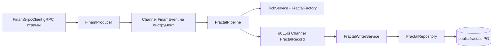
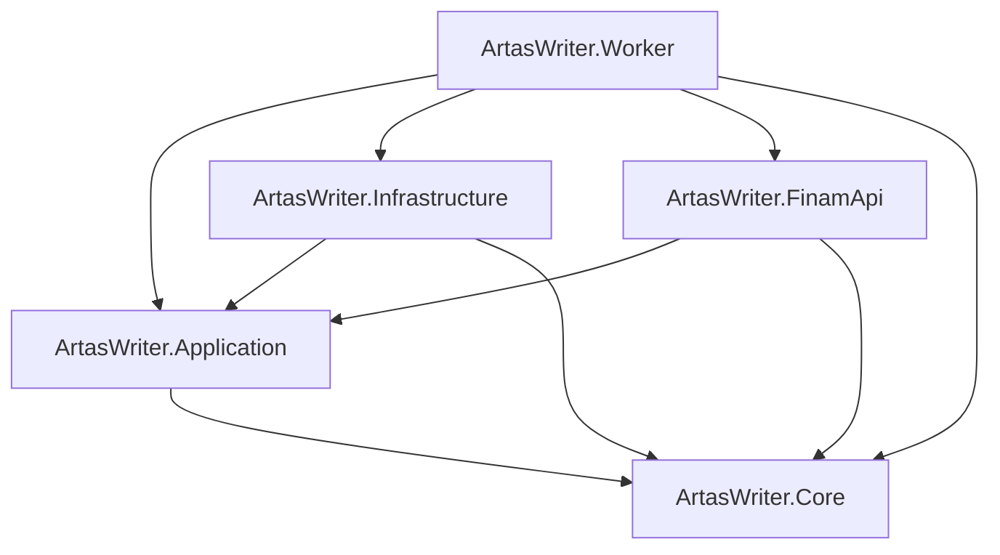
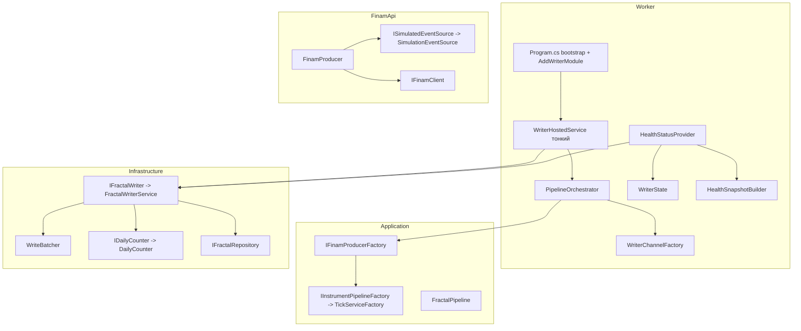

# План рефакторинга решения ArtasWriter (C#) по SOLID

Решение: [`ArtasWriter.slnx`](C#/src/Writer/ArtasWriter.slnx)
Сборки: `ArtasWriter.Core` (модели + абстракции), `ArtasWriter.Application` (сервисы/пайплайн),
`ArtasWriter.Infrastructure` (доступ к PG + writer-консьюмер), `ArtasWriter.FinamApi` (транспорт Finam),
`ArtasWriter.Worker` (host, DI, health), `ArtasWriter.Tests` (unit-тесты).

Статус: **выполнено 2026-10-09.** Все задачи реализованы: введены абстракции
(`IFractalWriter`, `IWriterState`, `IDailyCounter`, `ISimulatedEventSource`,
`IInstrumentPipelineFactory`, `IHealthSnapshotBuilder`), оркестрация вынесена в
`PipelineOrchestrator` + `WriterChannelFactory`, `WriterHostedService` стал тонким,
`FractalWriterService` разделён на `WriteBatcher` + `DailyCounter`, симуляция вынесена
из `FinamProducer`. Композиция — в `AddWriterModule`. Сборка без предупреждений,
33 теста зелёные; симуляция, `/health` (`status=ok`) и `/exit` работают.

Ограничения: сохранить текущее поведение (поток данных, батчинг, эндпоинты `/health`, `/exit`),
совместимость с БД и Python-эталоном, все существующие тесты должны проходить после рефакторинга.

## 1. Текущее состояние

### Поток данных

### Зависимости слоёв

### Сводка нарушений SOLID

| Принцип | Где | Суть проблемы |
|---------|-----|---------------|
| S | [`WriterHostedService.cs`](C#/src/Writer/ArtasWriter.Worker/WriterHostedService.cs:37) | Один класс создаёт канал записи, вызывает фабрику конвейеров, запускает writer-консьюмер, запускает потребителей и продьюсеров, выполняет graceful shutdown и логирует итог — 5+ ответственностей |
| S | [`FractalWriterService.cs`](C#/src/Writer/ArtasWriter.Infrastructure/Services/FractalWriterService.cs:43) | Смешаны три ответственности: чтение канала с батчингом/дедлайном, запись в репозиторий, ведение дневного счётчика (`WrittenToday`) |
| S | [`FinamProducer.cs`](C#/src/Writer/ArtasWriter.FinamApi/FinamProducer.cs:135) | Транспортный продьюсер дополнительно содержит генератор синтетических событий (`SimulateAsync`) — режим симуляции зашит в боевой класс |
| S | [`HealthStatusProvider.cs`](C#/src/Writer/ArtasWriter.Worker/Health/HealthStatusProvider.cs:26) | Сбор снапшота, маппинг тика в health-DTO и обработка исключений по символу в одном методе |
| O | [`FinamProducer.cs`](C#/src/Writer/ArtasWriter.FinamApi/FinamProducer.cs:58) | Ветвление «симуляция vs реальный клиент» по флагу `options.SimulationMode`; новый источник событий требует правки класса |
| O | [`FractalWriterService.cs`](C#/src/Writer/ArtasWriter.Infrastructure/Services/FractalWriterService.cs:130) | Логика сброса дневного счётчика (МСК-день) зашита; смена политики дня требует правки класса |
| L | [`FinamOptions.cs`](C#/src/Writer/ArtasWriter.FinamApi/Options/FinamOptions.cs:48) | `BuildFullSymbol` и конфиг в одном классе — смешение, но наследования с нарушениями не выявлено; риск усиления требует внимания при извлечении базовых типов |
| I | [`IHealthStatusProvider.cs`](C#/src/Writer/ArtasWriter.Worker/Health/IHealthStatusProvider.cs:6) | Интерфейс отдаёт готовый `HealthSnapshot` — потребитель (`/health`) зависит от конкретной DTO-модели; маппинг сопряжён с сериализацией |
| I | [`WriterState.cs`](C#/src/Writer/ArtasWriter.Worker/WriterState.cs:10) | Конкретный мьютэйбл-класс с публичными `volatile`-полями, читается и пишется из разных мест без абстракции |
| D | [`WriterHostedService.cs`](C#/src/Writer/ArtasWriter.Worker/WriterHostedService.cs:18) | Зависит от конкретного `FractalWriterService` вместо абстракции `IFractalWriter` |
| D | [`HealthStatusProvider.cs`](C#/src/Writer/ArtasWriter.Worker/Health/HealthStatusProvider.cs:12) | Зависит от конкретных `WriterState` и `FractalWriterService`, а не от абстракций |
| D | [`FinamProducerFactory.cs`](C#/src/Writer/ArtasWriter.Application/Producers/FinamProducerFactory.cs:78) | Создаёт `TickService`, `FractalPipeline` через `new` — прямая зависимость от конкретных реализаций, ломает тестируемость и IoC |
| D | [`Program.cs`](C#/src/Writer/ArtasWriter.Worker/Program.cs:28) | Вся композиция и bootstrap host в одном файле верхнего уровня без модульного DI-расширения |
| D | [`Program.cs`](C#/src/Writer/ArtasWriter.Worker/Program.cs:55) | Регистрация `IFinamClient` со `switch` по `SimulationMode` смешивает выбор реализации с bootstrap |

## 2. Целевая архитектура

### Принципы целевого состояния

- Слой `Core.Abstractions` содержит все контракты (`IFractalWriter`, `IWriterState`, `IDailyCounter`, `ISimulatedEventSource`), реализации — в Application/Infrastructure/FinamApi.
- `WriterHostedService` — тонкий `BackgroundService`, только жизненный цикл: делегирует оркестрацию и завершение.
- Выбор реализации (реальный клиент vs симуляция, writer vs mock) выполняется **в DI-композиции**, а не в рантайм-ветвлениях боевых классов.
- Каждый класс — одна причина изменения.

## 3. Задачи

### Задача 1. Абстракция writer-консьюмера (D + I)
- Добавить в `ArtasWriter.Core/Abstractions` интерфейс `IFractalWriter` с членами: `RunAsync(ChannelReader<FractalRecord>, CancellationToken)`, `TotalWritten`, `WrittenToday`.
- Реализовать в [`FractalWriterService`](C#/src/Writer/ArtasWriter.Infrastructure/Services/FractalWriterService.cs:14).
- Зарегистрировать в DI под интерфейсом.

### Задача 2. Абстракция состояния (D + S)
- Ввести `IWriterState` (чтение статуса: `StartTimeUtc`, `FinamConnected`, `DbConnected`, `Pipelines`) и отдельные методы-сеттеры `SetDbConnected`, `SetFinamConnected`, `SetPipelines`.
- Убрать публичные `volatile`-поля из [`WriterState`](C#/src/Writer/ArtasWriter.Worker/WriterState.cs:10); заменить на свойства с `Interlocked`/`lock`.
- `WriterHostedService` и `HealthStatusProvider` зависят от `IWriterState`.

### Задача 3. Вынос оркестрации и канала (S)
- Создать `WriterChannelFactory` — создаёт общий `Channel<FractalRecord>` с настройками из `WriterOptions` (единая точка настройки backpressure).
- Создать `PipelineOrchestrator` — принимает фабрику продьюсеров и writer, выполняет старт продьюсеров/потребителей/writer и корректную остановку (перенос тела `ExecuteAsync` из [`WriterHostedService`](C#/src/Writer/ArtasWriter.Worker/WriterHostedService.cs:37)).
- Возвращать результат запуска (кол-во конвейеров, задачи) для логирования и health.

### Задача 4. Тонкий hosted service (S)
- [`WriterHostedService`](C#/src/Writer/ArtasWriter.Worker/WriterHostedService.cs:15) оставить только: стартовый health-probe БД, вызов `PipelineOrchestrator.StartAsync`, ожидание остановки, вызов `PipelineOrchestrator.StopAsync`.

### Задача 5. Разделение FractalWriterService (S + O)
- Выделить `WriteBatcher` — цикл накопления батча по размеру/дедлайну (перенос тела `RunAsync`).
- Выделить `IDailyCounter` / `DailyCounter` — инкапсуляция дневного счётчика и сброса по МСК-дню.
- `FractalWriterService` становится композицией: читает через `WriteBatcher`, пишет через `IFractalRepository`, учитывает через `IDailyCounter`.

### Задача 6. Вынос симуляции из продьюсера (O + S)
- Создать `ISimulatedEventSource` и реализацию `SimulationEventSource` в `ArtasWriter.FinamApi/Simulation`, перенести тело `SimulateAsync` из [`FinamProducer`](C#/src/Writer/ArtasWriter.FinamApi/FinamProducer.cs:135).
- `FinamProducer` принимает источник событий через конструктор; реальный/симулированный путь выбирается в DI-композиции [`Program.cs`](C#/src/Writer/ArtasWriter.Worker/Program.cs:55).

### Задача 7. Инверсия создания сервисов инструментов (D + I)
- Ввести `IInstrumentPipelineFactory` (или `ITickServiceFactory`) в `Application`, инкапсулирующую создание `TickService` + `FractalPipeline`.
- В [`FinamProducerFactory`](C#/src/Writer/ArtasWriter.Application/Producers/FinamProducerFactory.cs:75) заменить прямые `new` на вызов фабрики через DI.

### Задача 8. Разделение health (S + I)
- Вынести `HealthSnapshotBuilder` из [`HealthStatusProvider`](C#/src/Writer/ArtasWriter.Worker/Health/HealthStatusProvider.cs:26) — чистое построение снапшота.
- `HealthStatusProvider` оставить тонким адаптером, реализующим `IHealthStatusProvider`.

### Задача 9. Модульный DI (D)
- Создать `DependencyInjection.cs` в `ArtasWriter.Worker` с расширением `AddWriterModule(IServiceCollection, IConfiguration)`, перенести регистрации из [`Program.cs`](C#/src/Writer/ArtasWriter.Worker/Program.cs:36).
- `Program.cs` оставить: построение конфигурации, вызов `AddWriterModule`, маппинг `/health` и `/exit`, запуск.

### Задача 10. Сегрегация интерфейсов (I)
- Подключить созданные интерфейсы (`IFractalWriter`, `IWriterState`, `IDailyCounter`, `ISimulatedEventSource`) в DI.
- Потребители (`WriterHostedService`, `HealthStatusProvider`, `FractalPipeline`) зависят только от нужных им абстракций.

### Задача 11. Тесты (сохранение поведения)
- Обновить [`FractalWriterServiceTests`](C#/src/Writer/ArtasWriter.Tests/Infrastructure/FractalWriterServiceTests.cs:16) под новые абстракции (`WriteBatcher`, `IDailyCounter`).
- Добавить тесты `WriteBatcher` (размер батча, дедлайн, завершение канала) и `DailyCounter` (сброс по дню).
- Добавить тесты `HealthSnapshotBuilder` (маппинг тика/интерфейса в снапшот).
- Сохранить существующие тесты [`FractalPipelineTests`](C#/src/Writer/ArtasWriter.Tests/Application/FractalPipelineTests.cs:15) и [`TickServiceTests`](C#/src/Writer/ArtasWriter.Tests/Application/TickServiceTests.cs:1).

### Задача 12. Верификация и документация
- `dotnet build` всего решения без предупреждений.
- `dotnet test` — все тесты зелёные.
- Запуск в режиме симуляции [`run_Writer.ps1`](C#/src/Writer/run_Writer.ps1:1) → проверка потока данных, `GET /health` (статус ok), `GET /exit` (graceful shutdown).
- Обновить [`README.md`](C#/src/Writer/README.md:17) по новой структуре и точкам расширения.

## 4. Порядок выполнения

1. Задача 1 → 2 → 10 (абстракции + DI, базис инверсии зависимостей).
2. Задача 5 (разделение writer) → 3 → 4 (оркестрация и тонкий host).
3. Задача 6 → 7 (развязка продьюсера и фабрики).
4. Задача 8 → 9 (health и модульный DI).
5. Задача 11 (тесты) → 12 (верификация).

## 5. Критерии готовности

- `WriterHostedService` не создаёт каналы, не запускает продьюсеры и потребители напрямую — только делегирует оркестратору.
- `WriterHostedService` и `HealthStatusProvider` зависят только от абстракций (`IFractalWriter`, `IWriterState`).
- `FractalWriterService` разделён на батчинг и дневной счётчик; поведение `TotalWritten`/`WrittenToday` сохраняется.
- `FinamProducer` не содержит логики генерации синтетических событий; выбор реализации — только в DI.
- `FinamProducerFactory` не создаёт `TickService`/`FractalPipeline` через `new`.
- Композиция вынесена в `AddWriterModule`; `Program.cs` — только bootstrap.
- `dotnet build` без предупреждений; `dotnet test` зелёный; симуляция, `/health` и `/exit` работают как прежде.
