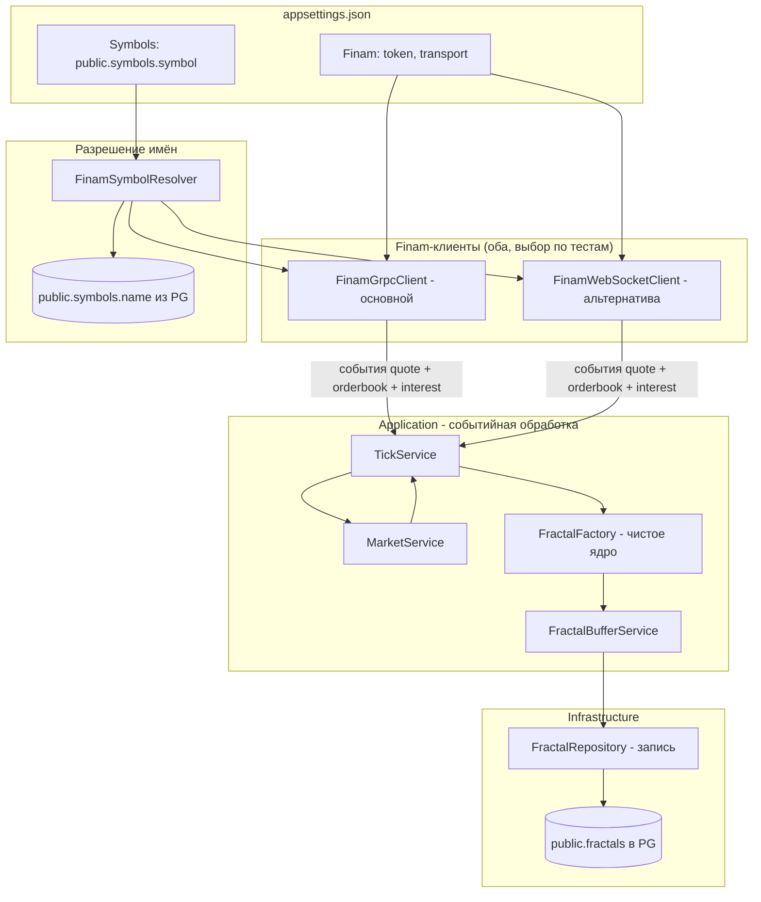
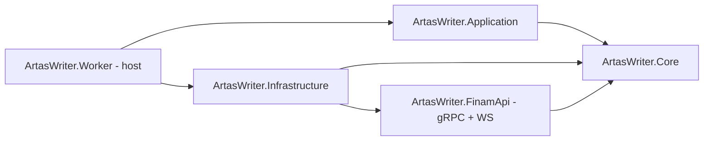
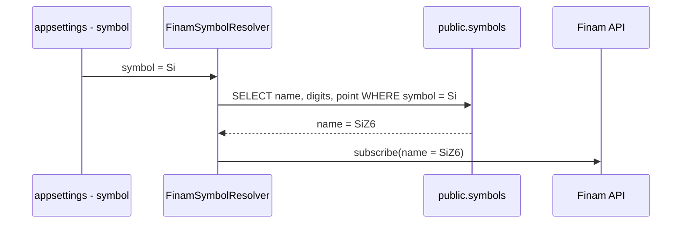
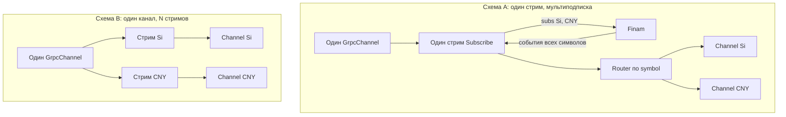
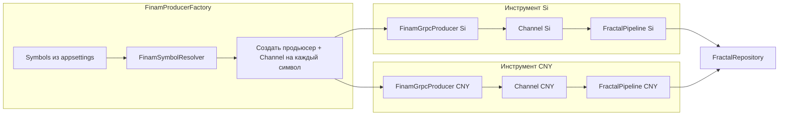
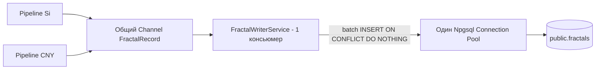

# План: перенос сервиса записи фракталов (Writer) с Python/MT5 на C#/.NET 10 + Finam API

**Дата:** 08.10.2026
**Целевая папка:** [`C#/src/Writer`](../C#/src/Writer)
**Основание:** [`C#/src/Writer/fractals-migration-plan.md`](../C#/src/Writer/fractals-migration-plan.md)
**Исходный Python-код:** [`src/artas2026/core/fractal_factory.py`](../src/artas2026/core/fractal_factory.py), [`src/artas2026/services/`](../src/artas2026/services)

---

## 1. Цель

Переписать Python-сервис записи фракталов в C# (.NET 10), заменив интеграцию с MetaTrader 5 на Finam API. Один процесс должен обрабатывать **все** инструменты, а список инструментов задаётся в конфигурации проекта (`appsettings.json`), а не через CLI-параметры.

### Ключевые требования (из запроса)

1. **Отказ от MT5** → интеграция с Finam API (https://api.finam.ru). Сначала — тесты, чтобы понять протокол.
2. **Новые инструменты — в настройках**, не через параметры. Один процесс обрабатывает все инструменты.
3. **База** — [`fractals-migration-plan.md`](../C#/src/Writer/fractals-migration-plan.md).
4. **Портировать** [`fractal_factory.py`](../src/artas2026/core/fractal_factory.py) и **написать тесты** на него.
5. **Проект на .NET 10**.

### Уточнённые требования (по итогам обсуждения)

- **История тиков НЕ нужна.** Нужны только: **текущий тик**, **стакан (order book) сейчас**, **открытый интерес (open interest)**.
- **Транспорт:** реализовать **оба клиента** (gRPC — основной приём тиков, WebSocket — альтернатива); **начать с тестов обоих транспортов**, выбрать лучший по результатам.
- **Событийная модель, без цикла опроса.** В Python был `while`-цикл с `INTERVAL_MS = 0.05` ([`run_fractal_writer.py`](../scripts/run_fractal_writer.py:265)). Здесь данные приходят **по подписке** в стриме Finam — событие на каждое обновление quote/orderbook. Периодического опроса нет.
- **Настройки инструментов:** в `appsettings.json` использовать `public.symbols.symbol`; при формировании соединения с Finam брать `public.symbols.name` из БД.

---

## 2. Что переносится (инвентаризация Python-кода)

| Python-модуль | Роль | Судьба в C# |
|---|---|---|
| [`core/fractal_factory.py`](../src/artas2026/core/fractal_factory.py) | `FFNew` — алгоритм фракталов на тиках | → Core: чистое ядро `FractalFactory` |
| [`core/fractal.py`](../src/artas2026/core/fractal.py) | `Fractal` | → Domain: `Fractal` |
| [`core/tick.py`](../src/artas2026/core/tick.py) | `MyTick`, `IsBuy` | → Domain: `MyTick` |
| [`core/market_pair.py`](../src/artas2026/core/market_pair.py) | `MarketPair`, `MarketPairBufferItem` | → Domain |
| [`core/info_f.py`](../src/artas2026/core/info_f.py) | `InfoF`, `create_Info` | → Domain |
| [`core/info_meta.py`](../src/artas2026/core/info_meta.py) | `InfoMeta`, `TempPair` | → Domain |
| [`core/stat_f.py`](../src/artas2026/core/stat_f.py) | `StatF` | → Domain |
| [`services/tick_service.py`](../src/artas2026/services/tick_service.py) | приём тиков, вызов ядра, буфер | → Application: `TickService` (без MT5, источник — Finam) |
| [`services/market_service.py`](../src/artas2026/services/market_service.py) | середина стакана, interest | → Application: `MarketService` (источник — Finam order book) |
| [`services/fractal_buffer.py`](../src/artas2026/services/fractal_buffer.py) | буфер фракталов, Index, DefInterest, FromStartInterest | → Application: `FractalBufferService` |
| [`services/fractal_writer.py`](../src/artas2026/services/fractal_writer.py) | запись фракталов в PG | → Infrastructure: `FractalRepository` |
| [`services/fractal_db.py`](../src/artas2026/services/fractal_db.py) | подключение к PG, symbol_id | → Infrastructure: `SymbolRepository` / `FractalDbService` |
| [`services/health_server.py`](../src/artas2026/services/health_server.py) | `/health`, `/exit` | → Worker: ASP.NET Core Minimal API |
| [`mt5/client.py`](../src/artas2026/mt5/client.py) | MT5-клиент | **Удаляется**, заменяется на Finam-клиент |

### Что переиспользуется из проекта Reader

| Артефакт Reader | Роль |
|---|---|
| [`Fractal.cs`](../C#/src/Reader/ArtasChart.Core/Models/Fractal.cs) | образец модели (record/class) |
| [`MyTick.cs`](../C#/src/Reader/ArtasChart.Core/Models/MyTick.cs) | образец `MyTick` |
| [`InfoF.cs`](../C#/src/Reader/ArtasChart.Core/Models/InfoF.cs) | образец `InfoF` |
| [`StatF.cs`](../C#/src/Reader/ArtasChart.Core/Models/StatF.cs) | образец `StatF` |
| [`MarketPair.cs`](../C#/src/Reader/ArtasChart.Core/Models/MarketPair.cs) | образец `MarketPair` |
| [`FlexibleNumberConverters.cs`](../C#/src/Reader/ArtasChart.Core/Json/FlexibleNumberConverters.cs) | гибкие JSON-конвертеры |
| [`DbConfig.cs`](../C#/src/Reader/ArtasChart.Data/DbConfig.cs) | образец конфигурации PG |
| [`FractalRepository.cs`](../C#/src/Reader/ArtasChart.Data/FractalRepository.cs) | образец Npgsql-репозитория |
| [`Directory.Build.props`](../C#/src/Reader/Directory.Build.props) | образец центральных свойств (net10.0) |
| [`Program.cs`](../C#/src/Reader/ArtasChart.App/Program.cs) | образец DI-композиции |

Важно: модели Reader уже 1:1 соответствуют JSONB-схеме БД — их можно **скопировать** в новый Writer-проект, обеспечив бинарную совместимость записи/чтения.

---

## 3. Целевая архитектура



### Слои решения



| Проект | Ответственность | Зависит от |
|---|---|---|
| `ArtasWriter.Core` | Модели (Fractal, MyTick, InfoF, InfoMeta, StatF, SymbolInfo), чистое ядро `FractalFactory`, интерфейсы | только BCL |
| `ArtasWriter.FinamApi` | gRPC- и WebSocket-клиенты Finam, DTO протокола, абстракция `IFinamClient` | Core |
| `ArtasWriter.Application` | `TickService`, `MarketService`, `FractalBufferService` — оркестрация | Core |
| `ArtasWriter.Infrastructure` | `FractalRepository`, `SymbolRepository`, `FinamSymbolResolver`, конфигурация | Core |
| `ArtasWriter.Worker` | Host, DI, многоинструментный hosted service, health endpoint, graceful shutdown | все |
| `ArtasWriter.Tests` | Unit + integration тесты | все |

---

## 4. Этап 0 — Разведка Finam API (КРИТИЧНО, выполняется первым)

### 4.1 Задачи разведки

1. Создать временный консольный проект (`ArtasWriter.Sandbox`) для экспериментов.
2. **gRPC smoke-тест (основной кандидат для тиков):**
   - получить proto-схему Finam;
   - сгенерировать C#-классы (`Grpc.Tools`);
   - авторизоваться токеном;
   - подписаться на quotes (текущий тик) по инструменту;
   - подписаться на order book (стакан);
   - получить open interest;
   - залогировать формат сообщений и зафиксировать фикстуры.
3. **WebSocket smoke-тест (альтернатива):**
   - подключиться к стриму Finam (`wss://` endpoint);
   - повторить подписки;
   - сравнить формат и задержки с gRPC.
4. Зафиксировать формат полей: bid/ask/last/volume, глубину стакана, размерность open interest, формат времени (ms).

### 4.2 Выход этапа

- JSON/proto-фикстуры сообщений Finam для тестов.
- Таблица сравнения gRPC vs WebSocket.
- **Решение о выборе транспорта** (зафиксировать в разделе 5).

### 4.3 Вопросы к Finam API (проверить в smoke-тестах)

- Формат идентификатора инструмента (ticker/board/`symbol` vs `name`).
- Есть ли отдельный канал open interest или он приходит в quote.
- Глубина стакана (в Python — 5 уровней с каждой стороны, всего 10).
- Частота событий (для оценки нагрузки; период опроса не нужен).
- Авторизация: токен в заголовке / первом сообщении / query.

---

## 5. Выбор транспорта (заполняется по итогам этапа 0)

| Критерий | WebSocket | gRPC |
|---|---|---|
| Простота отладки | JSON, видно глазами | требует proto |
| Типизация | ручные DTO | строгая из proto |
| Зависимости | `System.Net.WebSockets` (BCL) | `Grpc.Net.Client` + `Grpc.Tools` |
| Задержка | низкая | низкая |
| Поддержка нескольких инструментов | одно соединение, мультиподписка | один стрим |
| Зрелость в проекте | — | — |

**Предварительно:** gRPC — основной вариант приёма тиков (запрос пользователя), WebSocket — альтернативный. Итог фиксируется здесь после этапа 0.

---

## 6. Конфигурация инструментов

В `appsettings.json` задаётся ключ `public.symbols.symbol`, а при соединении с Finam используется `public.symbols.name` из БД.

```jsonc
{
  "Db": {
    "Host": "127.0.0.1",
    "Port": 5432,
    "Database": "artas_db",
    "User": "artas_user",
    "Password": "artas_password"
  },
  "Finam": {
    "BaseUrl": "https://api.finam.ru",
    "GrpcUrl": "https://api.finam.ru",
    "WsUrl": "wss://api.finam.ru/...",
    "Token": "",
    "Transport": "gRPC",
    "ReconnectDelayMs": 5000
  },
  "Writer": {
    "Symbols": [
      { "Symbol": "Si" },
      { "Symbol": "CNY" }
    ],
    "Depth": 5,
    "HealthPort": 8080
  }
}
```

> **Цикла опроса нет.** В отличие от Python-версии с `INTERVAL_MS = 0.05` и `while`-циклом ([`run_fractal_writer.py`](../scripts/run_fractal_writer.py:265)), здесь данные приходят **событийно** — по подписке в стриме Finam. Тик/стакан/interest доставляются в обработчик по мере поступления, никакого периодического опроса.

### Алгоритм разрешения имени (FinamSymbolResolver)



> В Python аналог — [`FractalDbService.resolve_mt5_symbol()`](../src/artas2026/services/fractal_db.py:190). Здесь меняется источник (Finam вместо MT5) и ключ поиска (`symbol` из настроек).

---

## 7. Декомпозиция по слоям

### 7.1 Core — Domain (модели)

Портировать 1:1 с Python; переиспользовать модели Reader.

- `MarketPair` — `Price: double`, `Volume: long`, `IsAsk: bool?`.
- `MarketPairBufferItem` — пара + `Interest`, свойства `Sum`, `MAsk`, `MBid`.
- `MyTick` — `Volume, Ask, Bid, Last, Flags, TimeMsc, Interest, MarketPairs`; свойства `IsBuy`, `Buy`, `Sell`, `Time`.
- `IsBuy(flags)` — статический хелпер (флаги 32/64).
- `InfoMeta` — изменяемая (class), все счётчики + методы `Update`, `UpdateActive`, `UpdateGlass`, `Add`, `ResetAllState`, `ResetTransientCounters`, `OnPickCompleted`.
- `InfoF` — immutable-аналог (record), + `CreateInfo(InfoMeta)`.
- `TempPair`, `StatF`, `Fractal`, `SymbolInfo`.

### 7.2 Core — чистое ядро `FractalFactory`

Прямой перенос [`FFNew`](../src/artas2026/core/fractal_factory.py:12):

- Поля: `PrevPick, Max, Min, IsUp, TickPeak, infoUp, infoDown, Digits, Distance`.
- Конструктор: `Distance = round(tradeTickSize * distancePoints, digits)`.
- Методы: `Init`, `Calculate`, `UpdateAb`, `GetFractal`.
- **Без I/O и side-effects** — только вход `MyTick` → выход `Fractal?`.
- **Замечание по точности:** Python — `float64`, проект Reader использует `double`. Для 1:1 с эталоном использовать `double` (не `decimal`). Зафиксировать решение и покрыть тестом округления.

### 7.3 Application (событийная обработка)

- `TickService` — принимает события тиков от Finam-клиента (по подписке), конвертирует в `MyTick`, вызывает `FractalFactory`, складывает фракталы в буфер. **Без загрузки истории** (только текущие события).
- `MarketService` — из событий стакана Finam формирует `MarketPairBufferItem` (середина стакана, `interest` из Finam). Аналог [`get_mid_pair()`](../src/artas2026/services/market_service.py:39) и [`update_current_markets()`](../src/artas2026/services/market_service.py:80). Обновляет состояние на каждом событии order book, а не по таймеру.
- `FractalBufferService` — буфер фракталов, `Index`, `DefInterest`, `FromStartInterest`, событие `FractalDetected`.
- `RunOptions` — глубина стакана, список инструментов.

### 7.3.1 Фабрика продьюсеров (`FinamProducerFactory`) — ДА, нужна

Отдельный компонент, который по списку инструментов из `appsettings.json` создаёт **по одному продьюсеру на инструмент** и связывает каждого продьюсера с его потребителем (пайплайном обработки).

Роль фабрики:
1. Резолвить имя: `public.symbols.symbol` (настройки) → `public.symbols.name` (БД) через `FinamSymbolResolver`.
2. Создать `IFinamProducer` (gRPC-продьюсер) на каждый инструмент с его подпиской.
3. Создать **персональный `Channel<T>`** (bounded, backpressure) на каждый инструмент.
4. Создать `FractalPipeline` (потребитель): читает из своего `Channel<T>`, вызывает `TickService`/`MarketService`/`FractalFactory`, пишет фракталы в `FractalRepository`.
5. Вернуть список пар «продьюсер + потребитель» в `WriterHostedService` для запуска и остановки.

### 7.3.2 Топология gRPC: мультиподписка vs N стримов (уточняется на этапе 0)

Один gRPC-стрим — это один RPC-вызов, возвращающий поток событий. Возможны две схемы; выбор определяется результатами smoke-тестов этапа 0:

**Схема A — один стрим, мультиподписка (предпочтительно, если поддержано).**
Один `GrpcChannel` → один стрим-вызов → команды подписки на несколько инструментов в одном стриме; сервер шлёт события по всем символам. Экономит соединения, единый реконнект восстанавливает все подписки.

**Схема B — один канал, N стримов.**
Один `GrpcChannel` (переиспользует HTTP/2-соединение), но N независимых стрим-вызовов — по одному на инструмент. Больше накладных расходов, но проще изоляция.



Влияние на дизайн:
- Схема A: `IFinamProducer` один на процесс, обязан маршрутизировать входящие события в `Channel` нужного инструмента (роутер по `symbol`).
- Схема B: `IFinamProducer` создаётся на каждый инструмент, как описано выше.
- Абстракция `IFinamProducerFactory` скрывает это от `WriterHostedService` — точка изменений локализована.



Ключевые интерфейсы:

| Интерфейс | Ответственность |
|---|---|
| `IFinamProducerFactory` | создаёт продьюсер + канал + пайплайн на каждый инструмент |
| `IFinamProducer` | продьюсер: подписка на Finam-стрим, пишет события в свой `Channel<FinamEvent>` |
| `IFractalPipeline` | потребитель: читает события из `Channel<FinamEvent>`, обрабатывает фракталы |

### 7.3.3 Модель записи в PG: один writer-консьюмер на процесс (УТВЕРЖДЕНО)

**Решение принято:** один writer-консьюмер на процесс. Фракталы — редкое событие (единицы-десятки в час на инструмент), поэтому параллелизм записи не нужен. Схема: **все пайплайны инструментов публикуют фракталы в один общий `Channel<FractalRecord>`, а пишет в PG единственный `FractalWriterService`**.

Варианты и почему выбран один writer:

| Вариант | Плюсы | Минусы |
|---|---|---|
| **1. Один writer на процесс (выбран)** | Один Npgsql pool, батчинг, единый graceful flush | Общий канал — точка сериализации (не критично при редкой записи) |
| 2. Writer на каждый инструмент | Изоляция | N соединений, N транзакций параллельно, лишние ресурсы |
| 3. Пул из M воркеров (как в Python) | Больше параллелизма | Избыточно при редкой записи, риск конкуренции за PG |



Детали:
- **Батчинг.** Писать пачками (например, `BatchSize` записей или `FlushIntervalMs`), а не по одному `INSERT` как в Python ([`_save_fractal_in_thread`](../src/artas2026/services/fractal_writer.py:177)).
- **Идемпотентность.** `ON CONFLICT (id, symbol_id) DO NOTHING` — безопасно для повторов и батча.
- **Graceful flush.** При `/exit` writer докачивает общий канал (`Channel.Writer.Complete()`) и дописывает остаток.
- **Пул соединений.** Один Npgsql pool на процесс; настройка в `DbConfig` (`Maximum Pool Size`).
- **Счётчик `fractals_count_today`** ведёт writer (потокобезопасно), отдаёт в `/health`.

> В Python-версии — `ThreadPoolExecutor(max_workers=2)` + отдельное соединение на поток ([`fractal_writer.py`](../src/artas2026/services/fractal_writer.py:78)). В C# это заменяется на один writer с очередью и батчингом.

Почему так:
- **Изоляция инструментов.** Один инструмент не влияет на другой (отдельный канал, отдельный обработчик).
- **Backpressure.** `Channel` с ограниченной ёмкостью; при переполнении продьюсер блокируется или дропает по политике (`BoundedChannelFullMode`).
- **Тестируемость.** Фабрику и пайплайн можно тестировать на мок-продьюсере без Finam.
- **Единая точка старта.** `WriterHostedService` получает готовый набор пар от фабрики.

> В Python-версии один процесс на символ ([`run_fractal_writer.py`](../scripts/run_fractal_writer.py:95), аргумент `--symbol`). Здесь — один процесс на N инструментов, а фабрика продьюсеров заменяет множественные процессы.

### 7.4 Infrastructure

- `FinamConfig`, `DbConfig` (образец [`DbConfig.cs`](../C#/src/Reader/ArtasChart.Data/DbConfig.cs)).
- `FinamSymbolResolver` — `symbol` (настройки) → `name` (БД) → подписка Finam.
- `FinamGrpcClient` / `FinamWebSocketClient` → общий `IFinamClient` (`SubscribeAsync`, события `OnQuote`, `OnOrderBook`, `OnOpenInterest`).
- `FractalRepository` — вставка в `fractals` (`id, symbol_id, price, time, metadata, stat`) c `ON CONFLICT (id, symbol_id) DO NOTHING`.
- `FractalWriterService` — **единственный консьюмер записи**: читает общий `Channel<FractalRecord>`, батчит, вызывает `FractalRepository`; ведёт счётчик `fractals_count_today` (см. раздел 7.3.3).
- `FractalMetadataDto` — совместим с Python-форматом (переиспользовать [`FractalMetadataDto.cs`](../C#/src/Reader/ArtasChart.Data/JsonModels/FractalMetadataDto.cs)).
- `SymbolRepository` — `GetSymbolInfoAsync(name)` (образец [`FractalRepository.GetSymbolInfoAsync`](../C#/src/Reader/ArtasChart.Data/FractalRepository.cs:31)).

### 7.5 Worker

- `Program.cs` — host + DI + `appsettings.json` + env.
- `WriterHostedService` — получает от `IFinamProducerFactory` набор пар «продьюсер + пайплайн» (по одной на инструмент), запускает их и останавливает, graceful shutdown.
- Два HTTP-эндпоинта: `/health` и `/exit` через ASP.NET Core Minimal API (см. раздел 7.6).
- Structured logging (`ILogger<T>`), опционально — отправка в Loki (по образцу Python).
- `run.ps1` для запуска.

---

## 7.6 Health-эндпоинты (`/health` и `/exit`)

Реализуются через ASP.NET Core Minimal API (Kestrel) в проекте `ArtasWriter.Worker` — аналог Python [`health_server.py`](../src/artas2026/services/health_server.py:24). Порт берётся из `Writer.HealthPort` (по умолчанию 8080).

### `/health` (GET)

Возвращает JSON-статус сервиса; используется для мониторинга живости.

Поля (аналог [`_build_health_payload`](../scripts/run_fractal_writer.py:51)):

| Поле | Описание |
|---|---|
| `status` | `"ok"` при нормальной работе, `"degraded"` при проблемах с Finam/PG |
| `server_time` | текущее время сервера (ISO 8601, UTC/МСК) |
| `start_time` | время запуска процесса |
| `uptime_seconds` | время работы в секундах |
| `finam_connected` | состояние соединения с Finam (gsRPC/WS) |
| `db_connected` | состояние соединения с PostgreSQL |
| `symbols` | массив по каждому инструменту |
| `symbols[].symbol` | `public.symbols.symbol` из настроек |
| `symbols[].name` | `public.symbols.name` из БД (код Finam) |
| `symbols[].last_tick` | последний обработанный тик (time_msc, last, bid, ask, volume, flags, interest) |
| `symbols[].fractals_count_today` | число записанных фракталов за текущий день (МСК), аналог [`get_fractals_count_today()`](../src/artas2026/services/fractal_writer.py:263) |

### `/exit` (GET)

Graceful shutdown всего процесса — аналог обработчика `/exit` в Python.

Алгоритм:
1. Ответить `200 {"status": "exiting"}` немедленно (чтобы клиент получил ответ).
2. Инициировать graceful shutdown: остановить подписки Finam, дочитать буфер фракталов, дописать их в PG, закрыть соединения.
3. Завершить процесс (`IHostApplicationLifetime.StopApplication()`).

> Обработка в фоне, чтобы не блокировать HTTP-ответ — как в Python (shutdown в отдельном потоке).

### Реализация (эскиз)

```csharp
var app = builder.Build();

app.MapGet("/health", (IHealthStatusProvider p) => Results.Json(p.GetSnapshot()));
app.MapGet("/exit", (IHostApplicationLifetime life) =>
{
    life.StopApplication();
    return Results.Json(new { status = "exiting" });
});

app.Run();
```

---

## 8. Стратегия тестирования

### 8.1 Тесты этапа 0 (разведка Finam)

- `FinamGrpcSmokeTests` — подключение, подписка, получение quote/orderbook/interest.
- `FinamWebSocketSmokeTests` — то же через WebSocket.
- Фиксация сообщений как fixtures.

### 8.2 Тесты ядра FractalFactory (из [`fractal_factory.py`](../src/artas2026/core/fractal_factory.py))

- Конструктор: `Distance = round(tickSize * distancePoints, digits)`.
- `Init` — сброс состояния.
- `GetFractal` — детекция нижнего и верхнего фрактала по `Distance`.
- Граничные: нет движения, два равных High/Low, смена направления, пустой поток.
- Перенос сценариев из [`test_ff_new.py`](../tests/unit/core/test_ff_new.py) и [`test_ff_new_simple.py`](../tests/unit/core/test_ff_new_simple.py).

### 8.3 Golden-тесты против Python-эталона

- Выгрузить из Python пары «входные события тиков → выходные фракталы» (JSON).
- Прогнать через C# `FractalFactory`, сравнить `Price, IsUp, Distance, Min, Max, Id`.
- Сравнение `double` с `epsilon` (например, `1e-9`).

### 8.4 Интеграционные тесты

- `FractalRepository` — запись + повторная запись (идемпотентность) в тестовую БД.
- `TickService` + `MarketService` — на мок-клиенте Finam (фикстуры этапа 0).
- `FinamSymbolResolver` — `symbol` → `name` из БД.

---

## 9. Риски

| Риск | Влияние | Митигация |
|---|---|---|
| Неизвестен точный протокол Finam | Блокирует реализацию | Этап 0 — smoke-тесты обоих транспортов |
| Отсутствие open interest в стриме Finam | Нет поля `interest` | Проверить в этапе 0; fallback — REST-запрос |
| `double` vs `float64` | Расхождение результата с эталоном | `epsilon`-сравнение в golden-тестах |
| Разный формат стакана Finam (глубина/стороны) | Неверный `get_mid_pair` | Адаптер с явным маппингом + тесты |
| Много инструментов в одном процессе | Утечки, взаимные блокировки | Изоляция `PerSymbolWorker` + `Channel<T>` |
| Смена схемы Finam | Поломка клиента | Абстракция `IFinamClient`, контрактные тесты |

---

## 10. Открытые вопросы

1. Точный gRPC/WebSocket-эндпоинт и формат авторизации Finam (уточняется на этапе 0).
2. **Топология gRPC:** поддерживает ли Finam мультиподписку на несколько инструментов в одном стриме (схема A) или требует по стриму на инструмент (схема B)? Проверить на этапе 0.
3. Есть ли open interest в стриме или только в REST-snapshot.
4. Нужен ли WebSocket после успешных gRPC-тестов (или оставить как опциональную реализацию).
5. Как сопоставляется `public.symbols.symbol` проекта (Si/CNY) с кодом инструмента Finam — нужна ли ручная таблица в настройках?
6. Нужна ли отправка логов в Loki (как в Python) или достаточно файла/консоли.

---

## 11. Порядок выполнения (Definition of Done по шагам)

1. Разведка Finam API (оба транспорта) + фиксация фикстур и выбора.
2. Решение `ArtasWriter.sln` собирается (`dotnet build`).
3. Модели Domain 1:1 с Python, тесты сериализации.
4. `FractalFactory` портирован, покрыт unit-тестами и golden-тестами.
5. `FinamSymbolResolver` + конфигурация инструментов через `appsettings.json`.
6. `TickService`, `MarketService`, `FractalBufferService` + тесты на мок-клиенте.
7. `FractalRepository` — запись в PG, идемпотентность.
8. `WriterHostedService` — мультиинструментный процесс (событийный) + health endpoint.
9. Верификация на живых данных Finam + сверка в БД.
10. README и `run.ps1`.
