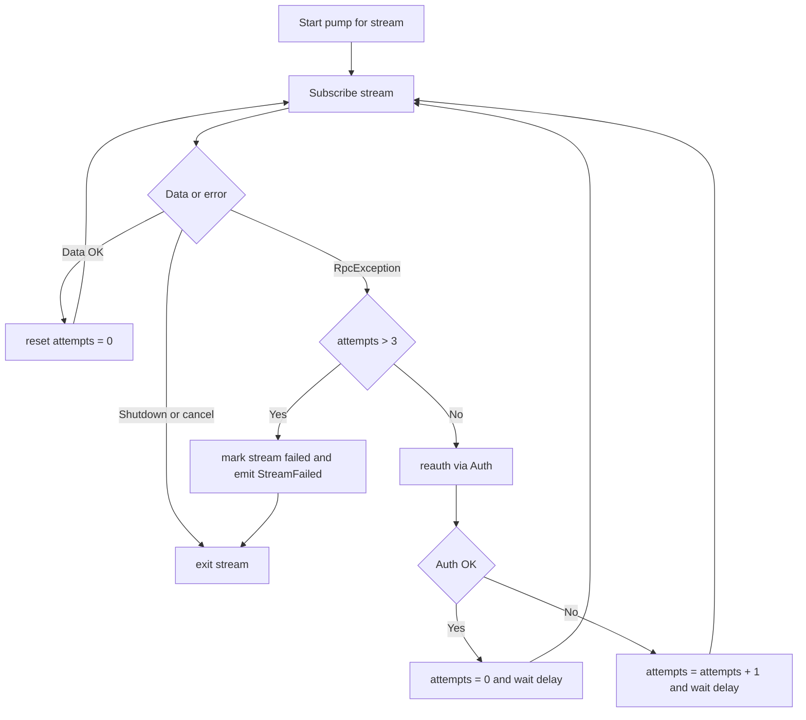

# План: ограничение ретраев стримов Finam до 3 + расширенный health

> УТОЧНЕНИЕ (архитектура авторизации): авторизация вынесена на уровень клиента.
> `FinamGrpcClient` — singleton на процесс, JWT (`_token`) общий для всех символов
> и стримов. Пампы-стримы независимы как задачи, но **Auth не вызывают**: обновлением
> JWT заведует единый фоновый «auth-keepalive» (под `SemaphoreSlim`, один Auth за раз,
> без гонок при параллельных обрывах). Пампы при обрыве лишь читают актуальный `_token`
> и ретраят (лимит 3), а при `Unauthenticated` сигналят keepalive обновить токен.

## Цель

Ограничить число попыток переподключения каждого стрима Finam (котировки / стакан / сделки)
до **3**. Перед каждым повтором — попытка **реавторизации** (`Auth`); при успехе счётчик
попыток сбрасывается. Если 3 попытки подряд неудачны — останавливается **только проблемный
стрим**, остальные продолжают работать, Writer продолжает жить. Факт падения стрима
отражается в health: `finam_connected=false` **на уровне конкретного символа** и в агрегате,
статус символа/стрима = `degraded`.

### Отображение в health (per-symbol)

- `finam_connected` дублируется **внутрь каждого элемента `symbols[]`** и выводится
  **первым полем блока символа** (перед `symbol`, `last_tick` и т.д.).
- Значение символа = `true`, если все его стримы up; `false`, если хотя бы один стрим
  символа исчерпал ретраи (`quotes` / `orderbook` / `trades`).
- Агрегированный (верхнеуровневый) `finam_connected` = `AND` по всем символам.
- Рядом со флагом символа — статус каждого стрима (`streams[]`: kind, up, reason),
  чтобы сразу видеть, какой именно поток упал.

## Текущее поведение (проблема)

- [`PumpQuotesAsync()`](../src/Writer/ArtasWriter.FinamApi/FinamGrpcClient.cs:225),
  [`PumpOrderBookAsync()`](../src/Writer/ArtasWriter.FinamApi/FinamGrpcClient.cs:309),
  [`PumpTradesAsync()`](../src/Writer/ArtasWriter.FinamApi/FinamGrpcClient.cs:365) —
  бесконечный `while (!cancelled)` с фиксированной паузой
  [`ReconnectDelayMs`](../src/Writer/ArtasWriter.FinamApi/Options/FinamOptions.cs:36) = 5000 мс.
- Нет лимита попыток, нет backoff, нет реавторизации.
- [`IsShutdown()`](../src/Writer/ArtasWriter.FinamApi/FinamGrpcClient.cs:547) различает плановое
  выключение и обрыв, но бесконечно ретраит реальные сбои.
- [`PipelineOrchestrator`](../src/Writer/ArtasWriter.Worker/PipelineOrchestrator.cs:78) ставит
  `SetFinamConnected(pipelines.Count > 0)` один раз на старте → health показывает
  `finam_connected: true` даже когда все стримы мертвы.

## Целевое поведение



Уточнение по счётчику: отдельный счётчик `attempts` на каждый стрим. Реавторизация
сбрасывает `attempts` только при **успешном** Auth. Если после сброса снова 3 неудачи —
стрим останавливается (защита от бесконечного цикла при невалидном ключе).

## Изменения по слоям

### 1. Настройки — [`FinamOptions.cs`](../src/Writer/ArtasWriter.FinamApi/Options/FinamOptions.cs)
- `StreamMaxRetries` (int, по умолчанию `3`) — лимит попыток на стрим.
- `ReconnectDelayMs` — оставить (пауза между попытками).
- `ReauthOnRetry` (bool, по умолчанию `true`) — пробовать `Auth` перед повтором.

### 2. Клиент — [`FinamGrpcClient.cs`](../src/Writer/ArtasWriter.FinamApi/FinamGrpcClient.cs)
- Ввести `_streamState` (словарь `streamKey -> StreamState`, под `_gate`): `Attempts`, `IsFailed`.
- **Auth-keepalive (единая авторизация на весь клиент):**
  - поля: `_authCts`, `_authLoopTask`, `SemaphoreSlim _authGate(1,1)`, `SemaphoreSlim _reauthSignal(0,1)`;
  - `ConnectAsync` делает первый `Auth` и запускает фоновый keepalive;
  - keepalive: цикл «ждать сигнал или таймаут `AuthRefreshMinutes`» → один `Auth` под `_authGate`
    → атомарно заменить `_token`; при неудаче — токен не портится, повтор позже;
  - `SignalReauth()` — памп будит keepalive (release `_reauthSignal`), если получил `Unauthenticated`;
  - `_token` читается памами атомарно (ссылочная замена), Auth меняет его под `_authGate`.
- Логика ретраев пама (**без вызова Auth из пама**):
  - при `RpcException` (не shutdown): `attempts++`;
    - `Unauthenticated`/`PermissionDenied` → `SignalReauth()` (токен обновит keepalive);
    - `attempts > StreamMaxRetries` → эмит `StreamFailed`, `break` (остальные стримы живут);
    - иначе — пауза `ReconnectDelayMs` и повтор.
- Общий блок try/catch/reconnect вынести в метод `RunStreamWithRetriesAsync(...)` (снять дублирование памов).
- При получении первых данных стрима — сброс `attempts` и `OnStreamRecovered`.
- `DisposeAsync` останавливает и auth-keepalive, и стримы.

### 3. Абстракция — [`IFinamClient.cs`](../src/Writer/ArtasWriter.Core/Abstractions/IFinamClient.cs)
- `enum StreamKind { Quotes, OrderBook, Trades }`.
- `record struct StreamFailedEvent(string Symbol, StreamKind Kind, string Reason)`.
- `event Action<StreamFailedEvent>? StreamFailed;`

### 4. Продьюсер — [`FinamProducer.cs`](../src/Writer/ArtasWriter.FinamApi/FinamProducer.cs)
- Подписаться на `_client.StreamFailed`, прокинуть наружу (в `IWriterState`) либо через
  новое событие продьюсера, которое слушает оркестратор.
- Передавать в `FinamProducer` ссылку на `IWriterState` (инверсия зависимостей) либо
  событие наверх — выбрать вариант: оркестратор [`PipelineOrchestrator`](../src/Writer/ArtasWriter.Worker/PipelineOrchestrator.cs:45)
  уже держит `IWriterState`.

### 5. Состояние — [`IWriterState.cs`](../src/Writer/ArtasWriter.Worker/IWriterState.cs) / [`WriterState.cs`](../src/Writer/ArtasWriter.Worker/WriterState.cs)
- Хранить карту статусов стримов: `symbol + kind -> up/failed`.
- `FinamConnected` вычисляется как «все ключевые стримы up» (или «хотя бы один failed → false»).
- Методы: `SetStreamStatus(symbol, kind, isUp, reason)`.

### 6. Health — [`HealthState.cs`](../src/Writer/ArtasWriter.Worker/Health/HealthState.cs) / [`HealthSnapshotBuilder.cs`](../src/Writer/ArtasWriter.Worker/Health/HealthSnapshotBuilder.cs)
- В `SymbolHealth` **первым** JSON-полем добавить `finam_connected` (bool) — состояние
  соединения конкретного символа (порядок полей в JSON соответствует порядку свойств класса,
  поэтому `FinamConnected` объявляем первым свойством `SymbolHealth`).
- В `SymbolHealth` добавить `streams` (список: `kind`, `up`, `reason`) — статус каждого
  потока символа (quotes/orderbook/trades).
- Пример блока символа в ответе `/health`:
  ```json
  {
    "finam_connected": false,
    "symbol": "Si",
    "name": "SiZ6",
    "streams": [
      { "kind": "quotes",    "up": true,  "reason": null },
      { "kind": "orderbook", "up": true,  "reason": null },
      { "kind": "trades",    "up": false, "reason": "Invalid access key" }
    ],
    "symbol_id": 1,
    "last_tick": { "last": 85201, "volume": 3, "time_msc": 0, "time_msk": "..." }
  }
  ```
- В `HealthSnapshot`: верхнеуровневый `finam_connected` = `AND` по символам;
  `status` = `degraded`, если есть упавший стрим; оставить `db_connected`.
- `FractalsCountToday` — заодно рассмотреть реальный источник (сейчас жёстко 0).

### 7. Конфигурация — [`appsettings.json`](../src/Writer/ArtasWriter.Worker/appsettings.json:9) / `appsettings.example.json`
- Добавить в секцию `Finam`: `StreamMaxRetries: 3`, `ReauthOnRetry: true`.
- Вернуть уровень логирования `ArtasWriter.FinamApi.FinamGrpcClient` с `Debug` на `Information`.

### 8. Тесты — [`ArtasWriter.Tests`](../src/Writer/ArtasWriter.Tests)
- Fake `IFinamClient`, который бросает `RpcException` N раз.
- Проверить: 3 неудачи → стрим остановлен, эмит `StreamFailed`, остальные не затронуты.
- Проверить: успешный Auth сбрасывает `attempts` (после 2 неудач + успех → стрим жив).
- Проверить: `HealthSnapshotBuilder` даёт `finam_connected=false` и `status=degraded`
  при упавшем стриме.

### 9. Документация
- Обновить [`src/Writer/README.md`](../src/Writer/README.md): политика ретраев, реакция health.

## Точки внимания / риски

- **Идемпотентность реавторизации**: `ConnectAsync` сейчас пишет `_token`/`_connected`;
  при повторных вызовах из памов нужна потокобезопасность (общий `_gate` или отдельный lock).
- **Разделяемый `_token`** между тремя стримами: при реавторизации одного стрима токен
  обновляется для всех — это ок, но сброс счётчиков должен быть **per-stream**.
- **Один клиент на процесс**: в DI [`AddSingleton<IFinamClient>`](../src/Writer/ArtasWriter.Worker/DependencyInjection.cs:63);
  продьюсеры используют общий экземпляр → статусы стримов логичнее хранить в клиенте по `symbol+kind`.
- **Событие StreamFailed из фонового потока**: вызывать потокобезопасно (подписка писателя).
- **Плановое выключение** не должно считаться падением (использовать существующий
  [`IsShutdown()`](../src/Writer/ArtasWriter.FinamApi/FinamGrpcClient.cs:547)).
- **Порядок сброса attempts**: сбрасывать и при «первых данных», и при успешном Auth —
  иначе валидный стрим с редкими обрывами накопит 3 сбоя за долгое время.

## Критерии готовности

1. Стрим с постоянной ошибкой останавливается после 3 попыток; остальные стримы живут.
2. Успешная реавторизация сбрасывает счётчик попыток.
3. Health: `finam_connected=false` и `status=degraded` при упавшем стриме; видно, какой
   именно стрим и причина.
4. Сборка без ошибок/предупреждений, новые тесты зелёные.
5. Диагностический уровень логирования возвращён на `Information`.
