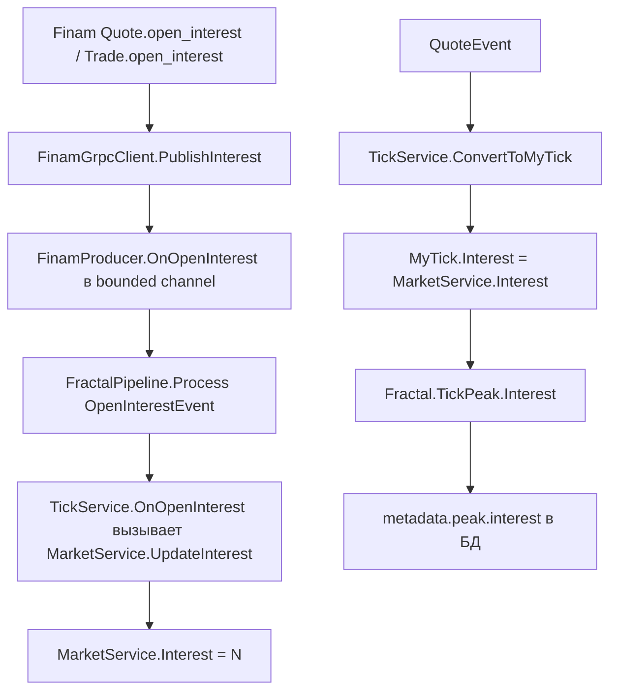
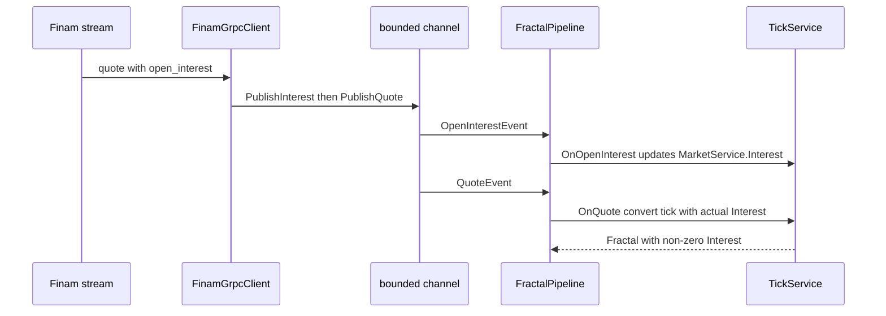

# План исправления записи нуля в открытый интерес

> Статус: **реализовано**. Порядок публикации исправлен, введён гейт
> `InterestInitialized`, добавлены unit-тесты. `dotnet test src/Writer/ArtasWriter.slnx`
> — 59/59 пройдено.

## Проблема

При запуске Writer в PostgreSQL попадают фракталы с открытым интересом, равным `0`,
хотя на рынке интерес ненулевой. Значение интереса «замораживается» в момент создания
фрактала и далее пишется в `metadata.peak.interest`.

### Путь данных

### Корневые причины

1. **Инверсия порядка в одном такте.** В [`PumpQuotesAsync()`](src/Writer/ArtasWriter.FinamApi/FinamGrpcClient.cs:221)
   для каждой котировки сначала вызывается `PublishQuote(quote)`, затем читается
   `quote.OpenInterest` и вызывается `PublishInterest(...)`. `QuoteEvent` попадает
   в канал раньше `OpenInterestEvent` из того же сообщения Finam: если эта котировка
   формирует фрактал, он получает старое значение интереса (или 0 для первого фрактала).

2. **Переполнение bounded-канала.** Канал в [`FinamProducer`](src/Writer/ArtasWriter.FinamApi/FinamProducer.cs:42)
   ограничен и использует `FullMode = DropOldest`. Интерес приходит реже котировок
   (дедупликация в [`PublishInterest()`](src/Writer/ArtasWriter.FinamApi/FinamGrpcClient.cs:498)),
   поэтому под нагрузкой вытесняется именно `OpenInterestEvent`.

3. **Нет отдельной подписки на интерес.** [`SubscribeOpenInterestAsync()`](src/Writer/ArtasWriter.FinamApi/FinamGrpcClient.cs:151)
   только запоминает символ и завершается. Реально интерес приходит внутри потока котировок,
   поэтому порядок вызовов в [`FinamProducer.StartAsync()`](src/Writer/ArtasWriter.FinamApi/FinamProducer.cs:74)
   не гарантирует прихода интереса до первого фрактала.

4. **Инициализация нулём и первый фрактал.** [`MarketService.Interest`](src/Writer/ArtasWriter.Application/Services/MarketService.cs:31)
   инициализируется нулём; до первого `OpenInterestEvent` любой фрактал уходит в БД с `interest = 0`.

5. **Почему в симуляции не видно.** В [`SimulationEventSource.RunAsync()`](src/Writer/ArtasWriter.FinamApi/Simulation/SimulationEventSource.cs:38)
   интерес публикуется **до** котировки, что маскирует проблему.

## Решения

### Шаг 1. Порядок публикации: интерес до котировки

- В [`PumpQuotesAsync()`](src/Writer/ArtasWriter.FinamApi/FinamGrpcClient.cs:221) сначала
  извлекать и публиковать `OpenInterest`, затем `PublishQuote`.
- В [`PublishTrade()`](src/Writer/ArtasWriter.FinamApi/FinamGrpcClient.cs:392) применять
  `PublishInterest(...)` **до** вызова `handler(new QuoteEvent(...))`.

Результат: тик-фрактал из того же такта видит уже актуальный интерес.

### Шаг 2. Не терять событие интереса при переполнении

Варианты (выбрать один при реализации):

- **A (предпочтительно).** Хранить «последнее известное значение интереса» вне канала
  (в `MarketService`/`FractalPipeline`) и подставлять его при конвертации тика, независимо
  от того, дошёл ли `OpenInterestEvent` по каналу. Это делает интерес устойчивым к `DropOldest`.
- **B.** Публиковать `OpenInterestEvent` в отдельный канал/механизм без вытеснения
  (не `DropOldest`), чтобы редкое событие не терялось.
- **C.** Увеличить `ProducerChannelCapacity` (по умолчанию 10 000) — паллиатив, не устраняет
  корень проблемы, применять только в сочетании с A/B.

### Шаг 3. Не формировать первый фрактал до получения интереса

- Ввести в [`MarketService`](src/Writer/ArtasWriter.Application/Services/MarketService.cs:31)
  флаг `InterestInitialized` (сбрасывается при старте/смене дня сессии).
- В [`TickService.OnQuote()`](src/Writer/ArtasWriter.Application/Services/TickService.cs:71)
  не отдавать готовый фрактал, пока `InterestInitialized == false` (буферизовать или пропускать),
  чтобы в БД не «замораживался» стартовый ноль.
- При этом сохранить корректное поведение: реальный ноль (начало сессии) после первого
  `OpenInterestEvent` — валидное значение и должен записываться как есть
  (см. существующий тест [`OnOpenInterest_Zero_IsAcceptedAsValid()`](src/Writer/ArtasWriter.Tests/Application/TickServiceTests.cs:124)).

### Шаг 4. Тесты

- Тест порядка: `OpenInterestEvent` обрабатывается до `QuoteEvent` из того же такта.
- Тест [`FractalPipeline`](src/Writer/ArtasWriter.Application/Pipeline/FractalPipeline.cs:76):
  фрактал не публикуется, пока интерес не инициализирован.
- Тест устойчивости: потеря `OpenInterestEvent` в канале не обнуляет сохранённый интерес.
- Тест `TickService`: первый фрактал после интереса содержит ненулевой `Interest`
  (по аналогии с [`OnOpenInterest_UpdatesInterest()`](src/Writer/ArtasWriter.Tests/Application/TickServiceTests.cs:110)).

### Шаг 5. Проверка

- Сборка решения `ArtasWriter` и запуск тестов проекта `ArtasWriter.Tests`.
- Прогон на реальном Finam либо симуляция с инвертированным порядком (interest раньше quote
  не публикуется) — убедиться, что в `public.fractals` нет стартовых фракталов с `interest = 0`.
- SQL-проверка: `SELECT metadata->'peak'->>'interest' FROM public.fractals ...`.

## Диаграмма исправленного потока

## Затрагиваемые файлы

- [`FinamGrpcClient.cs`](src/Writer/ArtasWriter.FinamApi/FinamGrpcClient.cs:221) — порядок публикации.
- [`MarketService.cs`](src/Writer/ArtasWriter.Application/Services/MarketService.cs:31) — флаг инициализации интереса.
- [`TickService.cs`](src/Writer/ArtasWriter.Application/Services/TickService.cs:71) — гейт по инициализации интереса.
- [`FinamProducer.cs`](src/Writer/ArtasWriter.FinamApi/FinamProducer.cs:42) — только если выбран вариант B.
- Тесты в [`TickServiceTests.cs`](src/Writer/ArtasWriter.Tests/Application/TickServiceTests.cs:1)
  и [`FractalPipelineTests.cs`](src/Writer/ArtasWriter.Tests/Application/FractalPipelineTests.cs:1).

## Критерии приёмки

- Новые фракталы в БД содержат ненулевой `interest`, если рынок его отдаёт.
- Потеря одного `OpenInterestEvent` в канале не приводит к записи нуля.
- Первый фрактал дня не публикуется до получения первого значения интереса.
- Реальный нулевой интерес (начало сессии) сохраняется корректно.
- Все существующие и новые тесты проходят.
