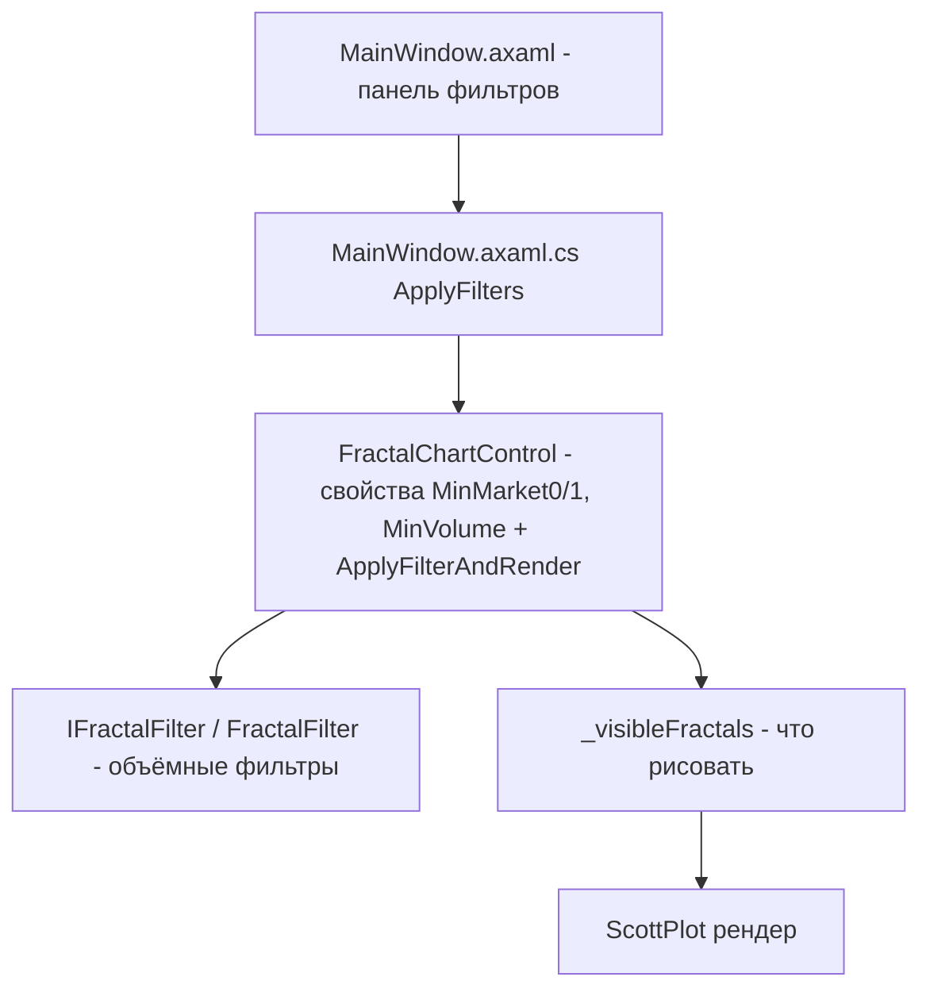
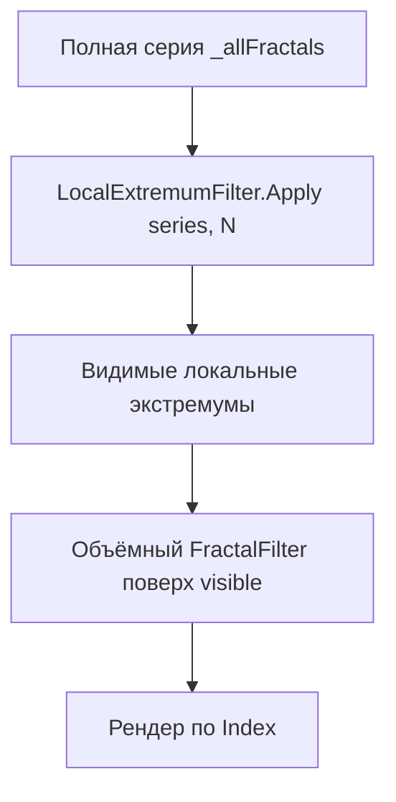

# План: фильтр отображения фракталов по локальному экстремуму (N соседей)

> **Статус: реализовано и проверено (сборка Release — 0 ошибок/предупреждений, `--check-db` и GUI работают).**
> Реализация: `ILocalExtremumFilter`/`LocalExtremumFilter` (ArtasChart.Services), свойство
> `FractalChartControl.ExtremumNeighbors`, поле `NumericUpDown FilterExtremumN` в `MainWindow.axaml`,
> связка в `MainWindow.axaml.cs.ApplyFilters()`, регистрация в DI.

## 1. Цель

Изменение отображения фракталов в C# приложении [`ArtasChart`](C#/src/ArtasChart.sln), чтобы отображался не каждый фрактал, а только те, что являются **локальными экстремумами** среди соседей по порядку в серии:

- **UP-фрактал** отображается, если у него **слева и справа N** соседних фракталов имеют цену **ниже или равную** его цене (локальный максимум).
- **DOWN-фрактал** отображается, если у него **слева и справа N** соседних фракталов имеют цену **выше или равную** его цене (локальный минимум).

## 2. Терминология и уточнённые требования (подтверждены пользователем)

- **Соседи** — соседние по порядку фракталы в серии (по `Fractal.Index`, т.е. по времени), N слева и N справа.
- **Строгость сравнения**: «ниже или равны» / «выше или равны» (нестрогое сравнение), равенство разрешено.
- **Краевые случаи** (у начала/конца серии меньше N соседей): **скрываем** таких фракталов (границы не отображаются).
- **N** задаётся в UI, значение 0 — фильтр выключен.
- Новый фильтр — **дополнительный** к уже существующим фильтрам по объёму/стаканам (применяется после них или независимо).

## 3. Текущая архитектура фильтрации (что уже есть)



- [`MainWindow.axaml`](C#/src/ArtasChart.App/MainWindow.axaml:28) — панель «Фильтры (0 = выкл)» с тремя полями и кнопкой «Применить фильтр».
- [`MainWindow.axaml.cs`](C#/src/ArtasChart.App/MainWindow.axaml.cs:55) — `ApplyFilters()` читает поля через `FindControl<TextBox>` и устанавливает свойства контрола, затем вызывает `_chart.ApplyFilterAndRender()`.
- [`FractalChartControl.axaml.cs`](C#/src/ArtasChart.App/Views/FractalChartControl.axaml.cs:221) — `ApplyFilterAndRender(autoScale)` вызывает `_filter.Filter(_allFractals, options)` → `_visibleFractals`, затем рендерит.
- [`FractalFilter.cs`](C#/src/ArtasChart.Services/FractalFilter.cs:9) — реализует `IFractalFilter`, фильтрует по объёмам.
- Данные загружаются в `_allFractals` через `Render`/`Append`, индексы и `FromStartInterest` вычисляет [`FractalSeriesPreparer`](C#/src/ArtasChart.Services/FractalSeriesPreparer.cs:25).

## 4. Ключевое архитектурное решение

**Экстремум-фильтр должен применяться к исходной (полной) серии `_allFractals`, а не к результату объёмного фильтра.** Причины:

1. **Локальный экстремум — свойство серии**, а не отдельного фрактала: зависит от контекста соседей.
2. Если применять после объёмного фильтра, удалённые фракталы «сдвигают» соседство в памяти, но индексная сетка X на графике строится по `Index`, который присвоен до фильтрации. Останутся «дыры» в соседстве по X.
3. Применение к полной серии даёт стабильный и предсказуемый результат независимо от изменения других фильтров (принцип единственной обязанности и открытости/закрытости).



Минимально-инвазивный вариант: `FractalChartControl` перед вызовом `IFractalFilter` применяет `ILocalExtremumFilter` к `_allFractals`. Тогда фильтр экстремумов — ещё один этап, не затрагивающий существующий интерфейс `IFractalFilter` (принцип OCP: новый функционал не меняет старый).

## 5. Проектирование API

### 5.1 Новый сервис в `ArtasChart.Services`

**Файл:** `C#/src/ArtasChart.Services/ILocalExtremumFilter.cs`

```csharp
namespace ArtasChart.Services;

/// <summary>
/// Фильтр отображения фракталов по локальному экстремуму.
/// UP показывается, если слева и справа N соседей имеют цену &le; его цены;
/// DOWN — если слева и справа N соседей имеют цену &ge; его цены.
/// Краевые (меньше N соседей) скрываются.
/// </summary>
public interface ILocalExtremumFilter
{
    /// <param name="series">Полная упорядоченная серия фракталов (по Index).</param>
    /// <param name="neighbors">Число соседей N с каждой стороны. 0 — фильтр выключен (возврат серии).</param>
    IReadOnlyList<Fractal> Apply(IReadOnlyList<Fractal> series, int neighbors);
}
```

**Файл:** `C#/src/ArtasChart.Services/LocalExtremumFilter.cs`

```csharp
using ArtasChart.Core.Models;

namespace ArtasChart.Services;

/// <summary>
/// Реализация фильтра локального экстремума. Работает по индексу в серии
/// (предполагается, что series отсортирован по Index возрастанию).
/// </summary>
public sealed class LocalExtremumFilter : ILocalExtremumFilter
{
    public IReadOnlyList<Fractal> Apply(IReadOnlyList<Fractal> series, int neighbors)
    {
        if (series is null) return Array.Empty<Fractal>();
        if (neighbors <= 0)  return series;

        var result = new List<Fractal>(series.Count);
        for (var i = 0; i < series.Count; i++)
        {
            if (i < neighbors || i + neighbors >= series.Count)
            {
                continue; // краевые случаи — скрываем
            }

            var f = series[i];
            var ok = f.IsUp
                ? IsLocalMax(series, i, neighbors)
                : IsLocalMin(series, i, neighbors);

            if (ok)
            {
                result.Add(f);
            }
        }

        return result;
    }

    private static bool IsLocalMax(IReadOnlyList<Fractal> s, int i, int n)
    {
        for (var k = 1; k <= n; k++)
        {
            if (s[i - k].Price > s[i].Price || s[i + k].Price > s[i].Price)
            {
                return false;
            }
        }

        return true;
    }

    private static bool IsLocalMin(IReadOnlyList<Fractal> s, int i, int n)
    {
        for (var k = 1; k <= n; k++)
        {
            if (s[i - k].Price < s[i].Price || s[i + k].Price < s[i].Price)
            {
                return false;
            }
        }

        return true;
    }
}
```

### 5.2 Интеграция в `FractalChartControl`

- Добавить свойство `public int ExtremumNeighbors { get; set; }` (0 = выкл).
- В `ApplyFilterAndRender` применить два этапа:

```csharp
var options = new FractalFilterOptions(MinMarket0Volume, MinMarket1Volume, MinVolume);

// 1) экстремум-фильтр (работает по полной серии)
var extremum = ExtremumNeighbors > 0
    ? _extremumFilter.Filter(_allFractals, ExtremumNeighbors)
    : _allFractals;

// 2) объёмные фильтры поверх результата
_visibleFractals = _filter.Filter(extremum, options).ToList();
```

- Поле `_extremumFilter` (внедряется как сервис в конструктор, по DI).
- Счётчик видимых `VisibleCountChanged?.Invoke(_visibleFractals.Count, _allFractals.Count)` остаётся прежним (относительно полной серии).

### 5.3 UI: поле N в `MainWindow.axaml`

Добавить в панель фильтров (после поля `FilterVolume`):

```xml
<TextBlock Text="N экстремумов (0 = выкл):" VerticalAlignment="Center" />
<NumericUpDown Name="FilterExtremumN" Minimum="0" Maximum="50"
               Increment="1" Value="0" Width="90" />
```

### 5.4 Связка в `MainWindow.axaml.cs`

В `ApplyFilters()` после существующих `Parse`:

```csharp
var n = (int)(this.FindControl<NumericUpDown>("FilterExtremumN")?.Value ?? 0);
_chart.ExtremumNeighbors = n;
```

## 6. Регистрация в DI

- [`Program.RegisterServices()`](C#/src/ArtasChart.App/Program.cs:70) — добавить `services.AddSingleton<ILocalExtremumFilter, LocalExtremumFilter>();`.

## 7. Особенности и подводные камни

1. **Порядок ступеней важен**: экстремум-фильтр по полной серии, затем объёмные. Если бы порядок был обратным, соседство по `Index` оставалось бы с «дырами», т.к. невидимые фракталы не удаляются из серии (всегда передаём полную `_allFractals`).
2. **Равенство цены:** при равных ценах фрактал считается проходящим (≤ / ≥), т.е. плоские серии сохраняют экстремумы — соответствует подтверждённым требованиям.
3. **Краевые случаи**: если `i < N` или `i + N >= Count` — скрываем. Это ожидаемо обрезает первые/последние N точек графика, что допустимо для отображения.
4. **N=0**: фильтр полностью отключается, возвращает исходную серию — поведение графика без изменений.
5. **При `_allFractals.Count <= 2*N`** весь график окажется пустым — следует добавить статус-подсказку в титл ("0 из X"), что уже реализовано в `ApplyFilterAndRender`.

## 8. Порядок выполнения

1. Создать `ILocalExtremumFilter` + `LocalExtremumFilter` в `ArtasChart.Services`.
2. Зарегистрировать в DI (`Program.RegisterServices`).
3. Интегрировать в `FractalChartControl` (свойство `ExtremumNeighbors` + двухэтапная фильтрация).
4. Добавить `NumericUpDown` в `MainWindow.axaml`.
5. Связать в `MainWindow.axaml.cs`.
6. Верификация: `dotnet build`, `--check-db`, запуск GUI, проверить N=0/1/2/3.

## 9. Дополнение: авто-масштаб гистограммы по оси Y (видимая область)

**Требование:** гистограмма «From Start Interest» должна автоматически масштабироваться по оси Y
под фракталы, видимые в текущем X-диапазоне (панорамирование/зум основного графика).

**Реализовано в [`FractalChartControl`](C#/src/ArtasChart.App/Views/FractalChartControl.axaml.cs):**
- Метод `AutoScaleHistY(AxisLimits mainLimits)` — по `_visibleFractals`, чей `Index` входит в
  `[mainLimits.Left, mainLimits.Right]`, вычисляет `min`/`max` по `FromStartInterest` и устанавливает
  Y-лимиты гистограммы с 5% запасом. Возвращает `true`, если лимиты изменились.
- Вызывается из `SyncHistToMain()` (таймер 100 мс) при каждом изменении X-диапазона — то есть
  при панорамировании/зуме пользователем.
- При первой загрузке/фильтре (`autoScale`) вместо `hist.Axes.AutoScale()` применяется
  `hist.Axes.AutoScaleX()` + `AutoScaleHistY()`.
- Флаг `_histYManual` отключает авто-масштаб Y, если пользователь сам крутил колесо мыши
  или тянул кнопкой мыши по гистограмме; сбрасывается при новой загрузке группы.
- Кэш `_lastHistAutoLimits` исключает лишние `Refresh`.

## 10. Критерии готовности

- С `N=0` график выглядит как раньше (фильтр отключён).
- С `N=1` отображаются только чередующиеся локальные максимумы/минимумы.
- С `N=2/3` точек становится меньше; каждое показанное UP — локальный максимум (N соседей ≤), каждое DOWN — локальный минимум.
- Существующие объёмные фильтры продолжают работать поверх.
- Решение собирается без ошибок и предупреждений.
