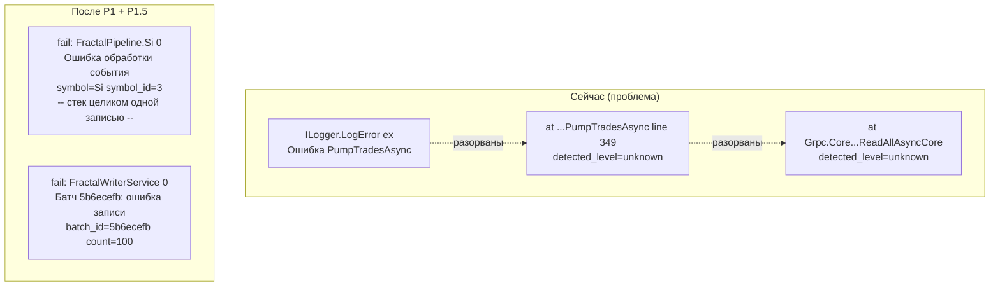
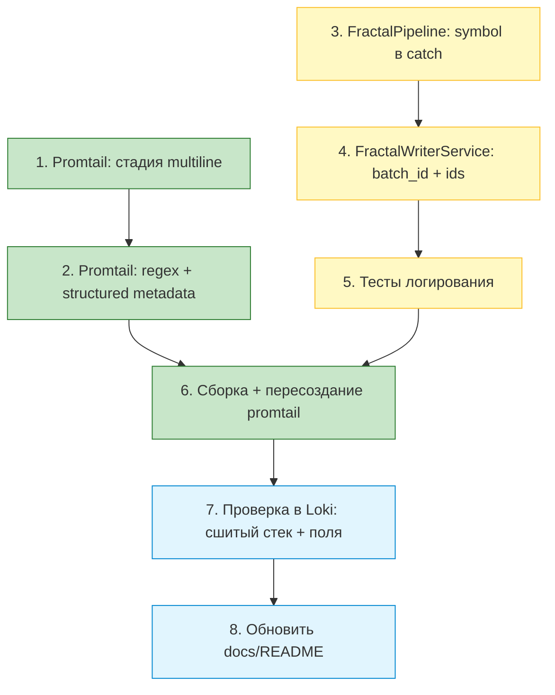

# План: улучшение разбора ошибок — multiline + symbol/batchId

> Проект: `d:/work/Artas2026`
> Цель: сделать логи Writer пригодными для разбора ошибок без полноценного
> trace-стека: (P1) сшивать многострочные исключения в Promtail, (P1.5) обогатить
> логи контекстом `symbol`/`symbolId`/`batchId`.

---

## 0. Обоснование (Почему именно это)

При разборе реальной ошибки обрыва gRPC-стрима (см. [`loki_writer.json`](../loki_writer.json:1))
выявлены три проблемы, из-за которых логи нечитаемы:

| Проблема | Следствие | Решение |
|---|---|---|
| Stack trace разбит на отдельные строки с `detected_level=unknown` | Исключение нельзя прочитать и скопировать целиком | **P1:** multiline-стадия в Promtail |
| В логе нет символа (`PumpTradesAsync` вызывается для всех инструментов) | Непонятно, какой инструмент упал | **P1.5:** `symbol` в ILogger scope |
| В логе нет `batchId` (он есть в `FractalWriterService`, но не в `WriteBatcher`) | Нельзя сопоставить лог с конкретным батчем | **P1.5:** `batchId` в scope батчера |

**Что НЕ делаем в этом плане:** traceId + Tempo (это P2 — отдельный план
[`add_opentelemetry_plan.md`](add_opentelemetry_plan.md:51)). TraceId без читаемых
stack trace и без привязки к символу даёт малый выигрыш — сначала эти два шага.

---

## 1. Архитектура (как есть → как станет)



---

## 2. P1 — multiline в Promtail

**Файл:** [`monitoring/promtail/config.yml`](../monitoring/promtail/config.yml:32)

Проблема: многострочные .NET-исключения прилетают как отдельные записи. Новый
первый лог от `ILogger` в формате `Microsoft.Extensions.Logging` начинается по
шаблону `^(trce|dbug|info|warn|fail|crit): `. Строки стека начинаются с
пробелов/`at `/регистра после `Exception` и должны **приклеиваться** к предыдущей.

**Что добавить:** стадию `multiline` **первой** в `pipeline_stages` (до `regex`
по `filename` и до парсинга уровня), чтобы она сшивала физические строки до всех
остальных стадий:

```yaml
pipeline_stages:
  # P1: сшиваем многострочные исключения в одну запись.
  # Новый лог начинается с уровня MS Logger ("info: ", "fail: " и т.п.).
  # Все прочие строки (at ..., Exception..., пустые) — продолжение предыдущей.
  - multiline:
      firstline: '^(trce|dbug|info|warn|fail|crit):\s'
      max_wait_time: 3s
      max_lines: 0                # без ограничения (стек бывает длинным)
```

**Важные ограничения и как они учтены:**

- Стадия `multiline` **обязана быть до** парсинга `lvl` — иначе regex уровня
  сработает на отдельных строках и `detected_level` снова словарётся.
- `firstline` — anchored к началу (`^`); строки стека (`   at ...`) начинаются с
  пробелов и не совпадут с шаблоном → склеятся.
- `max_wait_time: 3s` — чтобы последняя строка лога, за которой не пришла новая,
  всё равно ушла в Loki (иначе «залипнет» до следующей ошибки).
- Drop-стадия ASP.NET-шума ([`promtail/config.yml:92`](../monitoring/promtail/config.yml:92))
  работает по строке и остаётся после multiline — на сшитые исключения не влияет.

**Риск:** `.NET` может писать исключение в формате с префиксом без двоеточия
(например, `Unhandled exception...`). Такие случаи проверяются в верификации;
`firstline` при необходимости расширяется.

---

## 3. P1.5 — symbol/symbolId в ILogger scope

**Проблема:** в `FractalPipeline` логгер создаётся ровно один на инструмент
(`FractalPipeline.{symbolName}`, см.
[`InstrumentPipelineFactory.cs:50`](../src/Writer/ArtasWriter.Application/Producers/InstrumentPipelineFactory.cs:50)),
а сообщение содержит `symbol_id` **только** в ветке catch (см.
[`FractalPipeline.cs:68`](../src/Writer/ArtasWriter.Application/Pipeline/FractalPipeline.cs:68)).
Остальные логи пайплайна символа не содержат.

**Подходы:**

| Подход | Плюсы | Минусы |
|---|---|---|
| A. `ILogger.BeginScope` в `RunAsync` | **Выбран:** контекст во всех логах внутри цикла, включая будущие | Scope живёт весь цикл `RunAsync` |
| B. `LoggerMessage`-обёртка с полями | Явно, типизировано | Нужно переписать все вызовы |
| C. Поля в шаблон сообщения | Минимум кода | Нужно править каждый вызов вручную |

**Выбор: подход A (`BeginScope`), по решению пользователя.** В `RunAsync` весь
цикл чтения оборачиваем в `_logger.BeginScope(...)` с полями `symbol`, `symbol_id`.
Тогда **любой** лог внутри обработки (текущий catch и все будущие) автоматически
несёт контекст инструмента. Это устраняет главную боль «какой инструмент упал»:
`PumpTradesAsync`/`Process` вызываются для всех инструментов, а scope привязан к
конкретному пайплайну.

**Правки в [`FractalPipeline.cs`](../src/Writer/ArtasWriter.Application/Pipeline/FractalPipeline.cs:58):**

```csharp
// Добавить поле имени символа (для scope и читаемости логов).
private readonly string _symbolName;

// В конструкторе — принять symbolName (или вычислить из логгера).
// В RunAsync — обернуть цикл в scope:
public async Task RunAsync(ChannelReader<FinamEvent> reader, CancellationToken ct)
{
    using var scope = _logger.BeginScope(
        new Dictionary<string, object>
        {
            ["symbol"] = _symbolName,
            ["symbol_id"] = _symbolId,
        });

    await foreach (var evt in reader.ReadAllAsync(ct))
    {
        try { Process(evt); }
        catch (Exception ex)
        {
            _logger.LogError(ex,
                "Ошибка обработки события Finam: symbol={Symbol} symbol_id={SymbolId} event_type={EventType}",
                evt.Symbol, _symbolId, EventTypeOf(evt));
        }
    }
}
```

**Как scope попадёт в файл/Promtail:** `Microsoft.Extensions.Logging` при выводе в
консоль/файл через `Simple`/`Console`-провайдер **не рендерит** scope-поля в
строку по умолчанию (только категорию и уровень). Поэтому, чтобы `symbol`/`symbol_id`
оказались в строке лога для Promtail, дополнительно к scope:

1. **Добавляем поля в шаблон catch-лога** (см. код выше) — так они гарантированно
   попадут в текстовую строку для Promtail-regex.
2. Scope оставляем — он пригодится, если/когда включим OTel/структурный логгер
   (P2), где scope-поля экспортируются как атрибуты.

> Итог: **информационные/отладочные** логи пайплайна получают контекст через scope
> (для будущего структурного вывода), а **catch-лог ошибки** — ещё и явными полями
> в тексте, чтобы Promtail мог их извлечь уже сейчас.

**Расширенный формат catch-лога:**

```
fail: FractalPipeline.CNYRUBF[0]
      Ошибка обработки события Finam: symbol=CNYRUBF symbol_id=6 event_type=quote
```

**Промтail:** добавить `symbol` и `symbol_id` в `structured_metadata` рядом с
`logger`/`event_id` ([`promtail/config.yml:85`](../monitoring/promtail/config.yml:85)),
плюс regex-стадию извлечения полей `symbol=`/`symbol_id=`/`batch_id=` из строки.

---

## 4. P1.5 — batchId в логах батча

**Текущее состояние:** `batchId` генерируется в
[`FractalWriterService.cs:76`](../src/Writer/ArtasWriter.Infrastructure/Services/FractalWriterService.cs:76)
и присутствует в Debug/Error логах батча. **Но**:
- Debug-лог выводится, только если `LogLevel` позволяет (сейчас `Default=Information`);
- в catch-лог `batchId` есть — это хорошо;
- в периодической сводке ([`FractalWriterService.cs:147`](../src/Writer/ArtasWriter.Infrastructure/Services/FractalWriterService.cs:147))
  `batchId` отсутствует (там он не нужен — сводка агрегированная).

**Что улучшить:**
1. Имя параметра в шаблоне привести к единому `batch_id` (сейчас `{BatchId}` —
   Promtail regex ожидает `batch_id`, иначе structured metadata не заполнится).
   То же для `{Count}` → `count`, `{Elapsed}` → `elapsed` в Error-логе.
2. В catch-лог добавить список идентификаторов фракталов (`ids`) для отладки —
   как предложено в [`improve_writer_logging_plan.md:433`](improve_writer_logging_plan.md:433).
   Ограничить первые 10 (`ids=100,200,...`) чтобы не раздувать строку.
3. Обе ошибки (Debug и Error) **обернуть в `BeginScope`** с `batch_id` — по аналогии
   с `FractalPipeline`, чтобы контекст был доступен и структурно (P2).
   Текст лога при этом сохраняет `batch_id=` явно (для Promtail-regex).
4. `WriteBatcher` не логирует вовсе — при необходимости добавить Debug-лог
   «сформирован батч {Count}» (опционально, не обязательно для MVP).

---

## 5. Изменения в составе файлов

| Файл | Тип изменения | Что |
|---|---|---|
| [`monitoring/promtail/config.yml`](../monitoring/promtail/config.yml:32) | правка | стадия `multiline`; regex `symbol`/`symbol_id`/`batch_id`; structured metadata |
| [`src/Writer/.../FractalPipeline.cs`](../src/Writer/ArtasWriter.Application/Pipeline/FractalPipeline.cs:25) | правка | поле `_symbolName`; `BeginScope(symbol, symbol_id)` в `RunAsync`; catch-лог с полями |
| [`src/Writer/.../InstrumentPipelineFactory.cs`](../src/Writer/ArtasWriter.Application/Producers/InstrumentPipelineFactory.cs:84) | правка | передать `symbolName` в конструктор `FractalPipeline` |
| [`src/Writer/.../FractalWriterService.cs`](../src/Writer/ArtasWriter.Infrastructure/Services/FractalWriterService.cs:76) | правка | `{BatchId}` → `batch_id`; `ids` в catch; `BeginScope(batch_id)` |
| [`docs/loki_integration.md`](../docs/loki_integration.md:58) | правка | описать новые поля/метки и multiline |
| [`monitoring/README.md`](../monitoring/README.md:134) | правка | примеры LogQL с `symbol`/`batch_id` |
| `plans/improve_error_logging_plan.md` | новый | этот план |

---

## 6. Порядок реализации



### Шаг 1. Multiline в Promtail
- [ ] Добавить стадию `multiline` первой в `pipeline_stages` с `firstline: '^(trce|dbug|info|warn|fail|crit):\s'`
- [ ] Проверить, что `regex` парсинга уровня идёт **после** multiline

### Шаг 2. Regex + structured metadata
- [ ] Добавить regex-стадию извлечения `symbol=`, `symbol_id=`, `batch_id=` из строки
- [ ] Вынести `symbol`, `symbol_id`, `batch_id` в `structured_metadata`
- [ ] Убедиться, что существующие метки (`job`/`app`/`svc`/`lvl`) не затронуты

### Шаг 3. FractalPipeline
- [ ] Добавить поле `_symbolName` (параметр конструктора) в [`FractalPipeline`](../src/Writer/ArtasWriter.Application/Pipeline/FractalPipeline.cs:25)
- [ ] Обернуть цикл в `RunAsync` в `_logger.BeginScope(symbol, symbol_id)`
- [ ] В catch-лог [`RunAsync`](../src/Writer/ArtasWriter.Application/Pipeline/FractalPipeline.cs:68) добавить `symbol=`, `event_type=`
- [ ] Передать `symbolName` из [`InstrumentPipelineFactory.CreateAsync`](../src/Writer/ArtasWriter.Application/Producers/InstrumentPipelineFactory.cs:84)
- [ ] Не ломать существующий вызов конструктора в тестах (обновить при необходимости)

### Шаг 4. FractalWriterService
- [ ] Привести имена в шаблонах к `batch_id`/`count`/`elapsed` (Promtail-regex)
- [ ] Обернуть логи батча в `BeginScope(batch_id)`
- [ ] В catch-лог добавить список `ids` неудачных фракталов (ограничить, напр. первые 10)
- [ ] Проверить, что сводка `AccumulateSummary` не задета

### Шаг 5. Тесты
- [ ] Проверить, что тесты `FractalPipelineTests`/`FractalWriterServiceTests` проходят без правок логики
- [ ] При наличии «строгих» проверок текста лога — обновить ожидания

### Шаг 6. Верификация инфраструктуры
- [ ] `docker compose up -d --force-recreate promtail`
- [ ] Убедиться, что Promtail стартовал без ошибок парсинга стадий

### Шаг 7. Проверка в Loki
- [ ] Сгенерировать ошибку (симуляция/обрыв) и убедиться, что стек — **одной** записью
- [ ] `curl` по `label/symbol/values` и запрос с `| json`/`| logfmt` по `symbol_id`/`batch_id`
- [ ] Проверить `detected_level` у сшитого стека (должен быть `fail`, не `unknown`)

### Шаг 8. Документация
- [ ] Обновить [`docs/loki_integration.md`](../docs/loki_integration.md:58) (поля `symbol`/`batch_id`, multiline)
- [ ] Обновить [`monitoring/README.md`](../monitoring/README.md:166) (примеры LogQL)

---

## 7. Риски

| Риск | Вероятность | Смягчение |
|---|---|---|
| `firstline` не совпадает с реальным форматом — стек не сшивается | 🟡 средняя | Проверить на реальном логе; расширить шаблон (`Exception` без префикса) |
| Multiline «съест» первую строку лога при потере предыдущей | 🟢 низкая | `max_wait_time: 3s` + проверка в Loki |
| Promtail не перечitaet конфиг | 🟢 низкая | Mount каталогом уже применён; `--force-recreate` |
| `batch_id` в structured metadata конфликтует с индексной меткой | 🟢 низкая | Оставляем в metadata (не в `labels:`) |
| Изменение шаблонов логов ломает существующие тесты | 🟡 средняя | Шаг 5 — прогон тестов до верификации |

---

## 8. Критерии готовности

1. [ ] Многострочное исключение в Loki — **одна** запись с `detected_level=fail`
2. [ ] В логе ошибки пайплайна присутствуют `symbol` и `symbol_id`
3. [ ] В логе ошибки батча присутствует `batch_id` (и опц. `ids`)
4. [ ] `structured_metadata` содержит `symbol`/`symbol_id`/`batch_id`
5. [ ] Существующие метки (`job`/`app`/`svc`/`lvl`/`symbol`) и drop-стадия ASP.NET не сломаны
6. [ ] Сборка `ArtasWriter.slnx` — 0 ошибок; тесты проходят
7. [ ] Документация обновлена

---

## 9. Что дальше (не в этом плане)

- **P2:** traceId + Tempo — по [`add_opentelemetry_plan.md`](add_opentelemetry_plan.md:51).
- **P3 (опц.):** Grafana + алерты на `lvl=~"fail|crit"` и `writer.batch.errors`.
