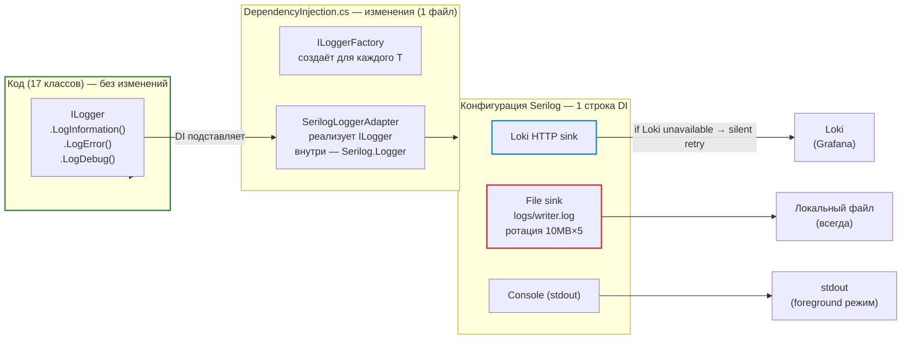
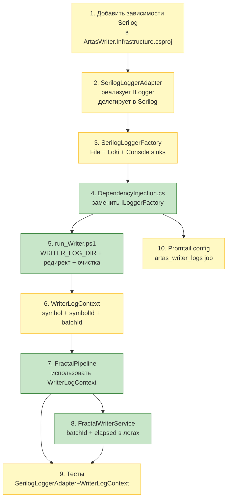

# План: улучшение логирования ArtasWriter — Serilog + Loki + File (fallback)

> Проект: `C#/src/Writer/ArtasWriter.Worker`
> Все пути ниже — относительно `d:/work/Artas2026/C#/src/Writer`

---

## Ключевое архитектурное решение: Loki — НЕ единственное хранилище

**Только Loki = антипаттерн.** Если Loki упал или перезагружается, все логи теряются. Это критично на старте — если Writer не может запуститься, а Loki ещё не поднят, вы не увидите причину.

**Решение: два синка (sinks) в Serilog**

| Синк | Роль | Куда |
|---|---|---|
| **File** (primary) | основное хранилище, ротация 10MB × 5 | `logs/writer.log` |
| **Loki HTTP** (replica) | централизованный сбор, поиск, алерты | `http://localhost:3100/loki/api/v1/push` |

> Локальный файл — **всегда**. Loki — **поверх**. Если Loki недоступен — ничего не ломается, логи на диске.

---

## Архитектура

### Схема потока логов



### Ключевые решения

1. **Код не трогаем** — все 17 классов остаются с `ILogger<T>`. Ни один конструктор не меняется.
2. **Меняется только DI** — регистрируется фабрика, которая для любого `ILogger<T>` создаёт `SerilogLoggerAdapter<T>`.
3. **Адаптер** — тонкая обёртка (~60 строк), реализует `ILogger<T>` делегированием в Serilog.
4. **Без Serilog не стартуем** — если Loki недоступен, Writer продолжает писать в файл. Если и файл недоступен — console.

---

## 1. Текущее состояние (анализ)

### 1.1 Как работает логирование сейчас

`Microsoft.Extensions.Logging.ILogger<T>` — DI-совместимый интерфейс, инжектится через конструктор.

```csharp
// 17 классов используют этот паттерн
private readonly ILogger<FractalWriterService> _logger;

public FractalWriterService(
    IFractalRepository repository,
    ILogger<FractalWriterService> logger,  // ← DI сам создаёт
    ...)
```

**Уровни:**

| Уровень | Применение |
|---|---|
| `LogInformation` | старт/стоп, создание конвейеров, подписка на стримы |
| `LogWarning` | симуляция, символ не найден, обрыв стрима |
| `LogError` | ошибки записи батча, публикации событий |
| `LogDebug` | `FractalWriterService` — кол-во записанных фракталов (1 место) |

**Конфигурация** (`appsettings.json`):

```json
"Logging": {
    "LogLevel": { "Default": "Information" }
}
```

### 1.2 🚩 Проблемы

1. **Логи теряются в background** — `run_Writer.ps1` не перенаправляет stdout/stderr
2. **Нет структурированных логов** — нельзя фильтровать по `symbol`, `batchId` в Grafana
3. **Нет централизованного сбора** — Writer не подключён к Loki
4. **Нет fallback** — если Loki недоступен, логи никуда не пишутся (сейчас и так не пишутся)

---

## 2. Состав изменений

### 2.1 Новые зависимости (csproj)

**Файл:** `ArtasWriter.Infrastructure/ArtasWriter.Infrastructure.csproj` или новый модуль `ArtasWriter.Logging`

```xml
<ItemGroup>
  <!-- Ядро Serilog -->
  <PackageReference Include="Serilog" Version="4.2.0" />
  <!-- Асинхронная отгрузка (не блокирует основной поток) -->
  <PackageReference Include="Serilog.Sinks.Async" Version="2.1.0" />
  <!-- File + ротация -->
  <PackageReference Include="Serilog.Sinks.RollingFile" Version="2.0.0" />
  <!-- Loki HTTP -->
  <PackageReference Include="Serilog.Sinks.Loki" Version="1.2.0" />
  <!-- JSON-форматер (loki принимает json) -->
  <PackageReference Include="Serilog.Format.Json" Version="1.0.0" />
</ItemGroup>
```

### 2.2 Основной класс — `SerilogLoggerAdapter.cs`

**Новый файл:** `ArtasWriter.Infrastructure/Services/SerilogLoggerAdapter.cs`

```csharp
namespace ArtasWriter.Infrastructure.Services;

/// <summary>
/// Адаптер: реализует Microsoft.Extensions.Logging.ILogger{T}
/// через Serilog. Позволяет не менять существующий код,
/// а заменить реализацию на уровне DI.
/// </summary>
public sealed class SerilogLoggerAdapter<T> : ILogger<T>
{
    private readonly Logger _logger;
    private readonly string _category;

    public SerilogLoggerAdapter(Logger logger, string category)
    {
        _logger = logger;
        _category = category;
    }

    public void LogInformation(string message, object... args)
        => _logger.Info(message, args);

    public void LogWarning(string message, object... args)
        => _logger.Warning(message, args);

    public void LogError(string message, object... args)
        => _logger.Error(message, args);

    public void LogError(Exception ex, string message, object... args)
        => _logger.Error(ex, message, args);

    public void LogDebug(string message, object... args)
        => _logger.Debug(message, args);

    // Остальные методы ILogger{T}: LogTrace, LogFatal и т.д.
}
```

**Важно:** `ILogger<T>` использует именованные плейсхолдеры `{Count}`. Serilog по умолчанию использует позиционные `{}`. Нужно проверить, проходит ли строку как есть — если Serilog игнорирует имя в `{Count}`, оставляем как есть; если падает — замена на `{}` в рантайме.

### 2.3 Фабрика логгеров — `SerilogLoggerFactory.cs`

**Новый файл:** `ArtasWriter.Infrastructure/Services/SerilogLoggerFactory.cs`

```csharp
namespace ArtasWriter.Infrastructure.Services;

/// <summary>
/// Фабрика, создающая SerilogLoggerAdapter{T} для любого ILogger{T}.
/// Регистрируется в DI вместо стандартной ILoggerFactory.
/// </summary>
public sealed class SerilogLoggerFactory : ILoggerFactory
{
    private readonly Logger _root;

    public SerilogLoggerFactory()
    {
        _root = new Logger(ConfigureLogging());
    }

    public ILogger<T> CreateLogger<T>()
        => new SerilogLoggerAdapter<T>(_root, typeof(T).Name);

    private static LoggerConfiguration ConfigureLogging()
    {
        var logDir = Environment.GetEnvironmentVariable("WRITER_LOG_DIR") ?? "logs";

        return new LoggerConfiguration()
            // 1. File sink — всегда (fallback)
            .WriteTo(new RollingFileSink(
                Path.Combine(logDir, "writer.log"),
                maxSize: 10 * 1024 * 1024,    // 10 MB
                maxFiles: 5,
                formatter: new JsonFormatter()))   // structured JSON
            // 2. Loki HTTP sink — если доступен
            .WriteTo(new LokiSink(
                url: "http://localhost:3100/loki/api/v1/push",
                labels: { { "app", "artas-writer" }, { "service", "writer-worker" } },
                batchSize: 100,
                retries: 3))
            // 3. Console — только если есть терминал
            .WriteTo(new ConsoleSink())
            // Минимальный уровень — Info; Debug только для Infrastructure
            .MinimumLevel(Level.Information)
            .MinimumLevel(Level.Debug, "ArtasWriter.Infrastructure.*")
            .MinimumLevel(Level.Warning, "ArtasWriter.FinamApi.*");
    }
}
```

### 2.4 DI — `DependencyInjection.cs`

**Файл:** `ArtasWriter.Worker/DependencyInjection.cs`

Добавить регистрацию фабрики **до** всех остальных сервисов:

```csharp
// Стандартная фабрика ILoggerFactory — заменяем на Serilog
services.AddSingleton<ILoggerFactory, SerilogLoggerFactory>();
```

**Всё.** После этой строки DI-контейнер при запросе `ILogger<FractalWriterService>` создаст `SerilogLoggerAdapter<FractalWriterService>`, который пишет через Serilog. **Ни один из 17 классов не требует изменений.**

### 2.5 `run_Writer.ps1` — перенаправление логов (fallback + очистка)

Переменная окружения `WRITER_LOG_DIR` указывает Serilog, куда писать файл. В скрипте:

```powershell
# Создаём директорию логов при старте
$logDir = Join-Path $ScriptDir "logs"
New-Item -ItemType Directory -Force $logDir | Out-Null

# Устанавливаем переменную для Serilog
$env:WRITER_LOG_DIR = $logDir

# Очистка логов старше 7 дней
Get-ChildItem $logDir -Filter "*.log" | Where-Object {
    $_.LastWriteTime -lt (Now - 7 * 24h)
} | Remove-Item -Force

# Перенаправление stdout/stderr — дополнительный fallback
# (даже если Serilog не настроен, логи не потеряются)
$stdoutLog = Join-Path $logDir "writer.stdout.log"
$stderrLog = Join-Path $logDir "writer.stderr.log"

Start-Process -FilePath $dotnet `
    -ArgumentList $dotnetArgs `
    -WorkingDirectory $ScriptDir `
    -WindowStyle Hidden `
    -RedirectStdout $stdoutLog `
    -RedirectStderr $stderrLog `
    -PassThru
```

**Два уровня fallback:**
- **Serilog → File** — основной канал (structured JSON)
- **stdout/stderr redirect** — если Serilog по какой-то причине не смог открыть файл

### 2.6 Promtail — сбор логов Writer

**Файл:** `monitoring/promtail/config.yml`

```yaml
- job_name: artas_writer_logs
  static_configs:
    - targets:
        - localhost
      labels:
        job: artas_writer
        app: artas_writer
        __path__: /path/to/artas/logs/writer.log
```

Обратите внимание: **Promtail теперь вторичен**. Основная доставка в Loki — через HTTP-синк напрямую из Serilog. Promtail нужен только если:
- Serilog по какой-то причине не может отправить в Loki (например, проблемы с SSL)
- Хотите дублирование

### 2.7 Structured контекст (MDC) — `WriterLogContext.cs`

**Новый файл:** `ArtasWriter.Infrastructure/Services/WriterLogContext.cs`

```csharp
namespace ArtasWriter.Infrastructure.Services;

/// <summary>
/// Вспомогательный класс для добавления диагностического контекста.
/// Использовать в ключевых точках (FractalPipeline, FractalWriterService).
/// Не заменяет ILogger<T>, а расширяет его.
/// </summary>
public sealed class WriterLogContext : AutoCloseable
{
    /// <summary>
    /// Установить контекст для текущего потока.
    /// Все последующие логи в этом потоке будут содержать поля symbol, symbolId.
    /// </summary>
    public WriterLogContext(string symbol, int symbolId)
    {
        LogContext.Push(() => ("symbol", symbol));
        LogContext.Push(() => ("symbolId", string(symbolId)));
    }

    public override void Close()
    {
        LogContext.Pop(); // symbolId
        LogContext.Pop(); // symbol
    }
}
```

Использование в `FractalPipeline.Process`:

```csharp
public void Process(FinamEvent evt)
{
    try (var ctx = new WriterLogContext(evt.Symbol, _symbolId))
    {
        // Все логи LogInformation/LogError внутри try-with-resources
        // автоматически содержат поля "symbol" и "symbolId"
        if (evt.Quote is { } quote)
        {
            ProcessedTicks++;
            var fractal = _tickService.OnQuote(quote);
            if (fractal is not null)
            {
                WrittenFractals++;
                _writerChannel.TryWrite(new FractalRecord(_symbolId, fractal));
            }
        }
    }
}
```

---

## 3. Что НЕ делаем (и почему)

| ❌ Не делаем | Почему |
|---|---|
| **Не заменяем ILogger<T> на Logger** в 17 классах | Риск регрессии: 17 конструкторов, 5 тестовых файлов, формат плейсхолдеров |
| **Не пишем Loki-аппендер вручную** | Serilog.Sinks.Loki уже есть и поддерживается |
| **Не убираем файловый синк** | Если Loki недоступен — теряем критичные логи при старте |
| **Не используем только Promtail** | Задержка 5-30 секунд, нет structured JSON, Promtail может не увидеть файл в Docker |

---

## 4. Порядок реализации



### Шаг 1. Зависимости

- [ ] Добавить `Serilog`, `Serilog.Sinks.Async`, `Serilog.Sinks.RollingFile`, `Serilog.Sinks.Loki`, `Serilog.Format.Json` в `ArtasWriter.Infrastructure.csproj`
- [ ] Проверить совместимость с .NET 10

### Шаг 2. Адаптер

- [ ] Создать `SerilogLoggerAdapter<T> : ILogger<T>` — ~60 строк
- [ ] Сопоставить уровни: `LogInformation → Info`, `LogWarning → Warning`, `LogError → Error`, `LogDebug → Debug`
- [ ] Проверить передачу `Exception`: `ILogger<T>.LogError(ex, msg, args)` → `Logger.Error(ex, msg, args)`

### Шаг 3. Фабрика

- [ ] Создать `SerilogLoggerFactory : ILoggerFactory`
- [ ] `RollingFileSink`: `logs/writer.log`, 10MB × 5, `JsonFormatter`
- [ ] `LokiSink`: `http://localhost:3100/loki/api/v1/push`, labels = `{app: artas-writer}`
- [ ] `ConsoleSink`: только `stdout` (без stderr — он для ошибок)
- [ ] Уровни: `Default=Info`, `ArtasWriter.Infrastructure.*=Debug`, `ArtasWriter.FinamApi.*=Warning`

### Шаг 4. DependencyInjection

- [ ] Добавить `services.AddSingleton<ILoggerFactory, SerilogLoggerFactory>()`
- [ ] Проверить порядок: фабрика должна быть зарегистрирована ДО всех, кто её использует
- [ ] Удалить или оставить `Logging.LogLevel` в `appsettings.json` (теперь не нужно — конфигурация в коде)

### Шаг 5. run_Writer.ps1

- [ ] Создать `logs/` директорию при старте
- [ ] Установить `env:WRITER_LOG_DIR`
- [ ] `RedirectStdout` + `RedirectStderr` (fallback)
- [ ] Очистка логов старше 7 дней
- [ ] Проверить наличие логов при `-Foreground` (console видно)

### Шаг 6. WriterLogContext

- [ ] Создать `WriterLogContext : AutoCloseable`
- [ ] `LogContext.Push(() => ("symbol", symbol))`
- [ ] Использовать в `FractalPipeline.Process()`

### Шаг 7. FractalPipeline

- [ ] Обернуть `Process()` в `try (var ctx = new WriterLogContext(...))`
- [ ] Все логи внутри автоматически содержат `symbol`, `symbolId`

### Шаг 8. FractalWriterService

- [ ] Добавить `batchId` (UUID первых 8 символов) при каждом вызове `FlushAsync`
- [ ] Добавить `elapsed` (ms) — время выполнения `SaveBatchAsync`
- [ ] `LogDebug` — `batchId`, `inserted/total`, `elapsed`, `ids[]`
- [ ] `LogError` — `batchId`, `total`, `elapsed`, `ids[]` (какие фракталы не записались)

### Шаг 9. Тесты

- [ ] `SerilogLoggerAdapterTests` — проверить все уровни логирования
- [ ] `WriterLogContextTests` — проверить, что контекст добавляется и очищается
- [ ] Smoke: старые тесты не падают (DI не сломан)

### Шаг 10. Promtail

- [ ] Добавить job `artas_writer_logs` в `promtail/config.yml`
- [ ] Обеспечить mount `C#/src/Writer/logs/` в контейнер Promtail (если нужно)

---

## 5. Риски

| Риск | Вероятность | Смягчение |
|---|---|---|
| **Serilog.Sinks.Loki несовместим с .NET 10** | 🟡 средняя | Использовать Promtail как fallback; написать свой Loki-аппендер через простой HTTP POST |
| **ILogger<T> не даёт создать generic-фабрику** | 🟢 низкая | Регистрировать конкретные типы в DI вместо generic |
| **Формат плейсхолдеров {Count} vs {}** | 🟡 средняя | Написать прослойку, заменяющую `{Name}` на `{}` в runtime, или проверить, что Serilog игнорирует имя |
| **Loki недоступен на старте** | 🟢 низкая | Serilog.Sinks.Loki имеет встроенные retry + игнорирует ошибки отправки; файловый синк работает всегда |

---

## 6. Критерии готовности

1. [ ] **Zero regressions** — все существующие тесты проходят без изменений в тестовых классах
2. [ ] **Background: файл с логами** — после `run_Writer.ps1 -Background` в `logs/writer.log` пишутся JSON-строки
3. [ ] **Foreground: консоль + файл** — при `-Foreground` логи видны в терминале и пишутся в файл
4. [ ] **Loki: логи в Grafana** — в Grafana дашборде видны записи из Writer
5. [ ] **Structured JSON** — каждая строка файла — валидный JSON с полями `@timestamp`, `@level`, `message`, `symbol`
6. [ ] **Ротация** — файл не превышает 10MB, старые файлы удаляются
7. [ ] **Контекст** — в логах FractalPipeline присутствуют `symbol` и `symbolId`
8. [ ] **Диагностика записи** — при ошибке `FlushAsync` в логе есть `batchId`, `ids[]`, `elapsed`
9. [ ] **Loki недоступен** — Writer работает, логи в файле, ошибки отправки в Loki не падают
10. [ ] **Очистка** — логи старше 7 дней удаляются скриптом