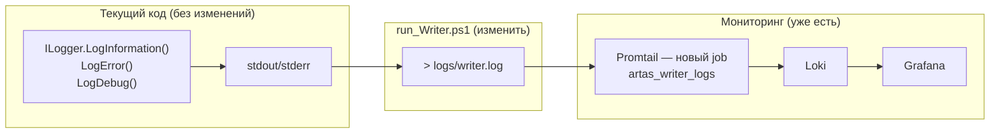

# Анализ: Serilog vs Microsoft.Extensions.Logging для Loki

## Контекст

В проекте Writer все классы используют `Microsoft.Extensions.Logging.ILogger<T>`, инжектируемый через DI:

```csharp
// 17 классов используют этот паттерн
public sealed class FractalWriterService : IFractalWriter
{
    private readonly ILogger<FractalWriterService> _logger;

    public FractalWriterService(
        IFractalRepository repository,
        IOptions<WriterOptions> options,
        ILogger<FractalWriterService> logger,  // ← DI
        ...)
    { ... _logger = logger; ... }

    public async Task<int> FlushAsync(...)
    {
        _logger.LogDebug("Записано фракталов в PG: {Count}", inserted);
        _logger.LogError(ex, "Ошибка записи батча фракталов ({Count})", records.Count);
    }
}
```

## Вариант 1: Serilog (новая библиотека)

### Плюсы

| | |
|---|---|
| **Loki-синк** | есть готовый [serilog-loki](https://github.com/JvHek/serilog-loki) — HTTP-аппендер в Loki |
| **Structured JSON** | из коробки: каждый лог — JSON-объект с полями `@timestamp`, `@level`, `message` |
| **LoggerContext** | встроенный MDC: `LogContext.Push(() => ("symbol", "Si"))` — все последующие логи содержат это поле |
| **Ротация файлов** | `FileSink` с ротацией по размеру/времени |
| **Несколько синков** | одновременно в файл, в консоль и в Loki |
| **Производительность** | асинхронная отгрузка, буферизация |

### Минусы

| | |
|---|---|
| **❌ Несовместимость с DI-фреймворком** | Serilog не реализует `Microsoft.Extensions.Logging.ILogger<T>`. Его нельзя просто подставить вместо `ILogger<FractalWriterService>`. |
| **❌ Придётся менять везде конструкторы** | все 17 классов нужно либо переписать на `Logger(SerilogLogger)`, либо писать адаптер |
| **❌ Адаптер = оверхед** | `ILogger<T>` типизирован по классу-владельцу. Serilog.Logs глобальный. Связывать их — дополнительная сложность. |
| **❌ Новая зависимость** | `serilog`, `serilog-loki`, их транзитивные зависимости |

## Вариант 2: Microsoft.Extensions.Logging + Promtail (нулевые изменения в коде)

### Как это работает

```
ArtasWriter → stdout/stderr (как сейчас)
                  │
                  ▼
        run_Writer.ps1: > logs/writer.stdout.log
                  │
                  ▼
        Promtail (уже развёрнут) → Loki
```

### Что нужно сделать

1. **`run_Writer.ps1`** — добавить редирект stdout в файл (см. план)
2. **Promtail config** — добавить job на `logs/writer*.log`
3. **Ни одной строки кода в C# менять не нужно**

### Плюсы

| | |
|---|---|
| ✅ **Zero code changes** | все 17 классов остаются без изменений |
| ✅ **Не добавляем зависимостей** | ни Serilog, ни его Loki-синка |
| ✅ **Promtail уже работает** | собирает Python-логи, просто добавляем ещё один job |
| ✅ **Меньше кода для ошибок** | если Loki недоступен — логи на диске, Promtail дотянет при восстановлении |
| ✅ **Promtail умеет парсить** | можно грепать произвольный текст, не обязательно JSON |
| ✅ **Масштабируется** | не нужно переписывать код, если позже захотим Serilog |

### Минусы

| | |
|---|---|
| ⚠️ **Логи не structured** | Promtail может парсить, но native JSON точнее |
| ⚠️ **Нет метаинформации** | нет поля `symbol`, `symbolId` в каждом логе |
| ⚠️ **Файловая задержка** | Promtail читает файл не мгновенно (но для логов это норма) |

## Вариант 3: Microsoft.Extensions.Logging → Serilog через адаптер (мост)

Создать класс, который реализует `ILogger<T>` и внутри делегирует Serilog:

```csharp
public sealed class SerilogLoggerAdapter<T> : ILogger<T>
{
    private readonly Logger _serilog;  // Serilog-логгер с Loki-синком

    public void LogInformation(string message, object... args)
    {
        _serilog.Info(message, args);
    }
    public void LogError(Exception ex, string message, object... args)
    {
        _serilog.Error(ex, message, args);
    }
    // ...
}
```

В DI зарегистрировать фабрику, которая для любого `ILogger<T>` создаёт `SerilogLoggerAdapter<T>`.

### Плюсы

| | |
|---|---|
| ✅ **Минимальные изменения в существующем коде** | только DI-регистрация |
| ✅ **Structured JSON + Loki** из коробки |
| ✅ **MDC** — можно добавить контекст (symbol, symbolId) |
| ✅ **Несколько синков** консоль + файл + Loki |

### Минусы

| | |
|---|---|
| ⚠️ **Адаптер нужно написать** | ~100 строк кода |
| ⚠️ **Serilog + Loki-синк** | ~5 новых зависимостей в `csproj` |
| ⚠️ **ILogger<T> не входит в стандартный набор** | Serilog-адаптер будет уникальным для этого проекта |

## Сравнительная таблица

| Критерий | Serilog | MS Logging + Promtail | Адаптер (MS→Serilog) |
|---|---|---|---|
| **Изменения в 17 классах** | ❌ нужно менять DI | ✅ 0 изменений | ✅ 0 изменений (только DI) |
| **Structured JSON** | ✅ из коробки | ❌ нет (Promtail парсит) | ✅ через Serilog |
| **Контекст (symbol, symbolId)** | ✅ LogContext | ❌ только Promtail-экстракция | ✅ LogContext |
| **Loki-доставка** | ✅ прямой HTTP push | ✅ через Promtail | ✅ прямой push |
| **Новые зависимости** | ❌ serilog + loki-sink | ✅ 0 | ❌ serilog + loki-sink |
| **Сложность** | ❌ высокая | ✅ низкая | 🟡 средняя |
| **Риск поломки DI** | ❌ высокий | ✅ нет | 🟡 низкий |

## Рекомендация

### Сейчас: Вариант 2 (MS Logging + Promtail)

Сделать **минимальными изменениями** — только `run_Writer.ps1` + Promtail config:



**Что получаем:**
- Все логи Writer попадают в Loki через существующий Promtail
- **Zero changes to C# code**
- Логи не теряются (файл на диске = fallback)

### В будущем: Вариант 3 (адаптер MS → Serilog)

Когда понадобится:
- structured поля (symbol, symbolId, batchId) — для фильтрации в Grafana
- MDC-контекст
- метрики времени

Тогда добавьте адаптер `SerilogLoggerAdapter<T> : ILogger<T>` — и все 17 классов **автоматически** начнут писать structured JSON + Loki без единой правки в их коде.

### Что НЕ стоит делать

❌ **Не пишите Loki-аппендер вручную.** Serilog уже сделал это за вас.

❌ **Не заменяйте ILogger<T> на Logger везде.** 17 файлов × регрессионные тесты — неоправданный риск.

❌ **Не добавляйте Serilog, пока не нужен structured контекст.** Promtail + файл — достаточное решение на текущий момент.