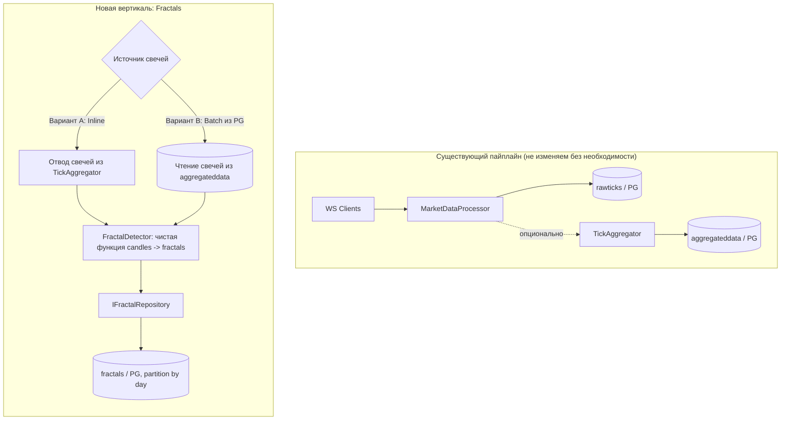
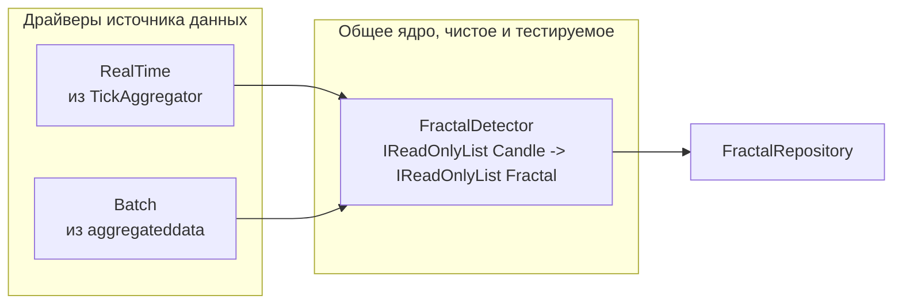

# План миграции: Python-проект вычисления фракталов → C# (MarketDataCollector)

**Дата:** 08.10.2026
**Статус:** Черновик (каркас). Детали алгоритма уточняются.
**Основание:** Запрос на перенос существующего Python-проекта (сбор тиков + вычисление фракталов + запись в PostgreSQL) на C# с переиспользованием наработок MarketDataCollector.

---

## 1. Цель и принципы

### Цель
Перенести логику вычисления фракталов с Python на C#, не дублируя уже отлаженную инфраструктуру сбора и записи данных в PostgreSQL.

### Принципы
1. **Максимальное переиспользование.** Не переносить «в лоб» сбор тиков и запись в PG — в проекте это уже реализовано и профилировано (async-writer, backpressure, partitioning, dedup).
2. **Вертикальный срез (Vertical Slice).** Новая функциональность оформляется как независимый bounded-контекст `Fractals`, не смешиваясь с существующим пайплайном.
3. **Чистое ядро детекции.** Алгоритм фракталов выделяется в чистую, тестируемую функцию без side-effects и I/O.
4. **Идемпотентность.** Пересчёт фракталов по истории должен быть повторяемым без дублей (защита уникальным индексом + `ON CONFLICT DO NOTHING`).
5. **Соответствие правилам проекта.** Интерфейсы в `Core/Application`, реализации в `Infrastructure`; `async/await` до самого низа; `ArgumentNullException.ThrowIfNull()`; `ILogger<T>`; DTO через `record`, доменные модели через `class`; один файл — одна ответственность.
6. **Верификация против Python-эталона.** Корректность переноса подтверждается golden-тестами «те же входные свечи → те же выходные фракталы».

---

## 2. Что уже есть в проекте (точки переиспользования)

| Слой | Артефакт | Роль для фракталов |
|---|---|---|
| Domain | [`RawTick`](../src/MarketDataCollector.Domain/Entities/RawTick.cs:11) | Образец immutable-сущности для `Fractal` |
| Domain | [`AggregatedData`](../src/MarketDataCollector.Domain/Entities/AggregatedData.cs:11) | Образец OHLCV-сущности (источник свечей для фракталов) |
| Domain | [`DecimalHelper`](../src/MarketDataCollector.Domain/Utilities/DecimalHelper.cs:1) | Усечение `decimal` перед записью в БД |
| Core | [`ITickAggregator`](../src/MarketDataCollector.Core/Interfaces/ITickAggregator.cs:1) | Образец интерфейса агрегатора |
| Core | [`IAggregatedDataRepository`](../src/MarketDataCollector.Core/Interfaces/IAggregatedDataRepository.cs:1) | Образец интерфейса репозитория |
| Application | [`TickAggregator`](../src/MarketDataCollector.Application/Services/TickAggregator.cs:41) | **Главный образец**: Channel → in-memory накопление → flush по таймеру |
| Infrastructure | [`MarketDataDbContext`](../src/MarketDataCollector.Infrastructure/Data/MarketDataDbContext.cs:16) | Fluent-маппинг, добавить `DbSet<Fractal>` |
| Infrastructure | [`AggregatedDataRepository`](../src/MarketDataCollector.Infrastructure/Repositories/AggregatedDataRepository.cs:14) | Образец EF-репозитория |
| Infrastructure | [`RawTickRepository.BulkInsertFastAsync`](../src/MarketDataCollector.Infrastructure/Repositories/RawTickRepository.cs:476) | Образец быстрой bulk-вставки (`unnest` + `ON CONFLICT`) |
| Infrastructure | [`PartitionMaintenanceService`](../src/MarketDataCollector.Infrastructure/Services/PartitionMaintenanceService.cs) | Образец обслуживания партиций |
| Worker | [`DependencyInjection.AddAggregation()`](../src/MarketDataCollector.Workers/MarketDataCollector.Worker/DependencyInjection.cs:103) | Образец регистрации DI-вертикали |
| DB | [`docker/init-partitioned.sql`](../docker/init-partitioned.sql:21) | Образец DDL с партиционированием по дню |

> **Важно:** в проекте на текущий момент **нет** вычисления фракталов — это полностью новый bounded-контекст.

---

## 3. Целевая архитектура (схема)

### Разделение «ядро / драйверы»

---

## 4. Сравнение вариантов источника данных

| Критерий | Вариант A: Inline (hook из TickAggregator) | Вариант B: Batch из PG |
|---|---|---|
| Латентность | Секунды (real-time) | Минуты / часы (offline) |
| Нагрузка на hot-path | Риск: детекция в процессе записи тиков | Нулевая |
| Сложность | Нужен callback/событие из TickAggregator | Отдельный hosted service читает свечи |
| Пересчёт истории | Сложно | Тривиально (идемпотентно) |
| Backpressure | Наследуется от каналов | Управляется размером батча |

**Рекомендация:** стартовать с **Варианта B** (batch). Он изолирован, идемпотентен, легко верифицируется против Python-эталона. Real-time (Вариант A) добавить после стабилизации алгоритма, переиспользуя то же чистое ядро детекции.

---

## 5. Декомпозиция по слоям

### 5.1 Domain
- `Fractal` (class) — сущность фрактала.
- `FractalType` (enum) — тип фрактала (например, Up/Down).
- Возможные поля (уточняются): `Id`, `Ticker`, `Exchange`, `Interval`, `FractalType`, `Level` (N баров), `Price`, `BarsBack`, `StartTime`, `ConfirmTime`, `DetectedAt`.
- `ConfirmTime` — время подтверждения фрактала (задержка N свечей), чтобы избежать look-ahead bias.

### 5.2 Core (интерфейсы)
- `IFractalDetector` — контракт драйвера (Start/Stop + приём свечей).
- `IFractalRepository` — контракт персистентности.
- `FractalDetectorOptions` — параметры (интервал, `N`, лимиты канала, батч, таймер flush).

### 5.3 Application
- `FractalDetector` — чистая функция детекции `IReadOnlyList<Candle> -> IReadOnlyList<Fractal>`.
- Batch-драйвер `FractalBackfillService` — чтение завершённых свечей из `aggregateddata`, вызов ядра, запись результата.
- In-memory окно последних `2N+1` свечей по ключу `(Ticker, Exchange, Interval)`.
- Метрики в `MarketDataTelemetry` по образцу существующих.

### 5.4 Infrastructure
- `DbSet<Fractal>` + Fluent-маппинг в `MarketDataDbContext` (по образцу `AggregatedData`).
- EF-миграция на создание таблицы `fractals`.
- Партиционирование по дню (`PARTITION BY RANGE`) — по образцу `init-partitioned.sql`.
- Уникальный индекс `(Ticker, Exchange, Interval, FractalType, StartTime)` — защита от дублей.
- `FractalRepository` с bulk-insert (`unnest` + `ON CONFLICT DO NOTHING`) — по образцу `RawTickRepository.BulkInsertFastAsync`.
- Дополнить `PartitionMaintenanceService` обслуживанием партиций `fractals`.

### 5.5 Worker
- `AddFractals()` в `DependencyInjection` по образцу `AddAggregation()`.
- Секция `FractalDetector` в `appsettings.*.json`.
- Регистрация `FractalBackfillService` как `IHostedService` (Вариант B).

---

## 6. Корректность переноса алгоритма

1. **Чистая функция детекции** — без I/O и side-effects; легко покрывается unit-тестами.
2. **Golden-тесты (Python-эталон):** выгрузить из Python-проекта пары «входные свечи → выходные фракталы» (JSON/CSV), зафиксировать как test fixtures, сравнить с результатом C#.
3. **`decimal` vs `float64`:** Python/Numpy работает на float64, проект — на `decimal`. Равенство пиков строже в `decimal`; возможны расхождения на 1 тик. Решить заранее: транспонирование в `decimal` либо `epsilon`-сравнение.
4. **Граничные случаи:** первый/последний бар, недостаток истории, пустые окна, тай-брейки (два равных High/Low), разрывы во времени.
5. **Идемпотентность:** повторный пересчёт не создаёт дубликатов.

---

## 7. Пошаговый план (todo)

- [ ] Создать и утвердить `plans/fractals-migration-plan.md` (этот документ).
- [ ] Зафиксировать Python-эталон: код детектора, параметры (`N`, интервал), DDL таблицы фракталов, объёмы.
- [ ] Domain: добавить `Fractal` и `FractalType`.
- [ ] Core: добавить `IFractalDetector`, `IFractalRepository`, `FractalDetectorOptions`.
- [ ] Application: реализовать чистое ядро детекции `FractalDetector`.
- [ ] Application: реализовать batch-драйвер `FractalBackfillService` (Вариант B).
- [ ] Infrastructure: `DbSet<Fractal>` + Fluent-маппинг.
- [ ] Infrastructure: EF-миграция таблицы `fractals` с партиционированием и уникальным индексом.
- [ ] Infrastructure: `FractalRepository` с bulk-insert.
- [ ] Infrastructure: расширить `PartitionMaintenanceService` на партиции `fractals`.
- [ ] Worker: `AddFractals()`, секция конфигурации, регистрация hosted service.
- [ ] Тесты: golden (против Python) + edge cases + happy path детектора.
- [ ] Верификация: прогон на общей с Python истории, сверка количества и цен фракталов.
- [ ] (Опционально) Real-time драйвер: интеграция с `TickAggregator` (Вариант A).

---

## 8. Открытые вопросы (требуют уточнения)

1. **Алгоритм фракталов:** классический Bill Williams (High/Low среди `2N+1` баров), ZigZag или иной? Чему равно `N`?
2. **Источник:** фракталы считаются по свечам (OHLCV) или напрямую по тикам? Интервал свечей?
3. **Латентность:** нужен real-time или достаточно batch-пересчёта по истории?
4. **Схема таблицы в Python:** имена колонок, индексы, объём записей в сутки.
5. **Совместимость БД:** сохранять ли текущую схему/имя таблицы Python-проекта или допустима новая схема?
6. **Формат хранения:** одна строка на фрактал или сериализованный массив уровней?

---

## 9. Риски

| Риск | Влияние | Митигация |
|---|---|---|
| Расхождение `decimal` vs `float64` | Ложные различия с эталоном | `epsilon`-сравнение либо транспонирование типов |
| Look-ahead bias при real-time | Неверная торговая интерпретация | Хранить и учитывать `ConfirmTime` |
| Нагрузка детектора на hot-path | Деградация записи тиков | Стартовать с batch-варианта |
| Много мелких вставок в PG | Медленная запись | Bulk-insert (`unnest` + `ON CONFLICT`) |
| Дубли при пересчёте истории | Некорректные данные | Уникальный индекс + `ON CONFLICT DO NOTHING` |

---

## 10. Следующий шаг

Уточнить открытые вопросы из раздела 8 (прежде всего — алгоритм и источник данных). После этого детализировать разделы 5 (декомпозиция) и 7 (todo) и переходить к реализации.
